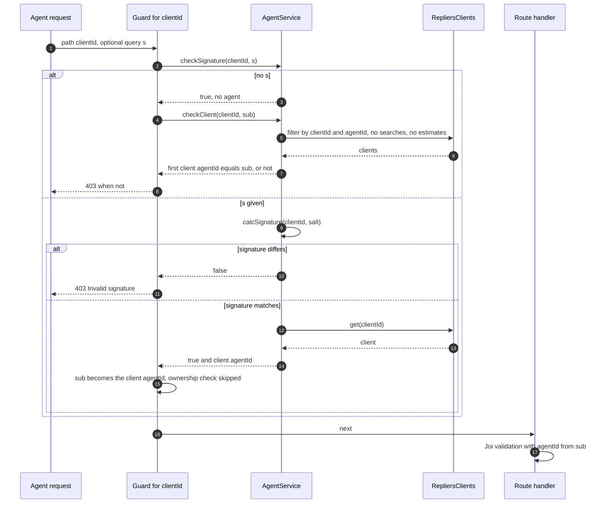

# Agent clients, estimates & messages

How `/api/agent` decides which client or estimate an agent may touch, what each route sends to
Repliers, and what a PATCH does with omitted, empty and `null` values. Terms are in the
[Glossary](/glossary#agentid).

[Agent & Admin](/api-reference/agent-and-admin) ·
[Authentication, agents and roles](/architecture/authentication#agents-and-roles) ·
[Data ownership](/architecture/data-ownership#identity-and-ownership) ·
[Events & messaging](/architecture/events-and-messaging)

## The param guards

| Guard                                   | Runs on                                                                                                            | Passes when                                                                                                                                                    | Effect on `ctx.state.user.sub`                                                                  | Source                                                                                                        |
| --------------------------------------- | ------------------------------------------------------------------------------------------------------------------ | -------------------------------------------------------------------------------------------------------------------------------------------------------------- | ----------------------------------------------------------------------------------------------- | ------------------------------------------------------------------------------------------------------------- |
| `router.use(jwt, role([Agent, Admin]))` | every route, first                                                                                                 | valid token with role Agent or Admin                                                                                                                           | none                                                                                            | `src/routes/agent.ts` (`router.use`)                                                                          |
| `clientId`                              | `GET` and `PATCH /client/{clientId}`, `POST` and `GET /estimate/{clientId}`, `POST` and `GET /messages/{clientId}` | no `s` and the first client returned for `{ clientId, agentId: sub }` has `agentId` = `sub`; or `s` equals the signature                                       | with a valid `s`, replaced by the client's own `agentId` (a number) for the rest of the request | `src/routes/agent.ts` (`router.param("clientId")`), `src/services/agent.ts` (`checkSignature`, `checkClient`) |
| `estimateId`                            | `POST /estimate/{estimateId}/send`, `PATCH` and `DELETE /estimate/{estimateId}`                                    | the estimate exists (404 otherwise), has a `clientId` (403 otherwise), and `s` matches the signature of that `clientId` or the client's `agentId` equals `sub` | as above                                                                                        | `src/routes/agent.ts` (`router.param("estimateId")`), `src/services/estimate.ts` (`get`, `checkOwnership`)    |
| none                                    | `POST` and `GET /client`, `GET` and `POST /boss/people`                                                            | n/a                                                                                                                                                            | none                                                                                            | `src/routes/agent.ts`                                                                                         |

Everything a handler sends upstream as `agentId` is `sub` after the guard, so a signed request
acts as the client's assigned agent: messages go out under that agent and estimates are read
and written for that agent. The signature is `calcSignature(clientId, AUTH_AGENTS_SIGNATURE_SALT)`
([signed client links](/architecture/authentication#agents-and-roles)); it is also the `?s=` appended to the client links written
into FUB (`secureFubAvmLink`).

## Clients

- `POST /api/agent/client`: `agentsCreateClientSchema` requires `email`, `agentId` (= `sub`) and
  `status` (forced to `true` after the body is spread, so a body `status` is ignored). Optional:
  `fname`, `lname`, `phone` (any string), `tags` (array of strings), `preferences`. When a
  `preferences` object is sent, omitted members are filled: `email` true, `sms` true,
  `unsubscribe` false. Unknown keys, including `externalId`, are a 400. A detached
  client-registration event follows (`SelectAgentClientRegistrationParams`).
- `GET /api/agent/client`: filter keys `clientId`, `condition`, `email`, `fname`, `lname`,
  `keywords`, `operator`, `pageNum` (default 1), `resultsPerPage` (default 100), `tags`, `phone`
  (a number), `status`, `showSavedSearches` (default false), `showEstimates` (default true),
  forwarded to Repliers `GET /clients` with `agentId` = `sub`. `condition` and `operator` accept
  any string. The body is Repliers' paged list.
- `GET /api/agent/client/{clientId}`: the same filter with only `clientId`, the two `show…` flags
  and `agentId`; the answer is the list shape with one entry in `clients`, not a bare client.

### PATCH `/api/agent/client/{clientId}`

The schema is the create schema with every key optional plus a required `clientId` (path), and
`agentId` is always set from `sub`. The service sends `PATCH /clients/{id}` with every validated
key except `clientId`, so `agentId` is always in the forwarded body.

| Body                          | Result                                                                                             |
| ----------------------------- | -------------------------------------------------------------------------------------------------- |
| key omitted                   | not forwarded (no default injected)                                                                |
| `{}`                          | valid; forwarded as `{ agentId }`                                                                  |
| `null` on any key             | 400                                                                                                |
| empty string                  | 400                                                                                                |
| `tags: []`                    | valid; forwarded as `[]`                                                                           |
| `preferences: { sms: false }` | forwarded as `{ sms: false, email: true, unsubscribe: false }` (defaults fill the omitted members) |
| `preferences: {}`             | forwarded as `{ email: true, sms: true, unsubscribe: false }`                                      |
| `email`, `status`             | accepted and forwarded                                                                             |
| any other key                 | 400                                                                                                |

What Repliers does with these values is not established by this checkout.

## Estimates

- `POST /api/agent/estimate/{clientId}`: `estimateAddSchema` plus `agentId`; `boardId` is
  required, `clientId` comes from the path (it overwrites a body value), and `sendEmailNow` /
  `sendEmailMonthly` are accepted. `AgentService.createEstimate` calls `RepliersEstimate.add`
  directly, not `EstimateService.add`. A detached estimate event and note follow.
- `GET /api/agent/estimate/{clientId}`: `RepliersEstimate.get({ clientId, agentId })`, returned
  as is (`EstimateService.getByClientId`, which adjusts values, is not used).
- `POST /api/agent/estimate/{estimateId}/send`: `PATCH /estimates/{id}` with
  `{ sendEmailNow: true }` and the response body from Repliers. A second handler then runs
  without being awaited: it reads the estimate and the client, finds the FUB person by
  `externalId` (else by email), and writes a note `Estimate sent to the client via email`. It
  skips when the estimate has no `clientId` or the client has neither `externalId` nor email;
  its errors are written with `console.error`.
- `PATCH /api/agent/estimate/{estimateId}`: `estimateBaseSchema` keys plus `agentId` and
  `estimateId`, with `agentId` removed before the call. `boardId` is not accepted; `clientId`
  is, and is forwarded. A nested object that is sent must carry its required members
  (`address`: city, street fields, `zip`; `details`: bedrooms, bathrooms, `propertyType`,
  `sqft`, `style`; `taxes`: `annualAmount`).

  | Body                                      | Result                                             |
  | ----------------------------------------- | -------------------------------------------------- |
  | top-level key omitted                     | not forwarded                                      |
  | `{}`                                      | valid; forwarded as `{}`                           |
  | `null` on any key                         | 400                                                |
  | empty string                              | 400, except `details.yearBuilt`, which allows `""` |
  | empty array (`condominium.amenities: []`) | valid; forwarded as `[]`                           |

- `DELETE /api/agent/estimate/{estimateId}`: `EstimateService.delete`, status 200, no body.

## Messages

- `POST /api/agent/messages/{clientId}`: `content` is an object with at least one key and a
  required `message`; optional `links`, `pictures`, `listings` (strings) and `searches`
  (numbers); `subject` is not accepted. It sends `POST /messages` with `sender: "agent"`,
  `agentId` and `clientId`, awaits it and returns Repliers' body. Delivery is Repliers'.
- `GET /api/agent/messages/{clientId}`: the handler validates only `clientId`, `agentId` and
  `estimateId` (from the query). Other query keys, including those the schema lists
  (`startTime`, `endTime`, `pageNum`, `resultsPerPage`, `sender`, `status`), are not read, and no
  error is raised for them.

## Boss people

`GET` and `POST /api/agent/boss/people` validate the **query** (`tags` optional) plus `agentId`
and `assignedUserId` from the token claim `external.fub_id`; without the claim the error is
`You need an account in FollowUpBoss, contact administroator to create one` (400). `GET` returns
FUB's people response (`{}` when `BOSS_ENABLED=false`).

`POST` (`AgentService.syncBossPeople`) reads one FUB page. With no people it answers
`{ "synced": 0 }`. Otherwise it opens a transaction, inserts a `sync` row and one `people_sync`
row per person with status `PENDING`, commits, then publishes each row to
`<NATS_WORKER_CONSUMER_STREAM>.people.upsert` and answers `{ "synced": n }`. The client writes
happen in the worker ([Events & messaging](/architecture/events-and-messaging)). The rows are
committed before the first publish.

## Gotchas

1. **The guard replaces `sub` with a number.** Handlers that compare or print `sub` after a
   signed request see the client's `agentId`, not the token's. Source: `src/routes/agent.ts`
   (`router.param("clientId")`).
2. **`GET /client/{clientId}` returns a list.** The single-client route calls `getClients`.
   Source: `src/routes/agent.ts`, `src/services/agent.ts` (`getClients`).
3. **A partial `preferences` object is completed with defaults on client create and PATCH.**
   Source: `src/validate/agent.ts` (`agentsCreateClientSchemaKeys`, `agentUpdateClientSchema`).
4. **The schema lists message filters the route never passes.** Source: `src/routes/agent.ts`
   (`router.get("/messages/:clientId")`), `src/validate/agent.ts` (`agentsGetMessagesSchema`).
5. **The estimate note is written after the response.** Source: `src/routes/agent.ts`
   (`router.post("/estimate/:estimateId/send")`).
6. **`condition`, `operator` and `sender` are declared with `.allow(...)`**, which keeps any string
   valid. Source: `src/validate/agent.ts`.
7. **The estimate PATCH forwards a body `clientId`.** Source: `src/validate/estimate.ts`
   (`estimateBaseSchema`), `src/routes/agent.ts` (`router.patch("/estimate/:estimateId")`).

## Evidence

- The validators were run in isolation with the project's joi on 2026-10-20 for the
  `preferences` default fill, `null` and empty-string cases.
- `test/services/eventsCollection/selectors/selectAgentClientRegistrationParams.test.ts`,
  `selectAgentEstimateParams.test.ts`.
- No route test exists for `/api/agent`.
- Not established by this checkout: Repliers' semantics for `GET /clients` with both `clientId`
  and `agentId`, and for the PATCH bodies above.

Verified against portal-backend `997ae3e`, 2026-10-20.
