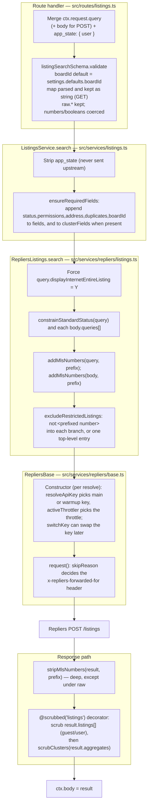

import { Callout } from 'nextra/components'

# Listings search & count

A search request (`GET` / `POST /api/listings/search`, and the `count` variants) travels
route handler → `ListingsService` → `RepliersListings` client → Repliers `POST /listings` and
back. The proxy does not run the search; it builds the outbound request, adds the fields the
scrubber needs, forces one permission filter, narrows the status vocabulary, applies the
MLS-number prefix, excludes the blocklist, and scrubs the response. D03 is the canonical map of
that order; the register below lists every caller that reaches the same pipeline, and the
search topics cover the parameters whose handling changes execution. Terms are in the
[Glossary](/glossary).

[Listings endpoints](/api-reference/listings) ·
[Detail, Similar & History](/api-reference/listings/detail-similar-history) ·
[Scrubbing](/architecture/scrubbing) ·
[Restricted listings](/architecture/restricted-listings) ·
[MLS-number prefix](/architecture/mls-number-prefix) ·
[Repliers API](/integrations/repliers-api) ·
[W1 worked trace](/architecture/flows#w1--guest-and-authenticated-search)

## D03 — the search transformation flow

Each stage that adds, constrains or removes values, in the order the code runs them, with the
file and symbol on each box. Boxes above the Repliers call are request-side; boxes below are
response-side; the `@scrubbed` decorator is last.

<Callout type="info">
`count` takes a shorter path: `ListingsService.count` runs `ensureRequiredFields`, then
overrides `sortBy=updatedOnDesc` and `fields=timestamps.repliersUpdatedOn`, calls
`RepliersListings.search` with `usePost = true`, and returns `{ count, lastUpdatedOn }`
without the `@scrubbed` decorator. See [Count](#count).
</Callout>

## Listing callers register

Every caller that ends at a Repliers `POST`/`GET /listings`. The split that matters: callers
through `ListingsService.search` get the identity fields appended and the `@scrubbed`
decorator; callers that reach `RepliersListings.search` directly get neither, but still get
the client-level transformations (forced `displayInternetEntireListing=Y`,
`constrainStandardStatus`, the prefix codec and the restricted-listing exclusion) because
those live in the client method.

| Caller                                                                                                                      | Input / context supplied                                                                                                                              | Transformations applied                                                                                                    | Upstream operation                         | Visibility handling                                                                                                                                          | Side effects                                                                                                 | Source                                                                   |
| --------------------------------------------------------------------------------------------------------------------------- | ----------------------------------------------------------------------------------------------------------------------------------------------------- | -------------------------------------------------------------------------------------------------------------------------- | ------------------------------------------ | ------------------------------------------------------------------------------------------------------------------------------------------------------------ | ------------------------------------------------------------------------------------------------------------ | ------------------------------------------------------------------------ |
| `GET` / `POST /api/listings/search` → `ListingsService.search`                                                              | Validated search DTO + `app_state.user`; `boardId` default                                                                                            | `ensureRequiredFields`; then all client-level steps                                                                        | `POST /listings` (`usePost=true`)          | `@scrubbed("listings")` top-level + `scrubClusters`; forced filter + `not:` exclusion                                                                        | none                                                                                                         | `src/routes/listings.ts`; `src/services/listings.ts` (`search`)          |
| `GET` / `POST /api/listings/count` → `ListingsService.count` (`countArray` per item)                                        | Count DTO only (no `fields`/`sortBy`/paging/`app_state`)                                                                                              | `ensureRequiredFields`, then `sortBy=updatedOnDesc` and `fields=timestamps.repliersUpdatedOn` override; client-level steps | `POST /listings` (`usePost=true`)          | No scrubber (returns `count` + `lastUpdatedOn` only); forced filter + `not:` still applied by the client; no user context, so the cache key is user-agnostic | none; `GET` cached `listings:count`                                                                          | `src/services/listings.ts` (`count`, `countArray`)                       |
| `AutosuggestService.search` (listings leg) → `ListingsService.search`                                                       | Autosuggest-built params: `search=q`, `searchFields`, proximity, board, status from `repliers.autosuggest`, `app_state.user`                          | `ensureRequiredFields`; client-level steps                                                                                 | `POST /listings`                           | `@scrubbed("listings")`                                                                                                                                      | none                                                                                                         | `src/services/autosuggest.ts` (`search`)                                 |
| `AutosuggestService.search` (MLS-number leg) → `ListingsService.search`                                                     | Same params, `searchFields="mlsNumber"`, widened by `addMlsSearchVariant`; only when `mlsNumberPrefix` is set and `q` is digits                       | `ensureRequiredFields`; client-level steps                                                                                 | `POST /listings`                           | `@scrubbed("listings")`                                                                                                                                      | Failure caught, leg yields `null` ([MLS-number prefix](/architecture/mls-number-prefix#autosuggest-mls-leg)) | `src/services/autosuggest.ts` (`search`)                                 |
| `ListingsService.nlp` follow-up → `this.search`                                                                             | `result.request.params` + `listings:false` + `statistics`/`aggregates`, `app_state.user`; only when the request asks for `statistics` or `aggregates` | `ensureRequiredFields`; client-level steps                                                                                 | `POST /listings`                           | `@scrubbed("listings")` (the NLP result itself is not decorated)                                                                                             | none                                                                                                         | `src/services/listings.ts` (`nlp`)                                       |
| `EstimateService.propertyDetails` / tax / address lookups → `RepliersListings.search`                                       | Address/status/`statistics` params built in the service; `resultsPerPage:1` or `999`                                                                  | **No** `ensureRequiredFields`; client-level steps only                                                                     | `GET /listings` (`usePost` defaults false) | No scrubber; forced filter + `not:` still applied                                                                                                            | none; the historical client uses `REPLIERS_API_KEY_EXTRA` when set ([Estimates](/api-reference/estimate))    | `src/services/estimate.ts`                                               |
| `StatsService.widgets` → `RepliersListings.search`                                                                          | Statistics params, `listings:false`; status in the instance's vocabulary                                                                              | No `ensureRequiredFields`; client-level steps                                                                              | `GET /listings`                            | No scrubber (aggregate numbers only)                                                                                                                         | none; cached `widgets`                                                                                       | `src/services/stats.ts` (`widgets`)                                      |
| `StatsService.fetchStats` (ships), reached by `neighborhoodsrankingAuthorised` (**Not in OSS**) → `RepliersListings.search` | Per-neighborhood statistics params, `listings:false`                                                                                                  | No `ensureRequiredFields`; client-level steps                                                                              | `GET /listings`                            | No scrubber                                                                                                                                                  | none; cached `stats` / `nr`                                                                                  | `src/services/stats.ts` (`fetchStats`, `neighborhoodsrankingAuthorised`) |

## Entry points

`ListingsService.search` is the one domain method; `RepliersListings.search(params, usePost)`
is the one client method. The `GET` and `POST` routes both build a payload from the query (the
`POST` route also merges `ctx.request.body` as `body`), add `app_state: { user }`, and call
`ListingsService.search`, which always passes `usePost = true` — so the outbound request is a
Repliers `POST /listings` whichever verb the client used. The order of every transformation
after that is D03 above; this page does not restate it in prose. The other callers are in the
register.

## Input provenance

- **Request values.** Query keys become `ctx.request.query` (a repeated key is an array, a
  lone one a string); the `POST` body is merged as `body`. Both are validated by
  `listingSearchSchema` — over 160 query/body filter keys (`src/validate/listings.ts`).
- **Validation and coercion.** `schema.validate(payload)` runs with Joi defaults
  (`abortEarly`, `allowUnknown:false`, `convert:true`); see
  [Validation](/api-reference#validation). `boardId` defaults to
  `settings.defaults.boardId`. Array-typed keys use `.single()`, so a lone value becomes a
  one-element array. `raw.*` keeps a lone value as a string on purpose. `map` is validated by
  `rplMapFlexibleSchema` — a JSON string in the query is checked but kept as a string; a body
  array is checked as coordinates.
- **Server-injected values.** `app_state: { user: ctx.state["user"] }` is added by the
  handler. It decides scrubbing and is stripped before the client call — it is never sent
  upstream (unlike the single/similar routes, [proxy notes](/architecture/repliers-proxy)).
- **Identity fields.** `ensureRequiredFields` appends `status, permissions, address,
duplicates, boardId` to `fields`, and to `clusterFields` when the request has one
  (`withRequiredFields`, `src/lib/utils.ts`).

## State and ownership

The search owns no local state. The result records belong to Repliers; the proxy only
reshapes them. `search` is not cached; `count` writes `listings:count`
([Caching](/architecture/caching)). The scrubber runs per request, so a cached count (and the
cached featured list) is never a cached scrubbing decision.

## Output

The Repliers payload after `stripMlsNumbers` and scrubbing: `listings[]`, `count`, `page`,
`numPages`, `pageSize`, `statistics`, and `aggregates` / `aggregatesUnique` when requested.
The identity field names added to `fields` are **not** removed from the response again — a
client that asked for `fields=listPrice` also receives `status`, `permissions`, `address`,
`boardId` (and `duplicates` when non-empty). This is the single home for the fields-behaviour
fact; other pages link here.

When the client sends no `fields` at all, the request carries
`fields=status,permissions,address,duplicates,boardId` and Repliers returns only those keys —
four in the capture (`status,address,permissions,boardId`; `duplicates` is omitted when
empty), not the full document (observed 2026-10-20 against sample data). The request no longer
means "all fields".

## Side effects and failures

The search path has no side effects: no view event, no write, no detached handler. An upstream
non-2xx becomes an `ApiError` carrying the Repliers status and body in `info`
([error variants](/api-reference#error-variants)); there is no retry
([Repliers proxy](/architecture/repliers-proxy)). A timeout or connection error has no status,
so the response is 500 with `undefined` in the message text.

## Search topics

### `queries[]` unions and parameter conflicts

In a `POST` body, `queries[]` is an array of sub-searches that Repliers unions. Two upstream
rules shape how the backend builds requests (recorded in the `excludeRestrictedListings` code
comment and in [Repliers API query semantics](/integrations/repliers-api#query-semantics-worth-knowing)):

- a parameter sent both top-level and inside `queries[]` is rejected with
  `400 Parameter conflict`;
- a union lets a listing back in through any branch that omits an exclusion.

`excludeRestrictedListings` therefore unions the `not:` entries into **every** branch when any
branch filters by `mlsNumber`, and otherwise adds a single top-level entry
([Restricted listings](/architecture/restricted-listings#placing-not-on-a-search)).

### Repeated values and `raw.*`

`brokerage` is declared `joi.array().items(joi.string().max(70)).single()` and the `raw.*`
pattern is `joi.alternatives().try(joi.string(), joi.array().items(joi.string()))`
(`src/validate/listings.ts`). So a repeated `brokerage` or `raw.<field>` arrives as an array
and a lone one stays as it was sent — a single `raw.*` value is forwarded as a string, not
wrapped. Repliers OR-matches the array members (upstream behaviour). A `raw.*` key is accepted
on the search schema but rejected by the count schema (see [Count](#count)).

### Status vocabularies

Two filter vocabularies, and they cannot be mixed: Repliers answers `400 standardStatus can
not be combined with status or lastStatus` (observed 2026-10-20). On an instance configured
with `APP_ALLOWED_LISTINGS_STANDARD_STATUSES`, `constrainStandardStatus`
(`src/services/listings/listingHelpers.ts`) narrows `standardStatus` to the allowed set on
every top-level query and every `queries[]` branch — **no filter means every allowed status,
never every status.** Every caller on such an instance must filter in the RESO vocabulary
(`Active`, `Closed`, …), which stats and autosuggest already do. RESO values are
case-sensitive.

### Polygons

`map` carries GeoJSON polygon or multi-polygon coordinates. In the query it is a JSON string
(validated by re-parsing, then kept as a string); in the body it is a coordinate array.
`mapOperator` sets how multiple polygons combine. The backend forwards `map` as given; the
geometry is interpreted upstream.

### `fields` and `clusterFields`

Both are comma-separated projection lists. `ensureRequiredFields` appends the five identity
field names to each present list before the call, so cluster-inlined listings carry what the
scrubber needs even for a narrow `clusterFields`
([Scrubbing: map clusters](/architecture/scrubbing#map-clusters--the-nested-listing-trap)).
Projection happens upstream, so the scrubber only ever sees the fields Repliers returned.

### Aggregates

`aggregates=map` returns clustered listings under `aggregates.map.clusters[].listings`, which
the scrubber reaches through `scrubClusters`. `aggregates=listPrice` returns two histograms,
`sale` (buckets spanning 0–5,000,000) and `lease` (0–10,000), each with a trailing `+` bucket;
the default bucket width is 100000 (sale) / 500 (lease), tunable per axis with
`aggregatesListPriceSaleBucketSize` / `aggregatesListPriceLeaseBucketSize` — a narrower bucket
adds resolution without moving the range (upstream behaviour, observed 2026-10-20). `imagesOrder`
(`score` / `original`) applies only to AI image search: Repliers answers `400` unless
`imageSearchItems` or `coverImage` is in the same request (observed 2026-10-20).

## Count

`ListingsService.count` reuses the search client. It runs `ensureRequiredFields`, then
overrides `sortBy = updatedOnDesc` and `fields = timestamps.repliersUpdatedOn`, calls
`RepliersListings.search(params, true)`, and returns `{ count: res.count ?? 0, lastUpdatedOn:
res.listings?.[0]?.timestamps?.repliersUpdatedOn }`. So `lastUpdatedOn` here is the newest
listing's update timestamp from the match set — distinct from the synthetic
[`/lastUpdatedOn`](/api-reference/listings/nlp-featured-locations#lastupdatedon) route.

`listingCountSchema` is `listingSearchSchemaKeys` minus `listingsCountOmittedFields`
(`fields`, `app_state`, `listings`, `resultsPerPage`, `pageNum`, `sortBy`), and — unlike the
search schema — it has **no** `raw.*` pattern, no `.unknown()` and no `radius`/`lat`/`long`
peer rule. With Joi's default `allowUnknown:false`, sending any of those omitted keys or a
`raw.*` key is a `400 "<key>" is not allowed`, not a silently dropped value. `radius`, `lat`
and `long` remain count keys, so a lone `radius` is accepted on `count` and forwarded
upstream as sent, while the same request on `search` is a 400 `missing required peer`. `count` is `@cached("listings:count")`, so the `GET` route sends `Cache-Control`
(canonical home for that header); `countArray` runs each item through the same cached method
and writes the array directly, with no `Cache-Control`. Because the count query runs through
`RepliersListings.search`, the forced filter and the `not:` exclusion apply, so a restricted or
entire-listing-N listing is never counted.

## Variation

- **Guest vs user.** The query is identical; only scrubbing differs. `app_state.user`
  undefined is a guest.
- **MLS-number prefix.** With `settings.mlsNumberPrefix` set, `addMlsNumbers` prefixes every
  `mlsNumber` value on the way out and `stripMlsNumbers` cleans the response
  ([MLS-number prefix](/architecture/mls-number-prefix)).
- **RESO instance.** `standardStatus` is constrained; legacy `status`/`lastStatus` filters
  collide with it upstream.
- **SSG request.** The call uses the warmup key and throttle when configured, and suppresses
  the forwarded-for header ([W10](/architecture/flows#w10--ssg-build-request-with-the-warmup-key)).

## Gotchas

1. **The GET search route goes upstream as a POST.** `ListingsService.search` and `count` pass
   `usePost = true`, so both verbs produce a Repliers `POST /listings`. Source:
   `src/services/listings.ts` (`search`, `count`).
2. **`ensureRequiredFields` and `@scrubbed` live in `ListingsService`, not in the client.**
   `EstimateService` and `StatsService` call `RepliersListings.search` directly, so their
   requests carry no added identity fields. Source:
   `src/services/estimate.ts`, `src/services/stats.ts`.
3. **The identity field names are part of the response.** The additions to `fields` /
   `clusterFields` are sent upstream and returned with the rest. Source: `src/services/listings.ts` (`ensureRequiredFields`).
4. **`count` and `search` validate differently.** `fields`, `sortBy`, `resultsPerPage`,
   `pageNum`, `listings` and `raw.*` are a 400 on `count`, while a lone `radius` (a 400 on
   `search`) is accepted, because the `.with("radius", ["long", "lat"])` rule exists only on
   `listingSearchSchema`. Source: `src/validate/listings.ts` (`listingCountSchema`,
   `listingSearchSchema`, `listingsCountOmittedFields`).
5. **`POST /count` sends no `Cache-Control`.** The handler writes the array with `ctx.body`, so
   the per-item cache is used but the response carries no cache header. Source:
   `src/routes/listings.ts` (`POST /count`), `src/services/listings.ts` (`countArray`).

## Evidence

- `test/routes/listings.test.ts`: `standardStatus` constrained on an unfiltered search and
  inside `body.queries`, dropped outside the allowed set, fallback to the allowed set.
- `test/services/listings/restrictedListings.test.ts`,
  `test/services/listings/listingHelpers.test.ts`: the blocklist excluded from every search,
  exclusion placement for POST and GET.
- `test/lib/utils.test.ts`: `withRequiredFields` merge and de-duplication.
- Executed against the sample-data key, 2026-10-20: a `fields`-less search sends the five
  identity names and Repliers returns the four present keys; `standardStatus` + `status` is a
  400; `imagesOrder` without an image item is a 400; the `aggregates=listPrice` bucket ranges
  and per-axis bucket sizes.
- Not established by this checkout: how Repliers scores or orders a union across `queries[]`
  branches; the upstream `400 Parameter conflict` rule (taken from the code comment).

Verified against portal-backend `997ae3e`, 2026-10-20.
