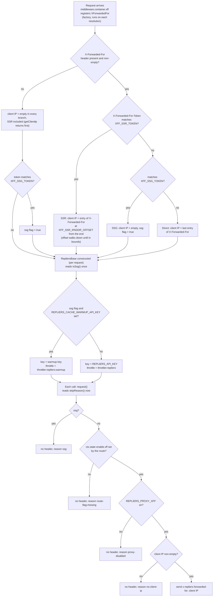

# Client IP forwarding

Which IP address, if any, reaches Repliers for a given request, and which upstream key and which local rate limit that request is charged to. Both answers come from the same signal: the `X-Forwarded-For-Token` header, compared against two shared secrets. Terms are defined in the [Glossary](/glossary).

[Repliers proxy](/architecture/repliers-proxy) | [Request lifecycle](/architecture/request-lifecycle) | [Workflow W10: SSG build request](/architecture/flows#w10--ssg-build-request-with-the-warmup-key) | [Environment variables](/getting-started/environment-variables#repliers-api-repliers_)

## Decision

The client IP is decided when the provider is built (once per resolution, from the request headers). Whether it is sent is decided later, on each Repliers call. The key and the throttle are decided when the Repliers client is built.



Outside an HTTP request there is no `ctx` to read. The `XForwardedFor` token then resolves to `DummyXFFProvider` (`src/providers/dummy.xff.ts`): `isSsg()` is false, `isEnabled()` is false and `skipReason()` is `no-request-context`. A Repliers client resolved from the root container, such as the services the NATS worker uses (`src/worker.ts`), therefore uses the main key and the shared throttle and sends no header.

## Contexts register

| Context                             | How it is identified                             | Client IP                                                              | Header sent upstream                                            | Key                                                               | Local throttle                                                                    | Source                                                                                                          |
| ----------------------------------- | ------------------------------------------------ | ---------------------------------------------------------------------- | --------------------------------------------------------------- | ----------------------------------------------------------------- | --------------------------------------------------------------------------------- | --------------------------------------------------------------------------------------------------------------- |
| Direct caller (browser, API client) | no token, or a token that matches neither secret | last `X-Forwarded-For` entry                                           | when the route sets `enable.xff` and `REPLIERS_PROXY_XFF` is on | `REPLIERS_API_KEY`                                                | `throttler:repliers`                                                              | `src/lib/xffprovider.ts` (`getClientIp`, default branch)                                                        |
| SSR render                          | token equals `XFF_SSR_TOKEN`                     | entry at `XFF_SSR_IPADDR_OFFSET` from the end (`getClientIpBehindSSR`) | as above                                                        | `REPLIERS_API_KEY`                                                | `throttler:repliers`                                                              | `src/lib/xffprovider.ts` (`isSsrRequest`, `getClientIpBehindSSR`)                                               |
| SSG, ISR or warm-up render          | token equals `XFF_SSG_TOKEN`                     | none (empty)                                                           | never (`skipReason()` is `ssg`)                                 | `REPLIERS_CACHE_WARMUP_API_KEY` when set, else `REPLIERS_API_KEY` | `throttler:repliers:warmup` when the warmup key is set, else `throttler:repliers` | `src/lib/xffprovider.ts` (`isSsgRequest`), `src/services/repliers/base.ts` (`resolveApiKey`, `activeThrottler`) |
| Outside a request (worker)          | `DummyXFFProvider`                               | none                                                                   | never (`no-request-context`)                                    | `REPLIERS_API_KEY`                                                | `throttler:repliers`                                                              | `src/providers/dummy.xff.ts`                                                                                    |

When one token value equals both secrets, the SSR branch picks the client IP but `isSsg()` is also true, so `skipReason()` is still `ssg` and the warmup key applies (`src/lib/xffprovider.ts`, constructor and `getClientIp`).

## Entry points

- Handlers set `ctx.state['enable.xff'] = true` (on `/api/agent` the `clientId` and `estimateId` param guards set it too); a route without it sends no header on any call. No handler sets it in `src/routes/vtour.ts`, `src/routes/user/assets.ts`, `src/routes/user/social.ts` and `src/routes/webhooks/boss.ts`, nor in `GET /api/listings/lastUpdatedOn` (`src/routes/listings.ts`), `GET` and `POST /api/agent/boss/people` (`src/routes/agent.ts`) and `GET /api/auth/{provider}/url` (`src/routes/auth.ts`); `src/routes/index.ts` and `src/routes/webhooks/index.ts` only mount routers.
- `middleware.container.xff` (`src/providers/middleware/container/xff.ts`) is registered right after `middleware.container` in `src/app.ts`. It registers the `XForwardedFor` token in the request's child container as a factory (`XFFProvider.getMiddleware`). The factory is not cached, so each resolution builds a provider that parses the headers again; the result is identical for the same request.
- `RepliersBase` (`src/services/repliers/base.ts`) injects `XForwardedFor`, `throttler:repliers` and `throttler:repliers:warmup`; every client in `src/services/repliers/` inherits that behaviour.

## Input provenance

| Input                                                                                                       | Source                                                                                                                                                                  | Used for                                                                                                           |
| ----------------------------------------------------------------------------------------------------------- | ----------------------------------------------------------------------------------------------------------------------------------------------------------------------- | ------------------------------------------------------------------------------------------------------------------ |
| `X-Forwarded-For-Token` header                                                                              | request                                                                                                                                                                 | selects SSR, SSG or direct                                                                                         |
| `X-Forwarded-For` header                                                                                    | request, as appended by the proxies in front of the process                                                                                                             | candidate client IPs                                                                                               |
| `XFF_SSR_TOKEN`, `XFF_SSG_TOKEN`, `XFF_SSR_IPADDR_OFFSET`                                                   | `config.repliers.xff` (`src/config.ts`); legacy names `REPLIERS_PROXY_XFF_SSR_TOKEN`, `REPLIERS_PROXY_XFF_SSG_TOKEN`, `REPLIERS_PROXY_XFF_SSR_IPADDR_OFFSET` still work | token comparison, offset (default `2`)                                                                             |
| `REPLIERS_PROXY_XFF`                                                                                        | `config.repliers.proxy_xff`, true only for the string `true`                                                                                                            | global switch for sending the header                                                                               |
| `ctx.state['enable.xff']`                                                                                   | set by the route handler                                                                                                                                                | per-route opt-in                                                                                                   |
| `REPLIERS_CACHE_WARMUP_API_KEY`, `REPLIERS_CACHE_WARMUP_API_LIMIT`, `REPLIERS_CACHE_WARMUP_API_INTERVAL_MS` | `config.repliers`                                                                                                                                                       | warmup key and its own throttle; limit and interval default to `REPLIERS_API_LIMIT` and `REPLIERS_API_INTERVAL_MS` |

Both tokens are compared with `timingSafeEqual` after a length check (`tokensMatch`). An empty header never matches, so an unset secret matches nothing.

## Execution phases

1. **Provider built.** `XFFProvider`'s constructor computes `ssg` (`isSsgRequest`) and the client IP (`getClientIp`). In `getClientIp`, the SSR case is checked first, then SSG (empty IP), then the default (last entry). `sanitizeIpAddr` removes `::ffff:` and surrounding whitespace.
2. **Services resolved.** The route handler resolves a domain service; `RepliersBase`'s constructor calls `resolveApiKey()` and `activeThrottler()`, both of which read `isSsg()` and `cache_warmup_api_key`. So the key and the throttle are fixed at resolution, before the handler's own code runs.
3. **Flag set.** The handler sets `enable.xff`. This can happen after the service was resolved, which is why the flag is not read until phase 4.
4. **Each call.** `RepliersBase.request` calls `xff.skipReason()`. With a reason, the request goes out with no extra header and an `info` log `Repliers call without x-repliers-forwarded-for` carrying `{ url, reason }`; without one, the header `x-repliers-forwarded-for` carries `getHeader()`.
5. **Throttled.** The call is wrapped by the throttle chosen in phase 2 and sent with the key chosen in phase 2, unless `switchKey` replaced the key (see Variation).

## State and ownership

No state outlives the request except the two throttles. `throttler:repliers` and `throttler:repliers:warmup` are `instanceCachingFactory` singletons (`src/providers/throttler/repliers.ts`, `repliersWarmup.ts`), so each limit is process-wide. They share the `throttler:ondelay` hook, which is a no-op placeholder (`src/providers/throttler/ondelay.ts`). Key choice is not remembered between requests.

## Output

The only outputs are the upstream headers and key on the Repliers call, and the `info` log line. Nothing about the decision reaches the HTTP response.

## Side effects and failures

- Startup fails (an `assert` in `src/config.ts`) when `REPLIERS_CACHE_WARMUP_API_KEY` is set and `XFF_SSG_TOKEN` is empty: the key could never be selected.
- With the warmup key unset, an SSG request uses the main key and the shared throttle; only the header suppression differs from a direct request.
- A route that forgets `enable.xff` does not fail; the call goes out without the header and the log line names `route-flag-missing`.
- An SSR-token request whose chain holds no real client resolves to whichever entry the offset walk lands on, so the forwarded address is that hop and not an end user.

## Variation

- **`switchKey()` and SSG.** `RepliersBase.switchKey(key)` rebuilds the axios instance with `key` and re-applies `activeThrottler()`. An SSG request therefore stays on the warmup throttle, but the key on the wire is the one passed to `switchKey` (`EstimateService` passes `REPLIERS_API_KEY_EXTRA` for its historical-listings client), not the warmup key.
- **Offset out of bounds.** `getClientIpBehindSSR` starts at `XFF_SSR_IPADDR_OFFSET` and decreases it until `chain length - offset` is a valid index, then returns that entry. An offset larger than the chain resolves to the first entry; an offset of `0` or less returns an empty IP.
- **Empty header and empty elements.** An absent or empty `X-Forwarded-For` header gives an empty IP without any offset arithmetic (`getClientIp` returns before the SSR check), and `skipReason()` is `no-client-ip`. The header is split on commas and each entry is only trimmed (`sanitizeIpAddr`), so an empty element inside a non-empty chain (for example `1.2.3.4,`) is kept as an entry: it is the last entry for the direct branch and counts toward the offset in the SSR branch.

## Chain shapes

Every proxy appends the address of the peer that connected to it, so the chain that reaches the backend, and therefore the right offset, depends on what sits in front of the process. These are the shapes an operator may meet; each row says what the code resolves and what to configure.

| Shape                                                                                           | Chain reaching the backend                  | Resolved IP                                                                                             | Offset                                                                   |
| ----------------------------------------------------------------------------------------------- | ------------------------------------------- | ------------------------------------------------------------------------------------------------------- | ------------------------------------------------------------------------ |
| Browser calls the backend through one proxy                                                     | `<client>`                                  | last entry is the client                                                                                | not used                                                                 |
| Browser calls the backend through two or more proxies (for example a CDN, then a load balancer) | `<client>, <first proxy>`                   | last entry is the address of the first proxy, the peer that connected to the second one, not the client | not used on this branch, so the proxy address is what would be forwarded |
| SSR: browser, frontend server, backend                                                          | `<client>, <frontend-egress>`               | entry at offset 2 is the client                                                                         | `2`                                                                      |
| SSR with a CDN in front of the frontend server                                                  | `<client>, <cdn-edge>, <frontend-egress>`   | entry at offset 3 is the client                                                                         | `3`                                                                      |
| SSR with a proxy between the frontend server and the backend                                    | one more trailing entry than the rows above | add one to the offset                                                                                   | `3`, or `4` with a CDN                                                   |
| SSR request with no real client in the chain                                                    | `<frontend-egress>`                         | the walk lands on the only entry, the frontend's own address                                            | no offset gives a client                                                 |
| SSG, ISR or warm-up render                                                                      | any                                         | none                                                                                                    | not used                                                                 |

Because of the walk-down, one offset can serve two shapes that differ by a leading hop: with the offset set to `3`, a two-entry chain resolves at offset 2 and index 0. The same walk resolves a chain shorter than the offset to its first entry, so entries to the left of the hops you trust are whatever those hops recorded.

## Which token to send

The rule on the caller's side is "is there a real client IP behind this render?". Send `XFF_SSR_TOKEN` only with a request that carries the user's `X-Forwarded-For`. A render with no user behind it (a build, a regeneration at runtime, a warm-up script) should send `XFF_SSG_TOKEN`. Two things go wrong with the SSR token and no real client: with no `X-Forwarded-For` at all the client IP is empty and nothing is forwarded (`no-client-ip`); with a one-entry chain (only the frontend server's own address) the offset walks down to index 0 and that address is forwarded as the end user. In both cases the request stays on the live key and the live throttle.

## Operator guidance

- Treat `XFF_SSG_TOKEN` as a secret. It selects which upstream key is billed and which local limiter is used, so anyone holding it can spend the warmup key's quota.
- Treat `XFF_SSR_TOKEN` as a secret too: its holder chooses which `X-Forwarded-For` entry is reported to Repliers as the end user.
- Give the warmup key no broader entitlements than the main key.
- Put a CDN or any other proxy in front of the backend and the direct branch starts forwarding that proxy's address as the end user, because it always takes the last entry. Re-check the offset whenever a hop is added or removed in front of the frontend server or between it and the backend.
- Rollout of a warmup key: provision a separate Repliers key, set `REPLIERS_CACHE_WARMUP_API_KEY` and a non-empty `XFF_SSG_TOKEN` on the backend, and have the build send `X-Forwarded-For-Token: <XFF_SSG_TOKEN>` on every backend request it makes.

## Diagnosing a missing header

`XFFProvider.skipReason()` returns the first reason that applies, in this order: `ssg`, `route-flag-missing`, `proxy-disabled`, `no-client-ip`, or `no-request-context` (the dummy provider). Every skipped call logs at `info`:

```
Repliers call without x-repliers-forwarded-for   { url, reason }
```

A user-facing route showing `route-flag-missing` is missing its `enable.xff` line; `no-client-ip` means the `X-Forwarded-For` header was absent or the offset walk found nothing.

## Gotchas

1. **The flag is read late, the token early.** `enable.xff` is read on each call (`skipReason`), but `isSsg()` is read when `RepliersBase` is constructed (`src/services/repliers/base.ts`), so the key and throttle of a client are fixed for the rest of the request.
2. **`REPLIERS_PROXY_XFF` defaults to off.** It is true only for the string `true` (`src/config.ts`), so a deployment that sets only the tokens sends no header.
3. **SSG requests send no header even without a warmup key.** `skipReason()` returns `ssg` before it looks at the route flag (`src/lib/xffprovider.ts`).
4. **The warmup key does not apply after `switchKey`.** The throttle survives; the key does not (`src/services/repliers/base.ts`, `switchKey`).

## Evidence

- `test/providers/xffprovider.test.ts`: token matching, `isSsg`, `isEnabled`, sanitizing.
- `test/services/repliers/base.test.ts`: warmup key and throttle selection with and without the key, header forwarded or omitted.
- Not established by this checkout: the real `X-Forwarded-For` chain of any deployment, and what the frontend sends as a token (its code is not in this repository).

Verified against portal-backend `997ae3e`, 2026-10-20.
