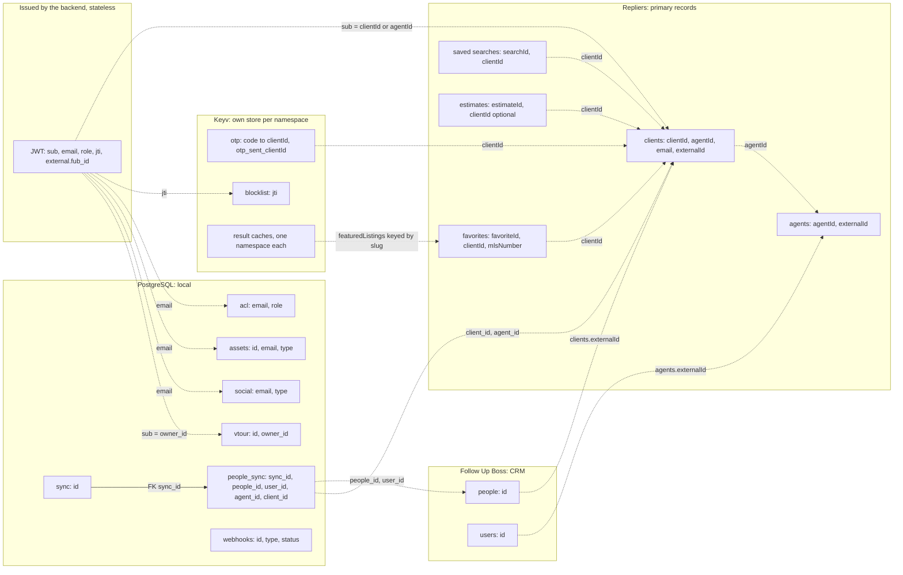

# Data ownership

Which system holds each record, which identifier names it, how one identifier turns into another, and what happens when the match is missing. The backend keeps very little state of its own: almost every primary record lives upstream, a few small tables live in PostgreSQL, and short-lived state lives in Keyv stores. Terms are defined in the [Glossary](/glossary); the tables of the local database are on [Persistence](/architecture/persistence), the cache namespaces on [Caching](/architecture/caching).

## Ownership map

Solid arrows are declared relations. Dashed arrows are **joins made in application code**: the two columns hold the same value, but nothing in a database enforces it.

## Identity and ownership

One row per identifier. **Scope** says where the value is meaningful. **Conversion** is how the backend gets from one identifier to the next. **Missing match** is what happens when the lookup finds nothing.

| Identifier / entity                        | Scope                                        | Conversion                                                                                                                               | Owner / store                                                                    | Readers / writers                                                                                                                                                         | Missing-match behaviour                                                                                                                                                                                                  |
| ------------------------------------------ | -------------------------------------------- | ---------------------------------------------------------------------------------------------------------------------------------------- | -------------------------------------------------------------------------------- | ------------------------------------------------------------------------------------------------------------------------------------------------------------------------- | ------------------------------------------------------------------------------------------------------------------------------------------------------------------------------------------------------------------------ |
| `clientId` (client record)                 | Repliers account of the deployment           | From an email or phone: `RepliersClients.filter` with operator `OR`. From a token: `sub`. From a CRM person: `externalId`                | Repliers `clients`                                                               | Created by signup, OAuth first sign-in, agent create-client and the CRM sync/webhook workers (`RepliersClients.create`); read by `UserService.info`                       | OTP login with no match: `404 User not found`. OAuth with no client and no agent: a client is created                                                                                                                    |
| JWT `sub`                                  | One token                                    | Set by `AuthService.useOtp`, `useRepliersToken`, `OAuthService` (client: `clientId`; agent: `agentId`); `embedLogin` sets none           | The token itself (RS256, not stored)                                             | Issued by `AuthService.generateToken`; read by every route as `ctx.state["user"].sub`                                                                                     | Absent on the embed token: routes that need it receive `undefined`. Absent for guests: `maybeClientId` returns `undefined`                                                                                               |
| `jti`                                      | One token                                    | Random UUID per issue                                                                                                                    | Keyv namespace `blocklist` (`BlocklistRepository`), only after logout or refresh | Written by `logout`, `refresh`; read by `isRevoked` in the JWT middleware on every strict or passthrough request                                                          | A token **without** `jti` is revoked; an unknown `jti` is valid                                                                                                                                                          |
| Client email                               | Repliers client; ACL, assets and social rows | `ctx.state["user"].email` (token claim)                                                                                                  | Repliers `clients.email`; copied into the token                                  | Keys `acl`, `assets` and `social` rows (see below)                                                                                                                        | No row: `acl` falls back to the token's role, then `User`; `assets` and `social` return empty                                                                                                                            |
| `agentId`                                  | Repliers account                             | Client record field `agentId`; OAuth agent `sub`; `config.repliers.clients.defaultAgentId`                                               | Repliers `agents`                                                                | `UserService.agent`, `RepliersAgents.get/filter`, `AgentService.checkClient`                                                                                              | Guest or no client: the default agent                                                                                                                                                                                    |
| FUB person id                              | Follow Up Boss account                       | Stored as the Repliers client `externalId`; webhook and sync match with `externalId` and email or phone, `OR`                            | Follow Up Boss `people`                                                          | Read by `BossService.getPeople`; copied into `people_sync.people_id` and `webhooks.payload`                                                                               | Webhook or sync: no client found, a client is created. Delete webhook: no client found, error stored in `webhooks.status` and the job fails. Events: falls back to a FUB lookup by email, then fails silently (detached) |
| FUB user id                                | Follow Up Boss account                       | Stored as the Repliers agent `externalId`; sent as `assignedUserId`                                                                      | Follow Up Boss `users`                                                           | `BossService.getUsers` (OAuth agent login, claim `external.fub_id`); `RepliersAgents.filter({ externalId })` in the webhook worker                                        | Webhook: the default agent. Contact: `assignedTo` carries the agent's name instead. Events: the FUB user is looked up by the agent's name, and no assignment is sent when none matches                                   |
| `externalId`                               | Repliers client or agent                     | Same value as the two rows above, as a string in filters and a number in the create DTO                                                  | Repliers                                                                         | Written by `SyncService.processUpsert`, `BossWebhooksService.processPeopleUpsert`; read by `EventsCollectionService`, `routes/user/boss.ts`, the agent estimate-sent note | Tag route: `404 User not found`. Estimate-sent note: falls back to email, returns quietly with neither                                                                                                                   |
| `mlsNumber`                                | One board                                    | Prefix added to requests and stripped from responses when `settings.mlsNumberPrefix` is set (`src/services/listings/mlsNumberPrefix.ts`) | Repliers listings (upstream form)                                                | Listings, favorites, autosuggest and the featured-listings paths of `src/services/repliers/`                                                                              | Prefix unset: values pass unchanged                                                                                                                                                                                      |
| `boardId`                                  | Repliers                                     | Request array defaults to `settings.defaults.boardId`; event collection falls back to its own default board                              | Repliers listings                                                                | Validators in `src/validate/listings.ts`, the scrubber gate (`scrubbing.board_ids`), event collection                                                                     | Missing in the request: the preset or environment default                                                                                                                                                                |
| `addressKey`                               | Repliers                                     | Passed through, not computed                                                                                                             | Repliers buildings and listings                                                  | `BuildingsService.single`, listings filter                                                                                                                                | The upstream answers; nothing is derived locally                                                                                                                                                                         |
| `estimateId`                               | Repliers                                     | Ownership: a user must equal `estimate.clientId`, an agent must equal the `agentId` of that client (`EstimateService.checkOwnership`)    | Repliers `estimates`                                                             | `routes/estimate.ts`, `routes/agent.ts`                                                                                                                                   | A guest estimate has no `clientId`: the ownership check fails for every caller                                                                                                                                           |
| `searchId`                                 | Repliers                                     | `SearchesService.delete` looks the id up in the caller's searches first                                                                  | Repliers saved searches                                                          | `routes/searches.ts`                                                                                                                                                      | Not in the list: `400 You are not owner of that searchId`                                                                                                                                                                |
| `favoriteId`                               | Repliers                                     | `FavoritesService.delete` looks the id up in the caller's unfiltered favorites first                                                     | Repliers favorites                                                               | `routes/favorites.ts`                                                                                                                                                     | Not in the list: `400 You are not owner of that favoriteId`                                                                                                                                                              |
| Featured listings `slug`                   | One deployment                               | `settings.featuredListings` maps a slug to the `clientId` whose favorites are published                                                  | Preset or `SETTINGS_FEATURED_LISTINGS` plus Repliers favorites                   | `FavoritesService.featuredListings`; cache cleared by `add` / `delete` of that client                                                                                     | Unknown slug: `404 Featured listing not found`                                                                                                                                                                           |
| OTP code and cooldown                      | One deployment                               | Code to `{ clientId }`; key `otp_sent_<clientId>` holds the send time                                                                    | Keyv namespace `otp`                                                             | Written by `AuthService.sendOtp`; read and deleted by `useOtp`                                                                                                            | Unknown or used code: `403`; resend inside the cooldown: `403` with `Retry-After`                                                                                                                                        |
| `acl.email`                                | Local database                               | Matched by exact email in `AclRepository.getUserAcl`                                                                                     | PostgreSQL `acl`                                                                 | Read when a token is issued; no code in the repository inserts rows                                                                                                       | No row: role from the token claim, then `User`                                                                                                                                                                           |
| `assets` key `(id, email, type)`           | Local database                               | Email from the token                                                                                                                     | PostgreSQL `assets`                                                              | `AssetsRepository`; insert ignores duplicates                                                                                                                             | Duplicate id: `409`; none: empty list                                                                                                                                                                                    |
| `social` key `(email, type)`               | Local database                               | Email from the token                                                                                                                     | PostgreSQL `social`                                                              | `SocialRepository` (provider tokens, upsert on the key)                                                                                                                   | None: no provider tokens returned                                                                                                                                                                                        |
| `vtour.id` and `owner_id`                  | Local database                               | `owner_id` is the `sub` of the admin who created the tour                                                                                | PostgreSQL `vtour`                                                               | `VtourRepository`                                                                                                                                                         | Unknown slug: `404` (`ctx.assert(vtour, 404)` in the `vtour` param handler)                                                                                                                                              |
| `sync.id`, `people_sync.id`, `webhooks.id` | Local database                               | `people_sync.sync_id` has a foreign key to `sync.id`; the rest are application joins                                                     | PostgreSQL                                                                       | `SyncRepository`, `PeopleSyncRepository`, `WebhooksRepository`; status text is written by the worker                                                                      | Failed jobs keep the error text in `status`                                                                                                                                                                              |

### Reading the register

- **`sub` is not a type.** The same claim is a `clientId` for clients and an `agentId` for OAuth agents. Code that needs a client id from an agent token must take it from the route (`/agent/client/:clientId`), not from `sub`; agent routes can borrow an agent id from a signed client link (`?s=`), see [Authentication](/architecture/authentication).
- **Matching a CRM person is by `externalId` first, then by email or phone.** The sync worker matches `externalId`, email and phone together with `OR`; the webhook worker matches `externalId` together with the email (or the phone when there is no email).
- **Email is the key of local per-user data**, not `clientId`. Changing the email of a Repliers client therefore detaches its `acl`, `assets` and `social` rows.

## Where each kind of state lives

| State                                                                     | Store                  | Survives a restart                 | Shared across processes            |
| ------------------------------------------------------------------------- | ---------------------- | ---------------------------------- | ---------------------------------- |
| Clients, agents, favorites, saved searches, estimates, messages, listings | Repliers (upstream)    | Yes                                | Yes                                |
| People and users                                                          | Follow Up Boss         | Yes                                | Yes                                |
| Roles, assets, tours, social tokens, sync jobs, webhook log               | PostgreSQL             | Yes                                | Yes                                |
| OTP codes and cooldown, token blocklist, result caches                    | Keyv                   | Only with `REDIS_KEYV_ENABLE=true` | Only with `REDIS_KEYV_ENABLE=true` |
| Session                                                                   | The JWT in the browser | Until `exp`                        | Not stored                         |

### Keyv stores own their data

A repository class name does not imply SQL. `BlocklistRepository` is a repository over the Keyv store `keyv.blocklist`, and the OTP state is held by `AuthService` directly on `keyv.otp`; neither touches PostgreSQL.

| Store            | Provider                                         | Key                                      | Value               | Lifetime                                           | Cleanup                                                              |
| ---------------- | ------------------------------------------------ | ---------------------------------------- | ------------------- | -------------------------------------------------- | -------------------------------------------------------------------- |
| `otp`            | `src/providers/keyv.otp.ts`                      | The one-time code                        | `{ clientId }`      | `AUTH_OTP_TTL_MS` (default 10 min); deleted on use | Expiry                                                               |
| `otp` (cooldown) | same                                             | `otp_sent_<clientId>`                    | send time in ms     | `AUTH_OTP_RESEND_TTL_MS` (default 1 min)           | Expiry                                                               |
| `blocklist`      | `src/providers/keyv.blocklist.ts`                | `jti`                                    | the token's `exp`   | The token's remaining lifetime                     | Expiry; `cleanupExpired` does nothing                                |
| Result caches    | `CacheFactory` in `src/lib/decorators/cached.ts` | `JSON.stringify` of the method arguments | `{ data, created }` | Per-namespace TTL from the environment             | Expiry; only the featured-listings namespace is also cleared by code |

The result-cache namespaces, their keys and TTLs are in the [Cache state register](/architecture/caching#cache-state). Each namespace has its own Keyv instance created once per process. Without `REDIS_KEYV_ENABLE=true` every instance is in memory: an OTP issued by one process is unknown to another, a revoked token is revoked only where it was revoked, and everything disappears on restart.

### Persistence off

`APP_DISABLE_PERSISTENCE=true` is read in exactly two places: `AuthService.generateToken` (`src/services/auth.ts`) skips its whole ACL block, so no role is resolved and no role-based lifetime applies: OTP, email-token and OAuth-client tokens carry **no** `role` claim, and only the embed and OAuth-agent flows, which set Agent themselves, issue one. The `db:migrate:prod` script skips migrations. No repository checks the flag and the `db` provider builds its Knex client either way, so the other database-backed features (assets, social tokens, tours, CRM sync, webhook log) still query the database. Per-flow consequences: [Authentication — Variation](/architecture/authentication#variation).

## Gotchas

1. **`sub` changes meaning with the token.** Source: `src/services/auth.ts` (`AuthService.useOtp`, `AuthService.embedLogin`), `src/services/oauth.ts` (`OAuthService.agentLogin`).
2. **A role in the `acl` table beats the role the login flow chose.** Source: `src/services/auth.ts` (`AuthService.generateToken`, `acl?.role || payload["role"]`).
3. **Local per-user rows are keyed by email.** Source: `src/repository/assets.ts` (`AssetsRepository`), `src/repository/social.ts` (`SocialRepository`), `src/repository/acl.ts` (`AclRepository`).
4. **A token without `jti` is rejected as revoked.** Source: `src/providers/middleware/jwt/config.ts` (`middleware.jwt.config`, `isRevoked`).
5. **Blocklist and OTP state are per process unless Redis-backed Keyv is enabled.** Source: `src/providers/keyv.blocklist.ts` (`keyv.blocklist`), `src/providers/keyv.otp.ts` (`keyv.otp`).
6. **Ownership of favorites and searches is checked by reading the caller's list.** The check looks for the id in the list the service reads for the caller before it calls the delete. Source: `src/services/searches.ts` (`SearchesService.getAll`, `SearchesService.delete`), `src/services/favorites.ts` (`FavoritesService.delete`).
7. **Guest estimates belong to nobody.** Source: `src/services/estimate.ts` (`EstimateService.checkOwnership`).
8. **`externalId` is typed differently on each side.** Number in `RplClientsCreateDto`, string in `RplClientsFilterDto` and in the client record. Source: `src/services/repliers/clients.ts` (`RplClientsCreateDto`, `RplClientsFilterDto`).

## Evidence

| Claim                                                                | Source (file and symbol)                                                                                      |
| -------------------------------------------------------------------- | ------------------------------------------------------------------------------------------------------------- |
| Client, agent, favorite, search and estimate CRUD all go to Repliers | `src/services/repliers/{clients,agents,favorites,searches,estimate}.ts` (`RepliersBase.request`)              |
| Seven local tables, one foreign key                                  | `src/migrations/*` (`people_sync.sync_id` references `sync(id)`)                                              |
| Blocklist and OTP on Keyv                                            | `src/repository/blocklist.ts`, `src/providers/keyv.blocklist.ts`, `src/providers/keyv.otp.ts`                 |
| Role precedence and persistence flag                                 | `AuthService.generateToken` in `src/services/auth.ts`                                                         |
| `externalId` links                                                   | `SyncService.processUpsert`, `BossWebhooksService.processPeopleUpsert`, `EventsCollectionService.getPersonId` |
| Prefix codec                                                         | `src/services/listings/mlsNumberPrefix.ts`                                                                    |
| Not established by this checkout                                     | The uniqueness of `externalId`, and whether Repliers enforces ownership on its side                           |

Verified against portal-backend `997ae3e`, 2026-10-20.
