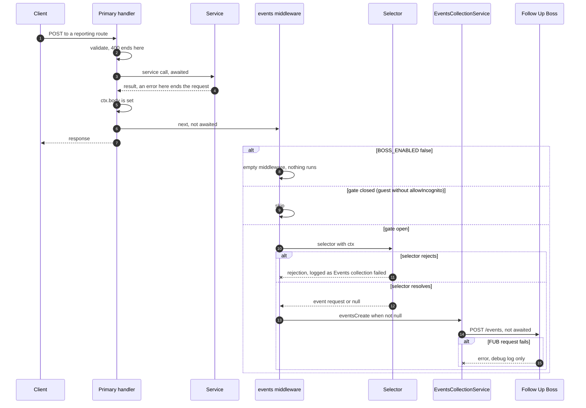
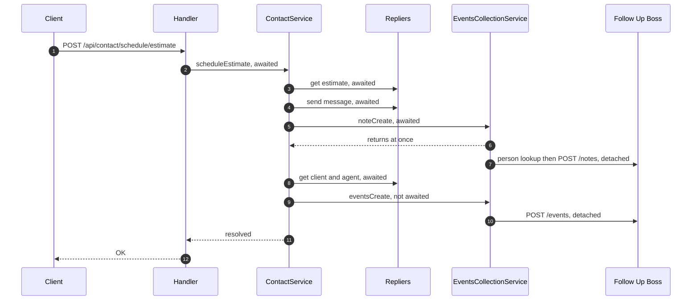

# Events & Messaging

How the backend reports user engagement to the CRM (Follow Up Boss) after it has answered the
user, which routes do it, and what each report carries. Terms are defined in the
[Glossary](/glossary).

[Request lifecycle](/architecture/request-lifecycle#detached-second-handlers) |
[Contact, Stats & Tours](/api-reference/contact-and-stats) |
[Follow Up Boss](/integrations/follow-up-boss) |
[Module catalogue](/architecture/modules) |
[Workflow W7](/architecture/flows)

## Respond first, report second

A route that reports an interaction chains **two** handlers. The primary handler does the real
work and sets the response; the second handler, `middleware.eventsCollection`, runs a **selector**
that maps the finished request to a CRM event (and optionally a note) and sends it without being
awaited. The chain, the gate (`allowIncognito` or a signed-in user, `BOSS_ENABLED`) and the error
handling of the response path are on
[Request lifecycle](/architecture/request-lifecycle#detached-second-handlers); this page holds
what is reported and how it can fail.

- **Selectors** (`src/services/eventsCollection/selectors/`) map `ctx` to a
  `BossEventsCreateRequest`, or to `null` to skip. They run after the response body is set and
  read it (`ctx.body`, `ctx.response.body`) where the event needs the result: the listing, the
  saved-search id, the estimate.
- Contact selectors attach an email or phone only when present (`contactEntries` in
  `baseEventCollectionSelector.ts`): an instance may make either optional, and the CRM must not
  receive an empty entry.
- **Notes** come from a `notesSelector` (`SelectEstimateNoteParams`) on the estimate routes, or are
  written directly by `ContactService.scheduleEstimate` and the agent send-estimate handler.

**Guidance for new features.** A new endpoint that captures a user action, a feedback form for
example, can reuse this pattern: the first handler answers the request, and a second handler
reports the action without being awaited, so the response does not wait on the downstream
system. `EventsCollectionService` (`src/services/eventsCollection/eventsCollection.ts`) sends to
Follow Up Boss only; a destination other than the CRM is its own service and does not have to go
through `eventsCollection`. Step by step for a CRM event:
[Adding an event selector](/tutorials/adding-an-event-selector).

## Engagement reporting

Every route that reports to the CRM. **M** is the middleware path
([D06](#d06--second-handler-and-detached-report)): the report starts after the response is decided
and is never awaited. A selector that returns `null` reports nothing. On **M**, an exception from a
selector or from the call that starts the CRM request is logged at error level as
`Events collection failed`; a failure of the CRM request itself (`POST /events`, `POST /notes`)
and a failed person lookup for a note reach only the `repliers:services:eventsCollection` debug
log. Selector paths are under `src/services/eventsCollection/selectors/`.

| Route                                                                | Selector                                                       | Event / note type                                                                          | Field, tag and assignment inputs                                                                                                                                                                                                                                                                                                                                                                                                                                                                                                                                                                                                           | Guest policy                                                                                                                     | Awaited / detached / error                                                                                                                                                                                                                                                                                                                                   | Source                                                                                                          |
| -------------------------------------------------------------------- | -------------------------------------------------------------- | ------------------------------------------------------------------------------------------ | ------------------------------------------------------------------------------------------------------------------------------------------------------------------------------------------------------------------------------------------------------------------------------------------------------------------------------------------------------------------------------------------------------------------------------------------------------------------------------------------------------------------------------------------------------------------------------------------------------------------------------------------ | -------------------------------------------------------------------------------------------------------------------------------- | ------------------------------------------------------------------------------------------------------------------------------------------------------------------------------------------------------------------------------------------------------------------------------------------------------------------------------------------------------------ | --------------------------------------------------------------------------------------------------------------- |
| `POST /api/contact/contactus`                                        | `SelectContactUsParams`                                        | event `General Inquiry`                                                                    | `firstName` = `name`; email and phone through `contactEntries`; tags = the request's `tags` (up to 5) plus default tags; `message`; `pageUrl` = body `pageUrl` or `Referer`; no assignment                                                                                                                                                                                                                                                                                                                                                                                                                                                 | reported for guests (`allowIncognito: true`)                                                                                     | primary awaits the message send, an error there ends the request and nothing is reported; report **M**                                                                                                                                                                                                                                                       | `src/routes/contact.ts`; `selectContactUsParams.ts`                                                             |
| `POST /api/contact/requestinfo`                                      | `SelectRequestInfoParams`                                      | event `Inquiry`                                                                            | as `contactus`, with the property read through `RepliersListings.single` (board `eventsCollection.defaultBoardId`); tag = `formTags.inquiry.sale` or `.rent` by `property.forRent`, no tag when unset; no assignment                                                                                                                                                                                                                                                                                                                                                                                                                       | reported for guests                                                                                                              | as `contactus`                                                                                                                                                                                                                                                                                                                                               | `src/routes/contact.ts`; `selectRequestInfoParams.ts`                                                           |
| `POST /api/contact/schedule`                                         | `SelectScheduleParams`                                         | event `Property Inquiry`                                                                   | as `requestinfo`; `message` = the visitor's optional note                                                                                                                                                                                                                                                                                                                                                                                                                                                                                                                                                                                  | reported for guests                                                                                                              | as `contactus`                                                                                                                                                                                                                                                                                                                                               | `src/routes/contact.ts`; `selectScheduleParams.ts`                                                              |
| `POST /api/contact/subscribe/newsletter`                             | `SelectSubscribeNewsletterParams`                              | event `General Inquiry`, message `Newsletter subscription`                                 | person email = body `email`; tags = `eventTags.SelectSubscribeNewsletterParams` plus default tags; `pageUrl` = body or `Referer`                                                                                                                                                                                                                                                                                                                                                                                                                                                                                                           | reported for guests                                                                                                              | the primary handler only validates; report **M**                                                                                                                                                                                                                                                                                                             | `src/routes/contact.ts`; `selectSubscribeNewsletterParams.ts`                                                   |
| `POST /api/contact/schedule/estimate`                                | none; `SelectScheduleEstimateNoteParams` called by the service | note `Client requested to schedule a meeting regarding estimate`, event `Property Inquiry` | note: HTML body with date, time, price, address and estimate URL; person looked up from `clientId`. Event: name, email, phone, tags = `eventTags.SelectScheduleEstimateNoteParams` only (`ignoreDefaultTags`), assignment set by the service itself, not by `assignAgent`: the agent of the estimate's owner (`clients.get(estimate.clientId).agentId`); with no owner on the estimate, the caller's agent for a signed-in caller or `REPLIERS_AGENT_ID` for a guest; that agent's `externalId` becomes `assignedUserId`, else first and last name become `assignedTo`; `message` and `description` only when the caller has no `clientId` | not gated: runs for guests and users; the note's `clientId` is the caller's, or `REPLIERS_UNAUTHENTICATED_CLIENT_ID` for a guest | the message send and the lookups are awaited; the note and the event are started inside the service and are detached ([D06](#d06--second-handler-and-detached-report))                                                                                                                                                                                       | `src/services/contact.ts` `scheduleEstimate`; `selectScheduleEstimateNoteParams.ts`                             |
| `GET /api/listings/{mlsNumber}`                                      | `SelectViewPropertyParams`                                     | event `Viewed Property`                                                                    | `property` mapped from the response body; `pageUrl` = property URL template; `pageReferrer` = `Referer` or the property URL; person = the JWT email; no tags beyond defaults; no assignment                                                                                                                                                                                                                                                                                                                                                                                                                                                | signed-in only (no `allowIncognito`); the route skips the second handler for role `Agent` (Admin and Root are reported)          | **M**                                                                                                                                                                                                                                                                                                                                                        | `src/routes/listings.ts`; `selectViewPropertyParams.ts`                                                         |
| `POST /api/favorites`                                                | `SelectSavePropertyParams`                                     | event `Saved Property`                                                                     | `property` read with `getProperty(mlsNumber, boardId)`; `pageUrl` = property URL; person = the JWT email                                                                                                                                                                                                                                                                                                                                                                                                                                                                                                                                   | signed-in only (strict JWT); no role check                                                                                       | **M**                                                                                                                                                                                                                                                                                                                                                        | `src/routes/favorites.ts`; `selectSavePropertyParams.ts`                                                        |
| `POST /api/searches`                                                 | `SelectSaveSearchParams`                                       | event `Saved Property Search`                                                              | `propertySearch` mapped from the validated body; `description` = `Saved search url: <url>` when `BOSS_SAVED_SEARCH_URL` is set and the response has a `searchId`; `pageUrl` = `Referer`                                                                                                                                                                                                                                                                                                                                                                                                                                                    | signed-in only (strict JWT); no role check                                                                                       | **M**                                                                                                                                                                                                                                                                                                                                                        | `src/routes/searches.ts`; `selectSaveSearchParams.ts`                                                           |
| `PATCH /api/user`                                                    | `SelectUnsubscribedParams`                                     | event `Unsubscribed`                                                                       | `null` unless `preferences.unsubscribe` is truthy; tags = `eventTags.SelectUnsubscribedParams` plus default tags; person = the JWT email                                                                                                                                                                                                                                                                                                                                                                                                                                                                                                   | signed-in only (`allowIncognito: false` on a strict JWT route)                                                                   | **M**                                                                                                                                                                                                                                                                                                                                                        | `src/routes/user.ts`; `selectUnsubscribedParams.ts`                                                             |
| `POST /api/estimate`                                                 | `SelectEstimateParams` and `SelectEstimateNoteParams`          | event `Seller Inquiry`; note `Seller Inquire details for <type> property at <address>`     | tags = the sell-intention tag (`Sell ASAP`, `Sell in 1-3 Months`, `Sell in 3-6 Months`, `Sell in 6-12 Months`, `Sell just Curious`) plus default tags; `property` from the validated body with the estimate as `price`; the note is `null` when the response carries no `clientId`, details or address                                                                                                                                                                                                                                                                                                                                     | reported for guests (`allowIncognito: true`)                                                                                     | **M** for both                                                                                                                                                                                                                                                                                                                                               | `src/routes/estimate.ts`; `selectEstimateParams.ts`, `selectEstimateNoteParams.ts`                              |
| `GET /api/estimate`                                                  | `SelectViewEstimateParams`                                     | event `Visited Website - Estimate`                                                         | `null` unless `BOSS_REPORT_CLIENT_VIEW_ESTIMATE=true`, the body is an estimate, and the role is user or absent; `description` = `Estimate: <estimate URL>`                                                                                                                                                                                                                                                                                                                                                                                                                                                                                 | passthrough route, `allowIncognito: false`: signed-in only                                                                       | **M**                                                                                                                                                                                                                                                                                                                                                        | `src/routes/estimate.ts`; `selectViewEstimateParams.ts`                                                         |
| `POST /api/agent/client`                                             | `SelectAgentClientRegistrationParams`                          | event `Registration`                                                                       | person name, email, phone from the body; tags `Registration`; `customAuthType` `Agent`; with `BOSS_CUSTOM_AVM_FIELD` the signed AVM link of the new client; assignment = the agent's `externalId`, else the FUB user matching the agent's name, else none                                                                                                                                                                                                                                                                                                                                                                                  | agents and Admin only (route-level role check)                                                                                   | **M**                                                                                                                                                                                                                                                                                                                                                        | `src/routes/agent.ts`; `selectAgentClientRegistrationParams.ts`                                                 |
| `POST /api/agent/estimate/{clientId}`                                | `SelectAgentEstimateParams` and `SelectEstimateNoteParams`     | event `Seller Inquiry`; estimate note                                                      | as `POST /api/estimate`, with the client's email and phone as the person and the assignment of the acting agent                                                                                                                                                                                                                                                                                                                                                                                                                                                                                                                            | agents and Admin only                                                                                                            | **M** for both                                                                                                                                                                                                                                                                                                                                               | `src/routes/agent.ts`; `selectAgentEstimateParams.ts`                                                           |
| `POST /api/agent/estimate/{estimateId}/send`                         | none (second handler written in the route)                     | note `Estimate sent to the client via email`                                               | person found by `externalId`, else by email; no note when the client has neither or FUB returns no person                                                                                                                                                                                                                                                                                                                                                                                                                                                                                                                                  | agents and Admin only                                                                                                            | detached, but not through the middleware: the second handler awaits `BossService.noteCreate` inside a chain nobody awaits; any error is caught and written with `console.error`. Nothing gates it on `BOSS_ENABLED`: when disabled, `BossService.request` logs a warning and returns `{}`, so the person lookup finds nothing and `console.error` is written | `src/routes/agent.ts`                                                                                           |
| `POST /api/auth/signup`, `POST /api/auth/{provider}/cb` (new client) | `SelectClientRegistrationParams`, called by the service        | event `Registration`                                                                       | person name, email, phone; tags `Registration`; `customAuthType` = `otp` or the provider; `pageReferrer` for signup; the AVM field as for agents                                                                                                                                                                                                                                                                                                                                                                                                                                                                                           | any caller who completes the flow                                                                                                | `eventsCreate` is not awaited; a selector failure is caught in the service (debug log for signup, error log for OAuth). Nothing gates these on `BOSS_ENABLED`: when disabled, `BossService.request` logs a warning and returns `{}`                                                                                                                          | `src/services/auth.ts`, `src/services/oauth.ts` `reportClientRegistration`; `selectClientRegistrationParams.ts` |

### Field provenance

What the service adds to every event (`EventsCollectionService.eventsCreate`) and where a value
comes from.

| Field                                            | Value                                                                                                                                                                                                                                                                         | Source                                                                                  |
| ------------------------------------------------ | ----------------------------------------------------------------------------------------------------------------------------------------------------------------------------------------------------------------------------------------------------------------------------- | --------------------------------------------------------------------------------------- |
| `source`                                         | `BOSS_DEFAULT_SOURCE` (default `example.tld`), spread before the selector's fields, so a selector value wins                                                                                                                                                                  | `src/config.ts` `eventsCollection.defaultEventFields`                                   |
| `person.tags`                                    | default tags first (`BOSS_DEFAULT_TAGS`, default the value of `APP_ENVIRONMENT`), then the selector's tags; the defaults are omitted when `ignoreDefaultTags` is set                                                                                                          | `eventsCollection.ts` `assignTags`                                                      |
| `person.assignedUserId` or `assignedTo`          | only what the selector put on the person; `BOSS_DEFAULT_ASSIGNED_TO` is configured but not applied                                                                                                                                                                            | `eventsCollection.ts` `assignAgent`                                                     |
| `occurredAt`, `pageReferrer`, person email       | now (at selector time), the `Referer` header, the JWT `email` (absent for a guest)                                                                                                                                                                                            | `baseEventCollectionSelector.ts` `getDefaults`                                          |
| property, client, estimate and saved-search URLs | templates `BOSS_PROPERTY_URL` (`[MLS_NUMBER]`, `[BOARD_ID]`), `BOSS_CLIENT_URL` (`[CLIENT_ID]`), `BOSS_ESTIMATE_URL` (`[ESTIMATE_ID]` or `[ULID]`), `BOSS_SAVED_SEARCH_URL` (`[SEARCH_ID]`); relative templates get `SETTINGS_EVENTS_COLLECTOR_URL_HOST` prepended at startup | `src/lib/settings.ts` `constructEventsCollectionUrls`, `baseEventCollectionSelector.ts` |

## D06 — Second handler and detached report

### Middleware path

### In-service path (`schedule/estimate`)

In the second diagram `noteCreate` is an `async` method: the service waits for the call to return,
and the person lookup (`getPersonId`) and
`BossService.noteCreate` are started inside it with `.then`, outside the promise it
returns. Nothing in the backend awaits a CRM response before answering the user.

## EventsCollectionService

`src/services/eventsCollection/eventsCollection.ts` wraps the Follow Up Boss service:

- `eventsCreate(params)`: **fire-and-forget** (`.then/.catch`, no `await`; the sanctioned exception
  to the await-everything rule). Merges `config.eventsCollection.defaultEventFields`, assigns the
  agent and tags.
- `noteCreate(params)`: resolves the CRM person (by explicit id, via the user's `externalId`, or by
  email lookup), then creates a note; both steps are detached the same way.
- `assignAgent` deliberately has **no default-agent fallback**: a lead must never flip from its
  real agent to the default one.

### Lead tags

Tags on a created person come from three independent places:

- **Carried by the request**: e.g. `/contact/contactus` accepts an optional `tags` list. The shared
  `contactSchema` (`src/validate/contact.ts`) allows at most 5 labels, each 1–50 characters of
  letters (accented letters included), digits, space, `.`, `'` and `-`; anything else is a 400. The
  selector copies the list into `person.tags`, so a new form can name its own tags with no backend
  change.
- **Derived on the server**: inquiry selectors fetch the listing and pick
  `config.eventsCollection.formTags.inquiry.{sale|rent}` from `property.forRent`. When the listing
  lookup fails, `forRent` is unset and the `sale` tag applies.
- **Configured per event**: `config.eventsCollection.eventTags`, keyed by selector: newsletter
  signup, the estimate-appointment event, and unsubscribe (`PATCH /user` with
  `preferences.unsubscribe` reports an `Unsubscribed` event). Env:
  `SETTINGS_EVENTS_COLLECTOR_EVENT_TAGS_{SUBSCRIBE_NEWSLETTER|SCHEDULE_ESTIMATE|UNSUBSCRIBED}`.

`assignTags` concatenates `defaultPersonFields.tags` with the selector's tags (unless
`ignoreDefaultTags`).

### Gotchas

- **The report reads the response.** Selectors for views, saves and estimates read `ctx.body` after
  the primary handler set it. The listing view event is built from the body of a route whose service
  is `@scrubbed` (`src/routes/listings.ts`, `selectViewPropertyParams.ts`).
- **A failed property lookup still produces an event.** `getProperty` returns only `mlsNumber` and `url`
  when the validation or the listing request fails (`baseEventCollectionSelector.ts`,
  `getProperty`).
- **The agent send-estimate report bypasses the middleware.** Its second handler is in the route,
  has no `BOSS_ENABLED` gate of its own and logs with `console.error` (`src/routes/agent.ts`).
- **`assignedTo` from configuration is never sent.** `assignAgent` returns only what the selector
  set (`src/services/eventsCollection/eventsCollection.ts`).

## NATS streams & the worker

The worker process, its stream, consumer, subjects and acknowledgements are on [Follow Up Boss — The NATS worker](/integrations/follow-up-boss#the-nats-worker).

## Outbound messages

OTP codes and inquiry notifications are delivered through the **Repliers Messages
API** (`services/repliers/messages.ts`): real emails/SMS to real people. With
`SMTP_ENABLED=true` and `REPLIERS_AGENT_EMAIL` set, the `ContactService` form messages go
through a static Gmail account instead (`services/smtp.ts`, nodemailer); OTP codes stay on the
Messages API. See [Email](/integrations/email).

Verified against portal-backend `997ae3e`, 2026-10-20.
