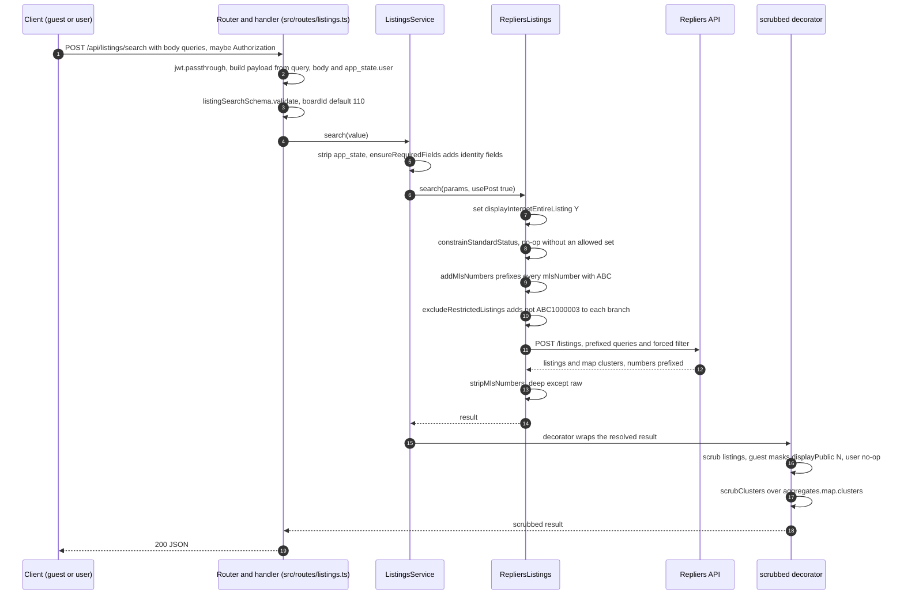
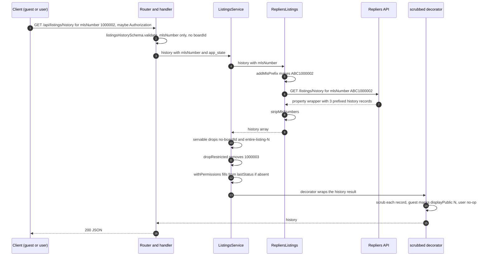
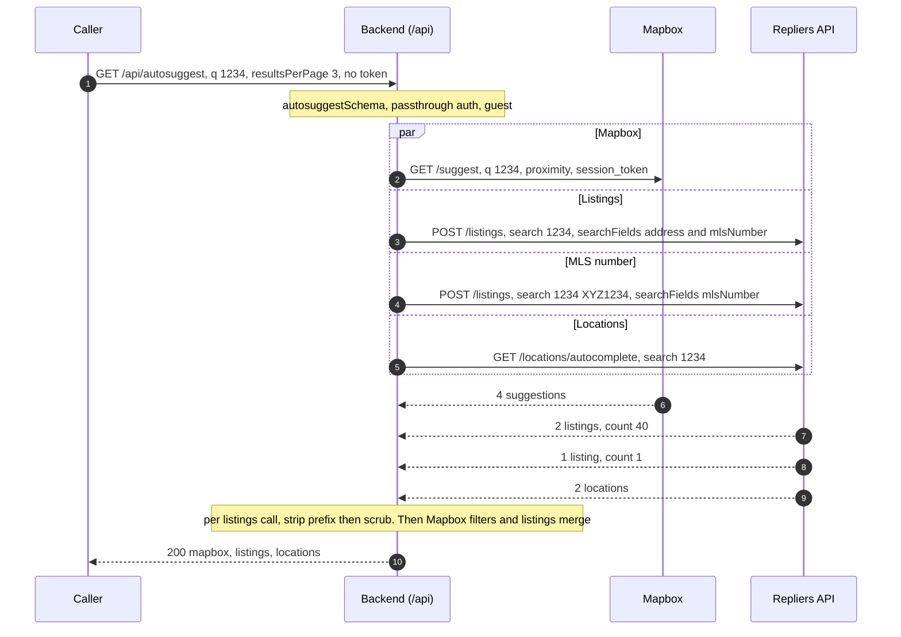
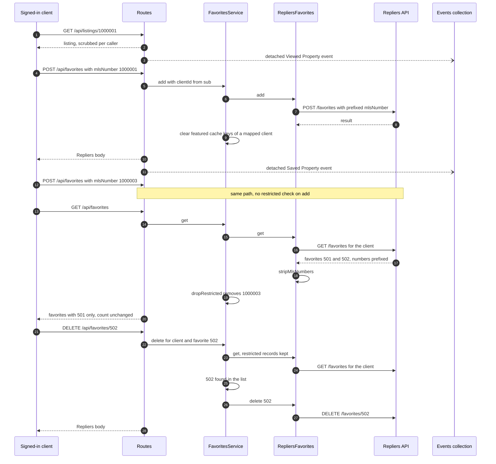
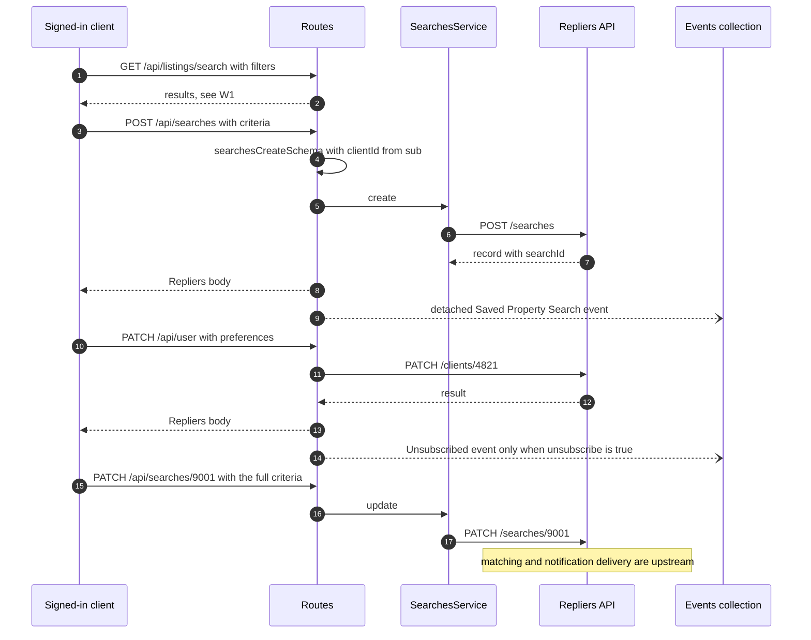
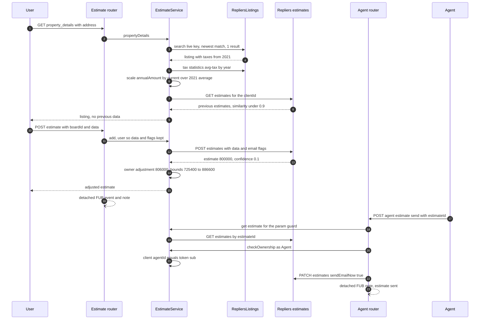
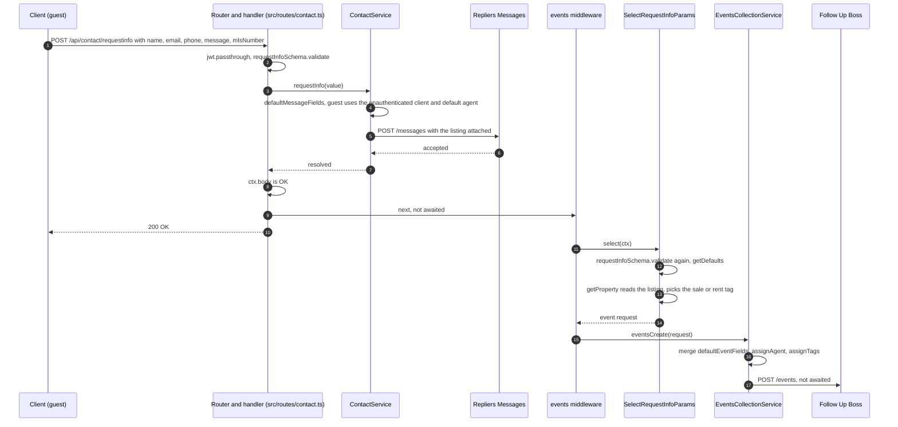
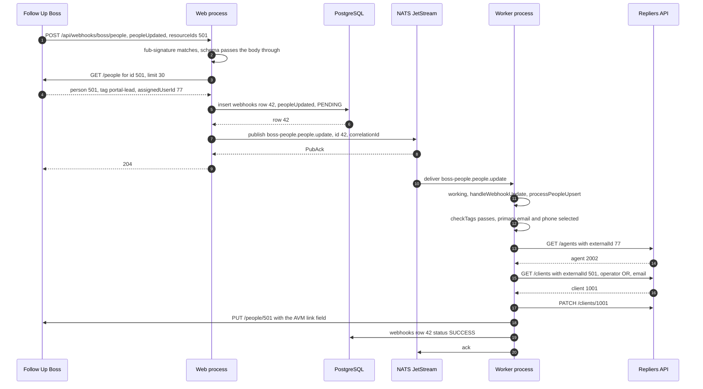
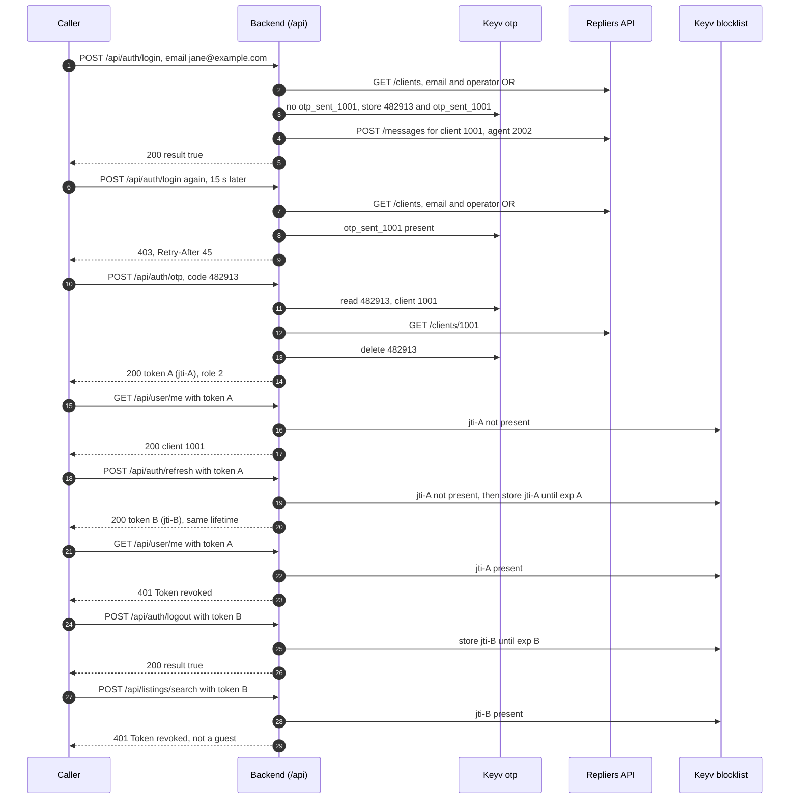
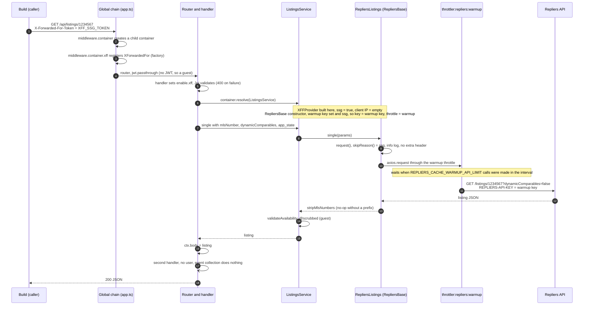

# Workflows

Cross-module workflows, each followed through the modules that take part in it. A workflow section has a sequence diagram that shows the order of the calls, and a worked trace: an input followed step by step through the intermediate values, the outbound request and the returned data, with the side effects. A trace labelled **executed** was run against the sample-data key on the stated date; the captured identifiers, MLS numbers, addresses and brokerage names are replaced by synthetic stand-ins, listed at the top of the trace. Every outcome row is derived from the same capture as its input and request. Any other trace is synthetic. In both the steps, names and orders are read from the source. Terms are defined in the [Glossary](/glossary).

[Architecture overview](/architecture) | [Request lifecycle](/architecture/request-lifecycle) | [Module catalogue](/architecture/modules) | [Authentication](/architecture/authentication) | [Client IP forwarding](/architecture/client-ip-forwarding) | [Listings search](/api-reference/listings/search) | [Scrubbing](/architecture/scrubbing)

## W1 — Guest and authenticated search

The same search request, sent once as a guest and once with a JWT, follows one pipeline
([D03](/api-reference/listings/search#d03--the-search-transformation-flow)) and produces one
outbound Repliers request; only scrubbing differs between the two responses. This trace was
**executed** against the sample-data key on 2026-10-20 with `settings.mlsNumberPrefix = "ABC"`
and `settings.restrictedListings = ["1000003"]`, a configuration chosen to exercise the prefix
and restriction branches.



### Worked trace (executed 2026-10-20)

Stand-ins (synthetic ← captured): MLS prefix `ABC` ← the prefix configured for the run; `1000001`,
`1000002` ← the two returned listings; `1000003` ← the restricted listing; all street numbers
and address keys shown are synthetic. Both returned listings carry
`permissions.displayPublic = "N"` in the capture.

Input: `POST /api/listings/search?status=U&resultsPerPage=3&fields=mlsNumber,listPrice,soldPrice&aggregates=map&cluster=true&clusterPrecision=10&clusterListingsThreshold=5&clusterFields=mlsNumber,soldPrice`
with body `{ "queries": [ { "mlsNumber": ["1000001","1000003"] }, { "mlsNumber": ["1000002"] } ] }`,
sent once with no `Authorization` (guest) and once with a JWT (user).

Outbound request the proxy builds (read from the `repliers:services:repliers` debug line):

```http
POST /listings?status=U&resultsPerPage=3&fields=mlsNumber,listPrice,soldPrice,status,permissions,address,duplicates,boardId&aggregates=map&cluster=true&clusterPrecision=10&clusterListingsThreshold=5&clusterFields=mlsNumber,soldPrice,status,permissions,address,duplicates,boardId&boardId=110&displayInternetEntireListing=Y
Content-Type: application/json

{ "queries": [
  { "mlsNumber": ["ABC1000001", "ABC1000003", "not:ABC1000003"] },
  { "mlsNumber": ["ABC1000002", "not:ABC1000003"] }
] }
```

| Step                   | What happens                   | Value (from the capture)                                                                                                                                                                                                                                    | Source                                         |
| ---------------------- | ------------------------------ | ----------------------------------------------------------------------------------------------------------------------------------------------------------------------------------------------------------------------------------------------------------- | ---------------------------------------------- |
| Validate               | `listingSearchSchema.validate` | `boardId` → `[110]`; `status` → `["U"]`; `fields`/`clusterFields` kept as strings                                                                                                                                                                           | `src/validate/listings.ts`                     |
| Identity fields        | `ensureRequiredFields`         | `fields` and `clusterFields` gain `status,permissions,address,duplicates,boardId` (see the outbound request)                                                                                                                                                | `src/services/listings.ts`, `src/lib/utils.ts` |
| Forced filter + prefix | client steps                   | `displayInternetEntireListing=Y` added; each `mlsNumber` prefixed with `ABC`                                                                                                                                                                                | `src/services/repliers/listings.ts` (`search`) |
| Exclusion              | `excludeRestrictedListings`    | `not:ABC1000003` unioned into **both** branches (both filter by `mlsNumber`)                                                                                                                                                                                | `src/services/listings/listingHelpers.ts`      |
| Upstream               | Repliers answers               | `count: 2` — `1000003` excluded by `not:`; two listings (`1000001`, `1000002`) and two map clusters, numbers still `ABC`-prefixed; both listings carry `permissions.displayPublic = "N"`                                                                    | observed                                       |
| Strip                  | `stripMlsNumbers`              | numbers return to `1000001`, `1000002` in the listings and the clusters; `raw` untouched                                                                                                                                                                    | `src/services/listings/mlsNumberPrefix.ts`     |
| Scrub (guest)          | `@scrubbed` + `scrubClusters`  | both listings `displayPublic=N`, so `listPrice`, `soldPrice`, `address.streetNumber` and `address.addressKey` → `!scrubbed!`; each cluster listing has `soldPrice` and `address.streetNumber` → `!scrubbed!`. No date field is present (none was requested) | `src/services/scrubber/listings.ts`            |
| Scrub (user)           | `@scrubbed` + `scrubClusters`  | the same fields returned in the clear (`asUser` is a no-op); clusters likewise                                                                                                                                                                              | `src/services/scrubber/listings.ts`            |
| Returned               | `ctx.body = result`            | `{ count: 2, page: 1, numPages: 1, pageSize: 3, statistics, aggregates.map.clusters[], listings[] }`; no `Cache-Control`                                                                                                                                    | `src/routes/listings.ts`                       |
| Side effects           | none                           | no view event, no write                                                                                                                                                                                                                                     | —                                              |

### Variations

- **A `displayPublic=Y` listing.** Both listings in this capture are `N`; a `Y` listing is
  returned to a guest unmasked (only `address` on `displayAddressOnInternet=N` and `map` on
  `displayOnMap=N` still apply, [Scrubbing](/architecture/scrubbing)).
- **No prefix configured.** `addMlsNumbers` and `stripMlsNumbers` are no-ops; the exclusion is
  `not:1000003`.
- **No `fields` sent.** The request carries only `fields=status,permissions,address,duplicates,boardId`
  and Repliers returns just the present keys — see
  [Search output](/api-reference/listings/search#output) for the detail.
- **RESO instance.** `constrainStandardStatus` narrows `standardStatus`; a `status`/`lastStatus`
  filter then collides with it upstream (`400`).

### Evidence

- Executed 2026-10-20 against the sample-data key; outbound request read from the
  `repliers:services:repliers` debug line; guest and user responses captured and compared
  field by field.
- `test/routes/listings.test.ts`, `test/services/scrubber/listings.test.ts`,
  `test/services/listings/restrictedListings.test.ts`.

## W2 — Property history

`GET /api/listings/history` resolves the _property_ behind an MLS number and returns its records
across every board the account reads. Each record is scrubbed on its own `boardId` and
`permissions`; before the scrubber runs, the service drops boardless, entire-listing-N and
restricted records and fills in missing permissions. This trace was **executed** against the
sample-data key on 2026-10-20 with `settings.mlsNumberPrefix = "ABC"` and
`settings.restrictedListings = ["1000003"]`.



### Worked trace (executed 2026-10-20)

Stand-ins (synthetic ← captured): MLS prefix `ABC` ← the prefix configured for the run; the seed and
one record `1000002`; the other kept record `1000001`; the dropped restricted record `1000003`;
all addresses and the brokerage name shown are synthetic. All three upstream records are on
`boardId 110` with `permissions.displayPublic = "N"` and `displayInternetEntireListing = "Y"`.

Input: `GET /api/listings/history?mlsNumber=1000002`, sent once as a guest and once with a JWT.

Outbound request the proxy builds:

```http
GET /listings/history?mlsNumber=ABC1000002
```

| Step          | What happens                      | Value (from the capture)                                                                                                                                                                                                                                                                                                                                                                                                                                | Source                                          |
| ------------- | --------------------------------- | ------------------------------------------------------------------------------------------------------------------------------------------------------------------------------------------------------------------------------------------------------------------------------------------------------------------------------------------------------------------------------------------------------------------------------------------------------- | ----------------------------------------------- |
| Validate      | `listingsHistorySchema`           | `mlsNumber` only; no `boardId` accepted                                                                                                                                                                                                                                                                                                                                                                                                                 | `src/validate/listings.ts`                      |
| Prefix        | `addMlsPrefix`                    | seed prefixed to `ABC1000002` in the upstream query                                                                                                                                                                                                                                                                                                                                                                                                     | `src/services/repliers/listings.ts` (`history`) |
| Upstream      | Repliers resolves the property    | wrapper (address, coordinates, beds/baths) + `history: [ ABC1000001, ABC1000002, ABC1000003 ]`, all `boardId: 110`, all `displayPublic: "N"`, each with its own `lastStatus`                                                                                                                                                                                                                                                                            | observed                                        |
| Strip         | `stripMlsNumbers`                 | numbers become `1000001`, `1000002`, `1000003`; only `history` is proxied further                                                                                                                                                                                                                                                                                                                                                                       | `src/services/listings/mlsNumberPrefix.ts`      |
| Eligibility   | `servable`                        | all three kept: numeric `boardId`, none `displayInternetEntireListing=N`                                                                                                                                                                                                                                                                                                                                                                                | `src/services/listings.ts` (`servable`)         |
| Restriction   | `dropRestricted`                  | `1000003` removed (blocklisted) → two records (`1000001`, `1000002`)                                                                                                                                                                                                                                                                                                                                                                                    | `src/services/listings/listingHelpers.ts`       |
| Permissions   | `withPermissions`                 | no-op here — both records carry `permissions`; a record without them would get `displayPublic` from `permissionsFromLastStatus` (`"Y"` for `A`/`New`/`Pc`/`Ext`/`Cs`, else `"N"`)                                                                                                                                                                                                                                                                       | `src/services/listings.ts` (`withPermissions`)  |
| Scrub (guest) | `@scrubbed("history")` per record | `displayPublic=N`, so the numeric detail fields present (`beds`, `baths`, `sqft`, `listPrice`, `soldPrice`, `photoCount`), `style`, `lastStatus`, `office.brokerageName` and `taxes.assessmentYear` → `!scrubbed!`; `soldDate` and `timestamps.{idxUpdated,listingUpdated,photosUpdated,closedDate,unavailableDate}` → `1900-06-21T01:39:00.000Z`. `mlsNumber`, `boardId`, `type`, `propertyType`, `listDate` (a safe field) and `permissions` are kept | `src/services/scrubber/listings.ts`             |
| Scrub (user)  | `@scrubbed("history")` per record | the same fields returned in the clear (`asUser` no-op)                                                                                                                                                                                                                                                                                                                                                                                                  | `src/services/scrubber/listings.ts`             |
| Returned      | `ctx.body = { history }`          | two records, Repliers' own order; no `boardId` scoping; not cached                                                                                                                                                                                                                                                                                                                                                                                      | `src/services/listings.ts` (`history`)          |
| Side effects  | none                              | no view event                                                                                                                                                                                                                                                                                                                                                                                                                                           | —                                               |

### Variations

- **Syndicated property.** A listing carried on several boards appears once per board under the
  same MLS number; the route passes the duplicates through — ordering and de-duplication are the
  consumer's concern.
- **A record without permissions.** `withPermissions` synthesizes them from `lastStatus`; a
  closed record then masks for a guest, an active one does not
  ([Detail/History](/api-reference/listings/detail-similar-history#history)).
- **No prefix configured.** The prefix steps are no-ops.

### Evidence

- Executed 2026-10-20 against the sample-data key; the upstream request and the record set read
  from the logs; guest and user responses captured and compared field by field.
- `test/routes/listings.test.ts` (history scrubbing through the route),
  `test/services/listings/history.test.ts` (`servable`, `withPermissions`).

## W3 — Autosuggest with the MLS-number leg

A guest types a digit string into the search box. One request fans out to four calls: Mapbox,
two Repliers listings searches (the primary one and the MLS-number one) and the Repliers
locations autocomplete; the proxy filters the Mapbox list, merges the two listing results and
returns three blocks. The branch table and the failure rules are on
[Autosuggest](/api-reference/search-and-locations/autosuggest); this section follows the values.
The trace is **synthetic**: it is read from the source and the unit tests, no server was run.



### Worked trace (synthetic)

Stand-ins (all synthetic): MLS prefix `XYZ`; session UUID `0b9c6a4e-5d1f-4c0e-9a57-3f2f7d2f8a11`;
coordinates `12.3456`, `-65.4321`; place names `Exampleville` and `Farville`, region code `XX`; MLS numbers `5001`, `5002`, `1234`; street names, postcodes
and `mbx-*` ids; the Mapbox distances. Configuration assumed: environment-built values with no
preset (`PROXIMITY_SEARCH_COUNTRY` unset → `ca`, `PROXIMITY_SEARCH_RADIUS_METERS` unset →
`150000`, `PROXIMITY_SEARCH_REGION_CODE` unset, Jaro-Winkler threshold `0.9`),
`APP_DEFAULTS_BOARDIDS=110`, `mlsNumberPrefix=XYZ`, the autosuggest listing settings at their
defaults, and the board not in the scrubbing list (so `@scrubbed` returns the listings unchanged).

Input: `GET /api/autosuggest?q=1234&searchSession=0b9c6a4e-5d1f-4c0e-9a57-3f2f7d2f8a11&lat=12.3456&long=-65.4321&resultsPerPage=3`
with no `Authorization` header.

Outbound requests the proxy builds (query values decoded; repeated keys as the client sends
them; Repliers headers as on [Client IP forwarding](/architecture/client-ip-forwarding)):

```http
GET https://api.mapbox.com/search/searchbox/v1/suggest?access_token=<token>&q=1234&country=ca&language=en&limit=10&types=street,postcode,address&proximity=-65.4321,12.3456&session_token=0b9c6a4e-5d1f-4c0e-9a57-3f2f7d2f8a11

POST /listings?search=1234&searchFields=address.streetName,mlsNumber,address.zip,address.streetNumber&boardId=110&lat=12.3456&long=-65.4321&radius=150000&listings=true&status=A&lastStatus=New&lastStatus=Ext&lastStatus=Pc&class=condo&class=residential&type=sale&resultsPerPage=3&fields=mlsNumber,status,class,listPrice,listDate,lastStatus,soldPrice,soldDate,address,map,images[0],details.numBathrooms,details.numBathroomsPlus,details.numBedrooms,details.numBedroomsPlus,details.propertyType,details.sqft,details.style,lot.depth,lot.width,lot.size,lot.acres,lot.measurement,updatedOn,daysOnMarket,boardId,permissions,raw,type,duplicates&sortBy=distanceAsc&displayInternetEntireListing=Y

POST /listings?search=1234 XYZ1234&searchFields=mlsNumber&<same keys as above>&searchOperator=OR

GET /locations/autocomplete?search=1234&boundary=false&resultsPerPage=3&lat=12.3456&long=-65.4321&radius=150000
```

| Step                  | What happens                                             | Value                                                                                                                                                                                                                                                                                      | Source                                                                                                        |
| --------------------- | -------------------------------------------------------- | ------------------------------------------------------------------------------------------------------------------------------------------------------------------------------------------------------------------------------------------------------------------------------------------ | ------------------------------------------------------------------------------------------------------------- |
| Validate              | `autosuggestSchema`                                      | `q "1234"`, `resultsPerPage 3`, `radius 150000` (default), `boundary false`, `hasBoundary null`; `searchSession` satisfies the `.or(...)` rule                                                                                                                                             | `src/validate/autosuggest.ts` (`autosuggestSchema`)                                                           |
| Mapbox request        | `MapboxService.suggest`                                  | the first request above; `limit 10` is `REPLIERS_AUTOSUGGEST_MAX_RESULTS`, not the page size                                                                                                                                                                                               | `src/services/mapbox.ts` (`suggest`)                                                                          |
| Mapbox upstream       | provider answers                                         | 4 suggestions: `1234 Example Street` (Exampleville, XX, distance 3200), `1234 Example St` (same place, 3300), `12 Maple Road` (Exampleville, XX, 5100), `1234 Faraway Lane` (Farville, XX, 351000)                                                                                         | observed (synthetic)                                                                                          |
| Distance filter       | `locationsFilter`                                        | `1234 Faraway Lane` is 351000 m away, above `max_distance 150000`: dropped before the Jaro-Winkler step                                                                                                                                                                                    | `src/services/autosuggest.ts` (`locationsFilter`)                                                             |
| Near-duplicate filter | `jaro-winkler` on `normalizedLocationName`               | `1234 example street exampleville XX` kept (first; the region code is not lower-cased); `1234 example st exampleville XX` scores `0.9417` against it, at or above `0.9`: dropped; `12 maple road exampleville XX` scores `0.8115` and `0.8209` against the two: kept                       | `src/services/autosuggest.ts` (`normalizedLocationName`)                                                      |
| Cut and reshape       | `slice(0, 3)`, `map`                                     | two items, each `{ name, mapbox_id, feature_type, region: { region_code }, postcode: { name }, place: { name }, neighborhood: {} }`                                                                                                                                                        | `src/services/autosuggest.ts` (`search`)                                                                      |
| Primary listings      | `ListingsService.search`                                 | `fields` gains `duplicates`; `displayInternetEntireListing=Y` is already set; upstream returns `count 40` and two listings, `XYZ5001` and `XYZ5002`, stripped to `5001` and `5002` in the Repliers listings layer, then `@scrubbed` runs inside `ListingsService.search`, before the merge | `src/services/listings.ts` (`search`, `ensureRequiredFields`), `src/services/repliers/listings.ts` (`search`) |
| MLS-number branch     | `mlsNumberCandidate("1234")` is true and a prefix is set | `addMlsSearchVariant` rewrites `search` to `1234 XYZ1234` and sets `searchOperator=OR` (`searchFields` is `mlsNumber`, no `address.streetNumber`); upstream returns `count 1` and the listing `XYZ1234`, stripped to `1234`                                                                | `src/services/listings/mlsNumberPrefix.ts` (`addMlsSearchVariant`)                                            |
| Locations             | `RepliersLocations.autocomplete`                         | passed through; two locations                                                                                                                                                                                                                                                              | `src/services/repliers/locations.ts` (`autocomplete`)                                                         |
| Merge                 | `mergeMlsNumberListings`                                 | `[5001, 5002, 1234]`, three entries, within `resultsPerPage 3`; `count = 40 + 1 = 41`                                                                                                                                                                                                      | `src/services/autosuggest.ts` (`mergeMlsNumberListings`)                                                      |
| Returned              | `ctx.body`                                               | `{ "mapbox": [2 items], "listings": { count: 41, listings: [5001, 5002, 1234], ... }, "locations": { ... } }`; no `Cache-Control`; no side effects                                                                                                                                         | `src/routes/autosuggest.ts`                                                                                   |

### Variations

- **The MLS-number request fails.** Its `.catch` logs to `repliers:services:autosuggest` and the
  branch yields `null`; the response is `listings` of `[5001, 5002]` with `count 40`.
- **`resultsPerPage=2`.** The merge is cut to `[5001, 5002]`; the `1234` match is gone but
  `count` is still `41`.
- **Non-digit `q` or no prefix.** No fourth call; `listings` is the primary block.
- **The Mapbox, primary listings or locations request fails.** `Promise.all` rejects and the
  caller gets that error (the Mapbox error carries the upstream status); no block is returned.
- **`REPLIERS_AUTOSUGGEST_PROVIDER=googlemaps`.** No change here: the combined endpoint always
  calls Mapbox; Google is used by `/api/autosuggest/address` only.
- **A signed-in user.** The same four calls; `@scrubbed("listings")` runs the user path on the
  listings when the board is in the scrubbing list ([Scrubbing](/architecture/scrubbing)).

### Evidence

- Read: `src/routes/autosuggest.ts`, `src/services/autosuggest.ts`, `src/services/mapbox.ts`,
  `src/services/repliers/locations.ts`, `src/services/listings/mlsNumberPrefix.ts`,
  `src/validate/autosuggest.ts`, `src/config.ts`.
- The Jaro-Winkler scores are computed with the installed `jaro-winkler` package on the three
  normalized names exactly as `normalizedLocationName` builds them.
- `test/services/autosuggest.test.ts`: `mergeMlsNumberListings` (null and empty leg, de-duplication,
  cut, summed count) and the client-IP forwarding on both Repliers legs.
- Not executed: no server was started in this pass; upstream answers are stand-ins.

## W4 — Favorite lifecycle with a restricted listing

A signed-in client views a listing, favorites it, favorites a second listing that is on the
restricted list, lists favorites and deletes both. The restriction shows in two places: the list
drops the restricted record, and the delete ownership check still sees it. The trace is
**synthetic**: favorites are Repliers records, so none was written; every step is read from the
source ([User & Favorites](/api-reference/user-and-favorites)).



### Worked trace (synthetic)

Stand-ins: none — every value is invented. Client `4821` (token `sub` `"4821"`), listings
`1000001` (visible) and `1000003` (in `settings.restrictedListings`), `settings.mlsNumberPrefix =
"ABC"`, favorite ids `501` and `502`.

Outbound requests, in order:

```http
POST /favorites
{ "clientId": 4821, "mlsNumber": "ABC1000001", "boardId": 110 }

POST /favorites
{ "clientId": 4821, "mlsNumber": "ABC1000003" }

GET /favorites?clientId=4821

GET /favorites?clientId=4821
DELETE /favorites/502
```

| Step           | What happens                                                                         | Value                                                                                                          | Source                                                                |
| -------------- | ------------------------------------------------------------------------------------ | -------------------------------------------------------------------------------------------------------------- | --------------------------------------------------------------------- |
| Validate (add) | `favoritesCreateSchema` with `clientId` = `sub`                                      | `clientId` 4821; `boardId` optional                                                                            | `src/validate/favorites.ts`, `src/routes/favorites.ts`                |
| Prefix         | `addMlsNumbers` on the body                                                          | `1000001` becomes `ABC1000001`                                                                                 | `src/services/repliers/favorites.ts` (`add`)                          |
| Restricted add | `FavoritesService.add` forwards the body                                             | `1000003` is stored upstream as favorite `502`                                                                 | `src/services/favorites.ts` (`add`)                                   |
| Event          | detached `Saved Property` for each add, signed-in only                               | not awaited; errors logged                                                                                     | `src/services/eventsCollection/selectors/selectSavePropertyParams.ts` |
| List           | `get`: `constrainStandardStatus`, upstream read, `stripMlsNumbers`, `dropRestricted` | upstream returns 501 and 502 with `count: 2`; `1000003` removed, so `favorites` has 501 and `count` is still 2 | `src/services/favorites.ts` (`get`)                                   |
| Delete 502     | ownership read of the list with restricted records kept, then delete                 | 502 is in the list, so `DELETE /favorites/502`; body is Repliers'                                              | `src/services/favorites.ts` (`delete`)                                |
| Delete 999     | id absent from the list                                                              | 400 `You are not owner of that favoriteId`; no upstream delete                                                 | `src/services/favorites.ts` (`delete`)                                |

### Variations

- **Featured client.** When `sub` is the `clientId` of a `settings.featuredListings` mapping,
  add and delete also clear `favorites:featuredListings` for that slug and every `sortBy`.
- **Standard-status instances.** The ownership read applies `constrainStandardStatus`, so a
  favorite outside the allowed statuses is not found (400).
- **More favorites than one page.** The ownership read sends no paging parameters; an id beyond
  the page Repliers returns is not found.

### Evidence

- `test/routes/favorites.test.ts` (list, forwarding, rejection).
- Not established by this checkout: Repliers' response bodies for `POST` and `DELETE`, its
  default page size.

## W5 — Saved search and notification preferences

A client narrows a search, saves its criteria, then sets contact preferences. The backend's part
ends at forwarding: the criteria and the notification keys are stored by Repliers, and no code in
this repository sends a saved-search notification. The trace is **synthetic**: saved searches and
client updates are Repliers writes, so none was run
([Saved searches](/api-reference/user-and-favorites/saved-searches)).



### Worked trace (synthetic)

Stand-ins: none — every value is invented. Client `4821`; the new search id `9001`.

Input, step 2: `POST /api/searches`

```json
{
  "name": "Two-bed condos",
  "minPrice": 300000,
  "maxPrice": 600000,
  "type": "sale",
  "class": "condo",
  "cities": ["Springfield"],
  "minBeds": 2,
  "notificationFrequency": "daily",
  "priceChangeNotifications": true
}
```

Outbound requests, in order:

```http
POST /searches
{ "clientId": 4821, "name": "Two-bed condos", "minPrice": 300000, "maxPrice": 600000,
  "type": "sale", "class": ["condo"], "cities": ["Springfield"], "minBeds": 2,
  "notificationFrequency": "daily", "priceChangeNotifications": true }

PATCH /clients/4821
{ "preferences": { "email": true, "sms": false } }

PATCH /searches/9001
{ "clientId": 4821, "name": "Two-bed condos", "minPrice": 300000, "maxPrice": 650000,
  "type": "sale", "class": ["condo"], "cities": ["Springfield"], "minBeds": 2,
  "notificationFrequency": "weekly", "priceChangeNotifications": true }
```

| Step              | What happens                                                                                                | Value                                                                                                                          | Source                                                              |
| ----------------- | ----------------------------------------------------------------------------------------------------------- | ------------------------------------------------------------------------------------------------------------------------------ | ------------------------------------------------------------------- |
| Filters           | the listing search is a separate request with its own vocabulary                                            | nothing links it to the saved-search body; the client supplies the criteria again                                              | `src/validate/listings.ts`, `src/validate/searches.ts`              |
| Validate (create) | `searchesCreateSchema`, `clientId` = `sub`                                                                  | `class` `"condo"` becomes `["condo"]` (`.single()`); `type` only has to be present                                             | `src/validate/searches.ts`, `src/validate/common.ts`                |
| Create            | `SearchesService.create` forwards the validated body                                                        | no `agentId` is sent; the response carries `searchId` 9001 (shape from Repliers)                                               | `src/services/searches.ts`, `src/services/repliers/searches.ts`     |
| Event             | `Saved Property Search` from the request body, detached                                                     | `propertySearch` from `class`, `cities`, `areas`, price and bed/bath bounds; description with `BOSS_SAVED_SEARCH_URL` when set | `src/services/eventsCollection/selectors/selectSaveSearchParams.ts` |
| Preferences       | `userUpdateSchema`, only supplied keys                                                                      | `{ preferences: { email: true, sms: false } }`; no event (`unsubscribe` not true)                                              | `src/validate/user.ts`, `src/services/user.ts`                      |
| Update            | the same schema plus `searchId`; the four required keys repeated                                            | omitting `maxPrice` here is a 400                                                                                              | `src/validate/searches.ts` (`searchesUpdateSchema`)                 |
| Delivery          | nothing in this repository reads `notificationFrequency`, `soldNotifications` or `priceChangeNotifications` | upstream; not established by this checkout                                                                                     | `src/validate/searches.ts`                                          |

### Variations

- **Unsubscribe.** `PATCH /api/user` with `preferences.unsubscribe: true` reports an
  `Unsubscribed` event; its effect on existing searches is not established here.
- **Agent-side client update.** `PATCH /api/agent/client/{clientId}` fills omitted preference
  members with defaults
  ([Agent clients](/api-reference/agent-and-admin/agent-clients#patch-apiagentclientclientid)).

### Evidence

- `test/services/eventsCollection/selectors/selectSaveSearchParams.test.ts`,
  `selectUnsubscribedParams.test.ts`.
- Not established by this checkout: Repliers' matching, merge, limit and delivery behaviour.

## W6 — Estimate: property details, creation, agent send

A signed-in user pre-fills a property, creates an estimate with owner-entered spend, and the
client's agent then sends it. The trace is **synthetic**: no estimate was created, every number
is invented, and the upstream payloads are shaped from the types in `src/services/repliers/estimate.ts`.
Mechanisms are described on [Estimate pipeline](/api-reference/estimate/pipeline).



### Worked trace (synthetic)

Stand-ins: city, street and all identifiers are invented; `estimateId 9001`, `clientId 4001`,
agent id `77`; the preset has both estimate email defaults on and `BOSS_ENABLED` on.

Outbound requests the backend builds (query strings abbreviated):

```http
GET /listings?listings=true&status=U&status=A&city=Exampleville&streetName=Main&streetNumber=12&displayInternetEntireListing=Y&sortBy=createdOnDesc&resultsPerPage=1
GET /listings?statistics=avg-tax,grp-yr&listings=false&status=U&status=A&city=Exampleville
POST /estimates    (body keeps data, sendEmailNow=true, sendEmailMonthly=true)
PATCH /estimates/9001    (body sendEmailNow=true)
```

| Step       | What happens                                                                | Value (synthetic)                                                               | Source                                                                                              |
| ---------- | --------------------------------------------------------------------------- | ------------------------------------------------------------------------------- | --------------------------------------------------------------------------------------------------- |
| Listing    | first match, tax year 2021                                                  | `taxes.annualAmount 3000`                                                       | `src/services/estimate.ts` (`findListingByAddress`)                                                 |
| Tax        | averages 2021 `2000`, current tax year `2200`, both over 15 records         | multiplier 1.1, `annualAmount 3300`                                             | `src/services/estimate.ts` (`adjustPropertyTax`)                                                    |
| Similarity | client's estimates share 3 of 5 address keys                                | 0.6, below 0.9, no `data` merged                                                | `src/services/estimate.ts` (`findSimilarClientEstimate`)                                            |
| Create     | user keeps `data`; each flag is the request value, else the preset value    | both `true`                                                                     | `src/services/estimate.ts` (`add`)                                                                  |
| Adjust     | spend 1000, 5000, 2000 at 0.6, 0.8, 0.7                                     | `+6000`: estimate `806000`, low `725400`, high `886600`, history months `+6000` | `src/services/estimate.ts` (`ownerAdjustedEstimates`)                                               |
| Event      | selectors run detached                                                      | "Seller Inquiry" event and a note                                               | `src/routes/estimate.ts` (`router.post`)                                                            |
| Guard      | estimate has a `clientId`; the client's `agentId` 77 equals the token `sub` | allowed                                                                         | `src/routes/agent.ts` (`router.param("estimateId")`), `src/services/estimate.ts` (`checkOwnership`) |
| Send       | `PATCH` with `sendEmailNow: true`; Repliers delivers                        | upstream estimate echoed                                                        | `src/services/agent.ts` (`sendEstimate`)                                                            |

### Variations

- **Guest create.** No `clientId`: `data` is withheld upstream and the preset email defaults are not applied (flags in the body are still forwarded); the
  adjustment still runs locally and `request.data` is echoed back.
- **Agent create.** `POST /api/agent/estimate/{clientId}` goes straight to `RepliersEstimate.add`,
  so no preset flags and no adjustment.
- **Signature link.** A valid `s` signature on the agent routes replaces the token's `sub` and
  skips `checkOwnership`.
- **No listing found.** The historical key is tried; then the fallback address and median-tax
  response, or an empty body with `SETTINGS_EXTENDED_PROPERTY_DETAILS` off.

### Evidence

`src/routes/estimate.ts`, `src/routes/agent.ts`, `src/services/estimate.ts`,
`src/services/agent.ts`, `src/services/repliers/estimate.ts` and
`test/services/estimate/estimate.test.ts` (property details, tax adjustment, owner adjustment).

## W7 — Contact submission

A visitor submits the property-inquiry form. The primary handler validates, sends the message to
the agent `defaultMessageFields` selects (the signed-in client's own agent, or the default agent
`REPLIERS_AGENT_ID` for a guest, as in this trace) and answers `OK`; only then does the second handler build a CRM event, reading
the listing, and start it without waiting. This trace is **synthetic**: it was read from the source
and not executed, because the route sends a real message.



### Worked trace (synthetic)

Stand-ins: MLS number `1000001`; client `4001` (the shared guest client); agent `7001`; every
name, email, phone and address is invented. Configuration assumed: `BOSS_DEFAULT_TAGS` unset with
`APP_ENVIRONMENT=dev` (default tag `dev`), `formTags.inquiry.sale` = `Inquiry-Sale`,
`BOSS_DEFAULT_SOURCE` unset (`example.tld`), `BOSS_PROPERTY_URL` at its default. The listing
lookup succeeds: a sale listing at 12 Example Street, Exampleton.

Input: `POST /api/contact/requestinfo` with no `Authorization`, header
`Referer: https://example.tld/listing/1000001`, and body
`{ "name": "Pat Example", "email": "pat@example.test", "phone": "15555550100", "message": "Is this still available?", "mlsNumber": "1000001" }`.

Outbound message request (`RepliersMessages.send`):

```http
POST /messages
Content-Type: application/json

{ "agentId": 7001, "clientId": 4001, "sender": "client",
  "content": { "message": "Name: Pat Example ... message: Is this still available?",
               "listings": ["1000001"] } }
```

Outbound CRM event, after the response (`BossService.eventsCreate`). `occurredAt` and
`pageReferrer` come from `getDefaults`; the selector's `person` replaces the default person; the
property is the mapped listing, with `url` from the property template (the `boardId` part is
removed because no board is passed):

```http
POST /events
Content-Type: application/json

{ "source": "example.tld", "type": "Inquiry", "message": "Is this still available?",
  "occurredAt": "2026-10-20T10:00:00.000Z",
  "pageReferrer": "https://example.tld/listing/1000001",
  "person": { "firstName": "Pat Example",
              "emails": [{ "value": "pat@example.test", "type": "main" }],
              "phones": [{ "value": "15555550100", "type": "main" }],
              "tags": ["dev", "Inquiry-Sale"] },
  "property": { "mlsNumber": "1000001", "url": "https://example.tld/listing/1000001?",
                "street": "12 Example Street", "city": "Exampleton", "state": "XX",
                "code": "00000", "price": 500000, "forRent": false, "type": "Sale",
                "bedrooms": "3", "bathrooms": "2" } }
```

| Step             | What happens                     | Value                                                                                                 | Source                                                                   |
| ---------------- | -------------------------------- | ----------------------------------------------------------------------------------------------------- | ------------------------------------------------------------------------ |
| Validate         | `requestInfoSchema`              | `clientId` is absent for a guest                                                                      | `src/routes/contact.ts`, `src/validate/contact.ts`                       |
| Message identity | `defaultMessageFields`           | `clientId` = `REPLIERS_UNAUTHENTICATED_CLIENT_ID`, `agentId` = `REPLIERS_AGENT_ID`                    | `src/services/contact.ts`                                                |
| Delivery         | `sendEmail`                      | Messages API, or SMTP when `SMTP_ENABLED` and `REPLIERS_AGENT_EMAIL` are set                          | `src/services/contact.ts`                                                |
| Response         | `ctx.body = "OK"`, then `next()` | 200, body `OK`                                                                                        | `src/routes/contact.ts`                                                  |
| Property         | `getProperty`                    | `RepliersListings.single` on `eventsCollection.defaultBoardId`; on failure only `mlsNumber` and `url` | `src/services/eventsCollection/selectors/baseEventCollectionSelector.ts` |
| Tag              | `formTags.inquiry`               | `forRent` is false, so `sale` = `Inquiry-Sale`; no tag when unset                                     | `src/services/eventsCollection/selectors/selectRequestInfoParams.ts`     |
| Event            | `eventsCreate`                   | default tags first, then the inquiry tag; no assignment                                               | `src/services/eventsCollection/eventsCollection.ts`                      |
| Side effects     | none beyond the two requests     | one message, one CRM event; nothing is stored locally                                                 | —                                                                        |

### Variations

- **`schedule`** has the same shape with event type `Property Inquiry` and the visitor's note as
  the event message.
- **`schedule/estimate`** has no second handler: after the message it starts the CRM note and
  event from inside `ContactService`, see
  [D06](/architecture/events-and-messaging#d06--second-handler-and-detached-report).
- **`BOSS_ENABLED=false`** answers the same `OK` and sends the message; no selector runs.
- **Message send fails.** The error ends the request before `next()`; no CRM event is created.
- **Listing lookup fails.** `property` shrinks to `mlsNumber` and `url`, `forRent` is unset and the `sale` tag applies.
- **Selector fails.** `Events collection failed` is logged; the response is already sent.

### Evidence

- Read from `src/routes/contact.ts`, `src/services/contact.ts`,
  `src/providers/middleware/eventsCollection.ts`, `selectRequestInfoParams.ts`.
- `test/services/eventsCollection/selectors/selectRequestInfoParams.test.ts`,
  `test/services/eventsCollection/eventsCollection.test.ts`.

## W8 — FUB people update

Follow Up Boss reports that one person changed. The web process checks the signature, reads the
person from FUB, stores a job row and publishes it, all before it answers; the worker then finds
the agent and the client, updates the client, corrects the AVM link in FUB, writes the job status
and acknowledges the message. The calls and their failure branches are in
[D07](/integrations/follow-up-boss#d07--webhook-to-worker) and the subjects in the
[Worker handoffs](/integrations/follow-up-boss#worker-handoffs) register; this section follows the
values. The trace is **synthetic**: the webhook and the worker write Repliers clients and FUB
people, so nothing was called; every step is read from the source.



### Worked trace (synthetic)

Stand-ins (all synthetic): FUB person id `501`, FUB user id `77`, `agentId` `2002`, `clientId`
`1001`, `webhooks.id` `42`, correlation id `11111111-2222-4333-8444-555555555555`, event id
`9f0c-synthetic`, email `jane@example.com`, phone `+1 (555) 010-0123`, tag `portal-lead`, AVM field
`customPortalAvm`, salt `salt-1`, system key `system-key`, the frontend URL `https://portal.example`.
Configuration assumed: `BOSS_ENABLED=true`, `BOSS_SYSTEM_KEY=system-key`,
`BOSS_WEBHOOK_CLIENT_TAGS_CSV=portal-lead`, `BOSS_CUSTOM_AVM_FIELD=customPortalAvm`,
`BOSS_CLIENT_URL=https://portal.example/agent/client/[CLIENT_ID]`,
`AUTH_AGENTS_SIGNATURE_SALT=salt-1`, `NATS_ENABLED=true`, `NATS_WORKER_CONSUMER_STREAM` unset (so
`boss-people`), persistence on, one web and one worker process. The FUB person has
`tags: ["portal-lead"]`, one valid primary email and phone, `assignedUserId: 77` and an empty
`customPortalAvm`; Repliers has agent `2002` with `externalId` `77` and client `1001` with
`externalId` `501`.

Input: `POST /api/webhooks/boss/people` with header
`fub-signature: b4713b385ec34852a6e657d9100b4d977e023565e27294757ddc8c140d2cd573`,
`x-correlation-id: 11111111-2222-4333-8444-555555555555` and this exact raw body (the signature is
the hex HMAC-SHA256 of its base64 form, keyed with `system-key`):

```json
{
  "eventId": "9f0c-synthetic",
  "eventCreated": "2026-10-20T12:00:00+00:00",
  "event": "peopleUpdated",
  "resourceIds": [501],
  "uri": "https://api.followupboss.com/v1/people/501"
}
```

Outbound requests, in order (FUB with Basic auth and the `X-System` / `X-System-Key` headers;
Repliers with `REPLIERS-API-KEY` and no `x-repliers-forwarded-for`, since the worker has no request
context):

```text
GET https://api.followupboss.com/v1/people?fields=id,name,firstName,lastName,emails,phones,picture,tags,assignedUserId,addresses,customPortalAvm&id%5B%5D=501&limit=30

NATS publish boss-people.people.update
correlationId: 11111111-2222-4333-8444-555555555555
{"id":"42","payload":{"person":{"id":501,"firstName":"Jane","lastName":"Doe","tags":["portal-lead"],"assignedUserId":77, …}}}

GET /agents?externalId=77

GET /clients?externalId=501&operator=OR&email=jane%40example.com

PATCH /clients/1001
{ "lname": "Doe", "fname": "Jane", "email": "jane@example.com", "phone": "15550100123",
  "tags": ["portal-lead"], "agentId": 2002, "externalId": 501,
  "data": { …client 1001's data, "lastSyncOn": "<now>", "fub": { "addresses": [] } } }

PUT https://api.followupboss.com/v1/people/501
{ "customPortalAvm": "https://portal.example/agent/client/1001?s=302d2e5d138ebd6db3a848930028291d" }
```

| Step             | What happens                                        | Value                                                                                                                                | Source                                                                                          |
| ---------------- | --------------------------------------------------- | ------------------------------------------------------------------------------------------------------------------------------------ | ----------------------------------------------------------------------------------------------- |
| Signature        | `isFromFollowUpBoss(rawBody, header, "system-key")` | the header equals the computed HMAC: `next()`                                                                                        | `src/providers/middleware/boss.webhook.auth.ts`, `src/lib/boss/auth.ts`                         |
| Intermediate DTO | `bossWebhooksEventSchema` plus the correlation id   | the body as sent, plus `correlationId: "11111111-2222-4333-8444-555555555555"` (a UUID, so kept)                                     | `src/validate/webhooks.ts`, `src/providers/middleware/logger.ts`, `src/routes/webhooks/boss.ts` |
| FUB read         | `handlePeopleUpdated`, one slice                    | `getPeople({ id: [501], limit: 30 })` with the default `fields` plus `customPortalAvm` (the `GET /people` above)                     | `src/services/boss/webhook.ts`, `src/services/boss.ts` (`getPeople`)                            |
| Task write       | `WebhooksRepository.create`                         | one row: `id 42`, `type "peopleUpdated"`, `payload { person }`, `status "PENDING"`; `id` comes back as the string `"42"`             | `src/repository/webhooks.ts`                                                                    |
| Publish          | `jsc.publish`, awaited                              | subject `boss-people.people.update`, header `correlationId`, body `{"id":"42","payload":{"person":…}}`; JetStream returns a `PubAck` | `src/services/boss/webhook.ts` (`handlePeopleUpdated`)                                          |
| Response         | `ctx.body = undefined`                              | `204`, no body; FUB's job is done here                                                                                               | `src/routes/webhooks/boss.ts`                                                                   |
| Delivery         | `StreamWorker.process`                              | `working()`; subject found in `eventMap` → `handleWebhookUpdate`                                                                     | `src/streams/worker.ts`, `src/streams/boss/people.ts`                                           |
| Tags and contact | `checkTags`, `getPrimaryEmail`, `getPrimaryPhone`   | `portal-lead` is in the CSV; email `jane@example.com`; phone `+1 (555) 010-0123` → `15550100123`                                     | `src/services/boss.ts`, `src/lib/utils.ts` (`normalizePhoneNumber`)                             |
| Agent            | `RepliersAgents.filter({ externalId: "77" })`       | first agent `2002` (else `REPLIERS_AGENT_ID`)                                                                                        | `src/services/boss/webhook.ts` (`processPeopleUpsert`)                                          |
| Client lookup    | `RepliersClients.filter`                            | `externalId=501` OR `email=jane@example.com`; first client `1001`                                                                    | `src/services/repliers/clients.ts` (`filter`)                                                   |
| Client write     | `RepliersClients.update`                            | the `PATCH /clients/1001` above; `data` is client 1001's `data` with `lastSyncOn` and `fub.addresses` merged over it                 | `src/services/boss/webhook.ts`                                                                  |
| AVM link         | `makeSureAVMLink`                                   | stored value empty, link `…/agent/client/1001?s=302d…291d` (`calcSignature("1001", "salt-1")`): the `PUT /people/501` above          | `src/services/boss/webhook.ts`, `src/lib/utils.ts` (`secureFubAvmLink`, `calcSignature`)        |
| Status           | `WebhooksRepository.update(42)`                     | `status "SUCCESS"`                                                                                                                   | `src/repository/webhooks.ts`                                                                    |
| Acknowledgement  | `message.ack()`                                     | the message is acknowledged                                                                                                          | `src/streams/worker.ts`                                                                         |
| Side effects     | —                                                   | one `webhooks` row (kept, never deleted), client `1001` updated, the FUB field set, log lines with the correlation id                | —                                                                                               |

### Variations

- **No `portal-lead` tag.** The worker logs a warning, stores `{"error":"No tags found"}` in row
  `42`, rethrows, and the message is `nak`ed; on redelivery the same happens again. The response
  to FUB was already `204`.
- **No client matches.** `RepliersClients.create` runs with the same fields and `status: true`;
  the AVM link then carries the new `clientId`.
- **A second update with the link already set.** `makeSureAVMLink` finds the stored value equal to
  the link and sends no `PUT`.
- **`peopleDeleted` for `501`.** No FUB read; the row's `payload` is `{ id: 501 }`; the worker
  filters clients by `externalId` only and deletes `1001`. With no client, row `42` gets
  `{"error":"Missing client on Repliers side"}` and the message is `nak`ed.
- **FUB answers `GET /people` with an error.** The handler throws an `ApiError` with FUB's status,
  no row is written, and FUB receives that status.
- **`NATS_ENABLED=false`.** The publish is a no-op returning `undefined`; row `42` stays `PENDING`
  and FUB still receives `204`.

### Evidence

- Read: `src/routes/webhooks/boss.ts`, `src/providers/middleware/boss.webhook.auth.ts`,
  `src/lib/boss/auth.ts`, `src/services/boss/webhook.ts`, `src/services/boss.ts`,
  `src/streams/worker.ts`, `src/streams/boss/people.ts`, `src/worker.ts`,
  `src/repository/webhooks.ts`, `src/lib/utils.ts`.
- The signature, the AVM signature and the outbound query strings were computed locally with
  Node's `crypto` and the backend's axios 1.20.0 (`getUri`), for the stand-in values above.
- No test covers this flow. Not executed: it writes a Repliers client and a FUB person.

## W9 — OTP login, cooldown, refresh, logout and revocation

One client asks for a code twice, signs in, uses the token, refreshes it, is refused with the old
token, logs out and is refused again. The internal calls of each step (role lookup, stores,
middleware) are in [D03a](/architecture/authentication#d03a--login-and-session-lifecycle); this
section follows the values. The trace is **synthetic**: the auth endpoints send messages and
read live clients, so none was called; every step is read from the source.



### Worked trace (synthetic)

Stand-ins (all synthetic): email `jane@example.com`, `clientId` `1001`, `agentId` `2002`, code
`482913`, token ids `jti-A` and `jti-B`, the frontend URL `https://portal.example`, the epoch
times below. Configuration assumed: `AUTH_OTP_TTL_MS=600000`, `AUTH_OTP_RESEND_TTL_MS=60000`,
`AUTH_OTP_MESSAGE_TYPE` unset (so `link_and_code`), `AUTH_OTP_MESSAGE` unset,
`AUTH_OTP_URI=https://portal.example/auth/otp/processing`, `JWT_EXPIRE` and `JWT_ISSUER` unset,
persistence on with no `acl` row for the email, `REDIS_KEYV_ENABLE=true`, one web process, no
`AUTH_OTP_MESSAGE_SUBJECT`. The client has `preferences.email = true` and is not unsubscribed.

Input: `POST /api/auth/login` with body `{ "email": "jane@example.com" }` at 12:00:00Z
(`1792497600`), repeated at 12:00:15Z; then `POST /api/auth/otp` with `{ "code": "482913" }` at
12:00:40Z.

Outbound requests the first login and the exchange build (headers `REPLIERS-API-KEY` and
`Content-Type: application/json` on each; `x-repliers-forwarded-for` as described on
[Client IP forwarding](/architecture/client-ip-forwarding)):

```http
GET /clients?email=jane%40example.com&operator=OR

POST /messages
{ "agentId": 2002, "clientId": 1001, "sender": "agent",
  "content": { "message": "Please click on the link below to login 482913",
               "links": ["https://portal.example/auth/otp/processing?code=482913"] } }

GET /clients/1001
```

| Step                             | What happens                                              | Value                                                                                                                                                                                                                                                                                                 | Source                                                                       |
| -------------------------------- | --------------------------------------------------------- | ----------------------------------------------------------------------------------------------------------------------------------------------------------------------------------------------------------------------------------------------------------------------------------------------------- | ---------------------------------------------------------------------------- |
| Validate                         | `userLoginSchema`                                         | `{ email: "jane@example.com" }`; `phone` absent, so axios leaves it out of the query                                                                                                                                                                                                                  | `src/validate/auth.ts` (`userLoginSchema`)                                   |
| Lookup                           | `RepliersClients.filter`                                  | first client: `clientId 1001`, `agentId 2002`; mailing allowed, so no update                                                                                                                                                                                                                          | `src/services/auth.ts` (`login`)                                             |
| Cooldown check                   | `otpSendRateOpened`                                       | no `otp_sent_1001` key: open                                                                                                                                                                                                                                                                          | `src/services/auth.ts` (`otpSendRateOpened`)                                 |
| Store                            | `sendOtp`                                                 | `otp: "482913" → { clientId: 1001 }` for 600 s; `otp: "otp_sent_1001" → 1792497600000` for 60 s                                                                                                                                                                                                       | `src/services/auth.ts` (`sendOtp`)                                           |
| Message                          | `formatOtpMessageContent`, `RepliersMessages.send`        | the `POST /messages` body above: default message text plus the code, and the link                                                                                                                                                                                                                     | `src/services/auth.ts` (`formatOtpMessageContent`)                           |
| Response 1                       | route                                                     | `200 { "result": true }`                                                                                                                                                                                                                                                                              | `src/routes/auth.ts` (`router.post("/login")`)                               |
| Second login                     | the lookup runs again, then `otpSendRateOpened`           | elapsed 15 000 ms: `Retry-After = ceil((60000 − 15000) / 1000) = 45`; nothing stored, no message                                                                                                                                                                                                      | `src/services/auth.ts` (`otpSendRateOpened`)                                 |
| Response 2                       | error handler, `ApiError` branch                          | `403`, header `Retry-After: 45`, body `{ "message": "403 - You have already requested a new OTP. Please wait before requesting another one. - /api/auth/login", "userMessage": "You have already requested a new OTP. Please wait before requesting another one.", "info": { "Retry-After": "45" } }` | `src/app.ts`                                                                 |
| Exchange                         | `useOtp`                                                  | `482913 → { clientId: 1001 }`; `GET /clients/1001`; payload `{ email, sub: "1001" }`                                                                                                                                                                                                                  | `src/services/auth.ts` (`useOtp`)                                            |
| Role and lifetime                | `generateToken`                                           | no `acl` row, no role claim: `role 2` (User); no override for User: `JWT_EXPIRE` `30d`                                                                                                                                                                                                                | `src/services/auth.ts` (`generateToken`)                                     |
| Token A                          | `jwt.sign`, RS256                                         | claims `{ "email": "jane@example.com", "sub": "1001", "role": 2, "iat": 1792497640, "exp": 1795089640, "iss": "http://repliers-proxy", "jti": "jti-A" }`; then `482913` is deleted                                                                                                                    | `src/services/auth.ts` (`generateToken`, `useOtp`)                           |
| Response 3                       | route                                                     | `200 { "token": "<token A>", "profile": { fname, lname, phone, email, status, preferences, tags } }`                                                                                                                                                                                                  | `src/routes/auth.ts` (`router.post("/otp")`)                                 |
| Use                              | `GET /api/user/me` with `Authorization: Bearer <token A>` | strict middleware verifies, `isRevoked("jti-A")` → `false`; `ctx.state.user` = the claims; the route reads client `1001`                                                                                                                                                                              | `src/providers/middleware/jwt/config.ts` (`isRevoked`), `src/routes/user.ts` |
| Refresh                          | `POST /api/auth/refresh` with token A at `1792500000`     | new payload `{ email, sub: "1001", role: 2 }`; lifetime `1795089640 − 1792497640 = 2592000s`; token B `iat 1792500000`, `exp 1795092000`, `jti-B`; then `blocklist: "jti-A" → 1795089640` with a TTL of `1795089640 − 1792500000 = 2589640` s                                                         | `src/services/auth.ts` (`refresh`), `src/repository/blocklist.ts` (`create`) |
| Old token                        | `GET /api/user/me` with token A                           | `isRevoked` → `true`; strict: `401 { "message": "Authentication Error: Token revoked" }`                                                                                                                                                                                                              | `koa-jwt` `lib/index.js`, `src/app.ts` (`HttpError` branch)                  |
| Logout                           | `POST /api/auth/logout` with token B                      | `blocklist: "jti-B" → 1795092000` until its `exp`; `200 { "result": true }`                                                                                                                                                                                                                           | `src/services/auth.ts` (`logout`)                                            |
| Revoked on a guest-allowed route | `POST /api/listings/search` with token B                  | passthrough: `Token revoked` is not `jwt must be provided`, so `401 { "message": "401 - Token revoked - /api/listings/search", "userMessage": "Token revoked" }`; the request is not served as a guest                                                                                                | `src/providers/middleware/jwt/passthrough.ts`                                |
| Side effects                     | stores and upstream                                       | one Repliers message; the `otp` entries expire on their own (the code was deleted on use); two `blocklist` entries live until each token's `exp`                                                                                                                                                      | —                                                                            |

### Variations

- **No Redis-backed Keyv and two web processes.** The second login can land on a process with no
  `otp_sent_1001` and send a second code; the exchange fails with 403 on a process that did not
  store the code; token A stays usable on every process except the one that refreshed it.
- **An `acl` row with role Admin (3).** Token A carries `role: 3` and the admin routes accept it.
- **An agent token.** Role Agent (4) gets `AGENT_JWT_EXPIRE` (`1d`) on issue, and refresh keeps
  the issued span.
- **Unsubscribed client.** The lookup is followed by `PATCH /clients/1001` with
  `preferences: { email: true, unsubscribe: false }` before the code is stored.
- **`DEBUG_AUTH_OTP_EXPOSE_CODE=true`.** Response 1 is `{ "result": true, "code": "482913" }`.

### Evidence

- Read: `src/routes/auth.ts`, `src/services/auth.ts`, `src/providers/middleware/jwt/*.ts`,
  `src/repository/blocklist.ts`, `src/app.ts`; `koa-jwt` 4.0.4.
- `test/routes/auth.test.ts`: the cooldown test asserts `403` and `0 < Retry-After ≤ 60` on the
  second login; the signup test exchanges a stored code (it needs the `acl` table to issue the
  token).
- Not executed against a live upstream: login sends a real message and signup creates a client.

## W10 — SSG build request with the warmup key

A static build asks the backend for a listing. The request carries the SSG token, so the backend sends it to Repliers with the warmup key, through the warmup throttle, and without a forwarded client address. The decision tree behind this is on [Client IP forwarding](/architecture/client-ip-forwarding#decision); this section follows one request through it.



The detached second handler is the one on `GET /:mlsNumber` in `src/routes/listings.ts`; it does not touch the Repliers call and is shown only because it runs after the response body is set.

### Worked trace (synthetic)

Assumptions for the trace: `REPLIERS_CACHE_WARMUP_API_KEY` is set (`warmup-key`), `XFF_SSG_TOKEN` is set (`ssg-secret`), `REPLIERS_API_KEY` is `main-key`, `REPLIERS_CACHE_WARMUP_API_LIMIT=2` and `REPLIERS_CACHE_WARMUP_API_INTERVAL_MS=1000`, the instance has no MLS-number prefix, and a single board is configured. All values are invented.

| Step              | What happens                           | Value                                                                                                                                                                                                                                                                                   | Source                                                                                              |
| ----------------- | -------------------------------------- | --------------------------------------------------------------------------------------------------------------------------------------------------------------------------------------------------------------------------------------------------------------------------------------- | --------------------------------------------------------------------------------------------------- |
| Input             | the build requests one listing         | `GET /api/listings/1234567` with header `X-Forwarded-For-Token: ssg-secret`; no `Authorization`, no `X-Forwarded-For`                                                                                                                                                                   | `src/routes/listings.ts` (`router.get('/:mlsNumber')`)                                              |
| Provider          | `XFFProvider` is built for the request | token matches `XFF_SSG_TOKEN`: `ssg = true`; the SSR token does not match; client IP = empty                                                                                                                                                                                            | `src/lib/xffprovider.ts` (`isSsgRequest`, `getClientIp`)                                            |
| Auth              | `jwt.passthrough` finds no token       | no `ctx.state.user`; the request is a guest                                                                                                                                                                                                                                             | `src/providers/middleware/jwt/passthrough.ts`                                                       |
| Handler           | opt-in and payload                     | `ctx.state['enable.xff'] = true`; payload `{ mlsNumber: "1234567", app_state: { user: undefined } }`                                                                                                                                                                                    | `src/routes/listings.ts`                                                                            |
| Intermediate DTO  | `listingsSingleSchema.validate`        | `mlsNumber: "1234567"`, `dynamicComparables: false` (the Joi default), and an `app_state` with no user                                                                                                                                                                                  | `src/validate/listings.ts` (`listingsSingleSchema`)                                                 |
| Client built      | `RepliersBase` constructor             | `isSsg()` and the warmup key are set: key `warmup-key`, throttle `throttler:repliers:warmup`                                                                                                                                                                                            | `src/services/repliers/base.ts` (`resolveApiKey`, `activeThrottler`)                                |
| Call              | `RepliersListings.single`              | path `/listings/1234567` (no prefix to add), query `{ dynamicComparables: false }` (`app_state` has no defined value, so axios omits it)                                                                                                                                                | `src/services/repliers/listings.ts` (`single`)                                                      |
| Header decision   | `skipReason()`                         | `ssg`; no `x-repliers-forwarded-for`; log line `Repliers call without x-repliers-forwarded-for { url: "/listings/1234567", reason: "ssg" }`                                                                                                                                             | `src/lib/xffprovider.ts`, `src/services/repliers/base.ts` (`request`)                               |
| Outbound request  | after the throttle                     | `GET {REPLIERS_BASE_URL}/listings/1234567?dynamicComparables=false`, headers `REPLIERS-API-KEY: warmup-key`, `Content-Type: application/json`                                                                                                                                           | `src/services/repliers/base.ts` (`createAxios`)                                                     |
| Throttle          | the third call inside one second       | the first two calls go out at once; the third waits for the window; live requests wait only on `throttler:repliers`                                                                                                                                                                     | `src/providers/throttler/repliersWarmup.ts`                                                         |
| Response handling | strip, validate, scrub                 | `stripMlsNumbers` returns the data unchanged for an empty prefix; `validateAvailability` throws an `ApiError` with the status `settings.hide_unavailable_listings_http_code` for a restricted listing or `displayInternetEntireListing = N`; `@scrubbed()` then applies the guest rules | `src/services/listings.ts` (`single`, `validateAvailability`), [Scrubbing](/architecture/scrubbing) |
| Returned          | `ctx.body = data`                      | the (scrubbed) listing as JSON, status 200; this route does not use `sendCached`                                                                                                                                                                                                        | `src/routes/listings.ts`                                                                            |
| Side effects      | none persisted                         | the log line above; the detached event-collection handler acts only for a user or `allowIncognito`, neither of which applies                                                                                                                                                            | `src/providers/middleware/eventsCollection.ts`                                                      |

### Variations

- **No warmup key configured.** The same request uses `main-key` and `throttler:repliers`; only the header suppression still applies, because `skipReason()` returns `ssg` first.
- **`switchKey` after construction.** An estimate request that reaches `EstimateService`'s historical-listings client keeps the warmup throttle but is sent with `REPLIERS_API_KEY_EXTRA` (`src/services/estimate.ts`, `src/services/repliers/base.ts`).
- **Same request with the SSR token.** The client IP is taken from `X-Forwarded-For` at the configured offset, `isSsg()` is false, the call uses the main key and the shared throttle, and the header is sent when `REPLIERS_PROXY_XFF` is on.
- **Wrong token.** A token that matches neither secret is a direct call: last `X-Forwarded-For` entry, main key, shared throttle.

### Evidence

- `test/services/repliers/base.test.ts`: key and throttle selection with and without the warmup key; header forwarded or omitted.
- `test/providers/xffprovider.test.ts`: token matching and `isEnabled`.
- Not established by this checkout: what the build sends (its code is not in this repository), the chain of any real deployment, and Repliers' own quota behaviour.

Verified against portal-backend `997ae3e`, 2026-10-20.
