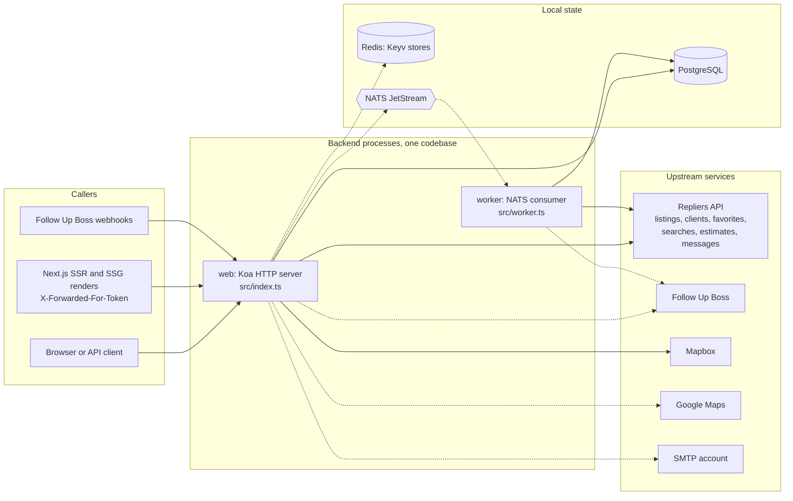

# Architecture Overview

This page answers what the backend is made of: which processes it runs, what each one talks to, which of those dependencies are required, how dependency injection hands out objects, and where a new feature plugs in. Each topic links to the page that goes deeper.

Next: [Request Lifecycle](/architecture/request-lifecycle) · [Repliers Proxy](/architecture/repliers-proxy) · [Data Ownership](/architecture/data-ownership)

## Component map

Solid arrows are dependencies that no setting switches off (a request still reaches them only when its route needs them). Dashed arrows are dependencies that a setting turns off or selects; the settings and fallbacks are listed in [Required and optional dependencies](#required-and-optional-dependencies). The Next.js SSR and SSG renders are shown as a client role: the backend tells them apart from other callers by the `X-Forwarded-For-Token` header, not by where they run.



Evidence: the entry points are `src/index.ts` and `src/worker.ts`; callers are told apart by `XFFProvider` (`src/lib/xffprovider.ts`); the clients are the services in `src/services/` (`repliers/*`, `boss.ts`, `boss/*`, `mapbox.ts`, `google.ts`, `smtp.ts`) and the providers `db`, `keyv.*` and `nats` in `src/providers/`. The worker's only stream handler is `src/streams/boss/people.ts`. It builds on `SyncService` (`src/services/sync.ts`), which injects `SyncRepository` and `PeopleSyncRepository` (PostgreSQL) and calls `RepliersClients.filter`, `.create` and `.update`, and on `BossWebhooksService` (`src/services/boss/webhook.ts`), which injects `WebhooksRepository`, `RepliersClients` and `RepliersAgents`. Both go through `BossService` for Follow Up Boss. `web --> google` is dashed because `AutosuggestService` calls Google only when `config.repliers.autosuggest.provider` is `googlemaps`.

## Processes

The `Procfile` defines three commands. The first two start long-running processes from the same build:

| Process   | Command                   | Entry point     | Role                                                                                                                                                                                                                                                                                           |
| --------- | ------------------------- | --------------- | ---------------------------------------------------------------------------------------------------------------------------------------------------------------------------------------------------------------------------------------------------------------------------------------------- |
| `web`     | `node dist/index.js`      | `src/index.ts`  | Koa app from `src/app.ts` listening on `config.app.port`. After it starts listening it calls `BossWebhooksService.installHooks()`; on `SIGINT` and `SIGTERM` it calls `uninstallHooks()` and then exits                                                                                        |
| `worker`  | `node dist/worker.js`     | `src/worker.ts` | Resolves the `nats` provider (with `p-retry` around one cached connection promise, see [Process lifecycle](/architecture/process-lifecycle#what-stops-a-step)), then consumes the stream named by `NATS_WORKER_CONSUMER_STREAM` in a loop and hands each message to that stream's worker class |
| `release` | `npm run db:migrate:prod` | none            | Runs the migrations; a command, not a long-running process                                                                                                                                                                                                                                     |

Startup order, what stops each process and signal handling: [Process lifecycle](/architecture/process-lifecycle).

Both entry points import `src/providers/index.ts` first, so they share the same container registrations and the same configuration code.

## Required and optional dependencies

| Dependency           | Required                                           | What decides it                                                                            | Without it                                                                                                                                                                                                                                                                                                                                                                                                                                         | Source                                                                                                                           |
| -------------------- | -------------------------------------------------- | ------------------------------------------------------------------------------------------ | -------------------------------------------------------------------------------------------------------------------------------------------------------------------------------------------------------------------------------------------------------------------------------------------------------------------------------------------------------------------------------------------------------------------------------------------------- | -------------------------------------------------------------------------------------------------------------------------------- |
| Repliers API         | Required                                           | `REPLIERS_API_KEY`                                                                         | Config load fails an `assert`                                                                                                                                                                                                                                                                                                                                                                                                                      | `src/config.ts` (`config.repliers.api_key`)                                                                                      |
| Mapbox               | Required                                           | `MAPBOX_ACCESS_TOKEN`                                                                      | Config load fails an `assert`                                                                                                                                                                                                                                                                                                                                                                                                                      | `src/config.ts` (`config.mapbox.access_token`)                                                                                   |
| JWT key pair         | Required                                           | `JWT_PRIVATE_KEY`, `JWT_PUBLIC_KEY`                                                        | Config load fails an `assert`                                                                                                                                                                                                                                                                                                                                                                                                                      | `src/config.ts` (`config.auth.jwt`)                                                                                              |
| PostgreSQL           | Not checked at startup                             | `DATABASE_URL` or `DB_*`                                                                   | Nothing asserts a connection when the process starts; the `db` provider only builds a Knex instance. A route or worker handler whose repository queries the database fails when it runs. `APP_DISABLE_PERSISTENCE` is read only in `AuthService.generateToken`, which then skips the ACL lookup, and in the `db:migrate:prod` script, which then skips migrations; the `defaults` settings file sets it to true. Other repositories do not read it | `src/providers/db.ts`, `src/services/auth.ts`, `src/settings/defaults.ts`, `package.json`                                        |
| Redis (Keyv)         | Optional                                           | `REDIS_KEYV_ENABLE`                                                                        | The Keyv stores are created without `KeyvRedis`, so they are in-memory                                                                                                                                                                                                                                                                                                                                                                             | `src/providers/keyv.otp.ts`, `src/providers/keyv.blocklist.ts`, `CacheFactory` in `src/lib/decorators/cached.ts` (result caches) |
| NATS                 | Optional                                           | `NATS_ENABLED`                                                                             | The `nats` provider returns `DummyNats`; the worker logs a warning instead of consuming                                                                                                                                                                                                                                                                                                                                                            | `src/providers/nats.ts`, `src/worker.ts`                                                                                         |
| Follow Up Boss       | Optional                                           | `BOSS_ENABLED` (enabled unless set to `false`)                                             | `BossService` is disabled and the events-collection middleware is replaced by an empty one                                                                                                                                                                                                                                                                                                                                                         | `src/config.ts`, `src/services/boss.ts`, `src/providers/middleware/eventsCollection.ts`                                          |
| SMTP account         | Optional                                           | `SMTP_ENABLED`                                                                             | `SmtpService` does not create its transport                                                                                                                                                                                                                                                                                                                                                                                                        | `src/services/smtp.ts`                                                                                                           |
| Google Maps          | Optional                                           | `GOOGLE_MAPS_API_KEY`, selected by `config.repliers.autosuggest.provider === "googlemaps"` | `AutosuggestService` does not call `GoogleService`                                                                                                                                                                                                                                                                                                                                                                                                 | `src/services/autosuggest.ts`, `src/services/google.ts`                                                                          |
| `GOOGLE_CREDENTIALS` | Required when `APP_ENVIRONMENT` is not `localhost` | Environment variable                                                                       | Config load fails an `assert`. Nothing else in `src/` reads the variable, so this page does not state what it is used for                                                                                                                                                                                                                                                                                                                          | `src/config.ts`                                                                                                                  |

For how settings are resolved see [Configuration](/getting-started/configuration). Cache behaviour is in [Caching](/architecture/caching), local tables in [Persistence](/architecture/persistence), and who owns each identifier in [Data Ownership](/architecture/data-ownership#ownership-map).

## Layers

A request travels through fixed layers, each with one job:

```
routes/      → HTTP wiring: one Router per feature, mounted under /api
validate/    → Joi schemas: one file per feature, raw body → DTO
services/    → business logic; services/repliers/* is the upstream client family
providers/   → DI registrations: middleware, db, cache, loggers, NATS, OAuth
repository/  → knex query modules for portal-owned tables
settings/    → per-deployment presets merged into AppConfig at startup
streams/     → NATS stream workers (background processing)
```

Supporting directories: `lib/` (errors, decorators, middleware internals, utilities), `types/`, `migrations/`.

## Dependency injection

tsyringe with constructor injection. Services are `@injectable()`; named tokens exist for infrastructure: `@inject("config")`, `@inject("logger")`, `@inject("db")`. Other services resolve automatically by class reference.

`src/lib/middleware/container.ts` (registered as `middleware.container` in `src/app.ts`) calls `container.createChildContainer()` for each request and stores the result in `ctx.state.container`. A child container does not make anything per-request by itself; the lifetime comes from how each token or class is registered in `ContainerRegistry` (`src/providers/index.ts`):

| Registration kind                          | Examples                                                                                                                                                                                                     | Lifetime                                                                                                                                                       |
| ------------------------------------------ | ------------------------------------------------------------------------------------------------------------------------------------------------------------------------------------------------------------ | -------------------------------------------------------------------------------------------------------------------------------------------------------------- |
| `useValue`                                 | `config`, `data.communities`, `throttler:ondelay`                                                                                                                                                            | The same object on every resolve                                                                                                                               |
| `instanceCachingFactory`                   | `db`, `nats`, `keyv.otp`, `keyv.blocklist`, `oauth.google`, `throttler:repliers`, `throttler:repliers:warmup`, `async_local_store`, `logger.global`, every `middleware.*` token, the default `XForwardedFor` | The factory runs once and every container in the process, child containers included, gets the same result. `nats` caches the promise its async factory returns |
| Plain `useFactory`                         | `logger`                                                                                                                                                                                                     | Runs on every resolve: returns the request's child logger from `async_local_store`, or `logger.global` outside a request                                       |
| Registered on the child container          | `XForwardedFor`                                                                                                                                                                                              | `XFFProvider.getMiddleware()` registers a factory on each request's container; it builds a new `XFFProvider(ctx)` on every resolve of that token               |
| `@injectable()` class with no registration | Every service and repository                                                                                                                                                                                 | A new instance on every `resolve` call, and a new instance of each class it depends on                                                                         |

`src/` registers no `@singleton()` class and calls no `registerSingleton`, so no registration shares a service instance between calls. Resolving the same service twice in one request gives two instances. Four route call sites resolve from the root container instead of `ctx.state.container`. `src/routes/user/assets.ts` (`AssetsService`), `src/routes/user/social.ts` (`SocialService`) and `src/routes/vtour.ts` (`VtourService`) call `container.resolve` once at module load, so one instance serves every request. `src/routes/user/boss.ts` resolves `BossService` from the root container inside its handler, so each request gets a new instance that does not come from its child container. See [Module catalogue: Gotchas](/architecture/modules#gotchas).

Startup work therefore does not belong in a service constructor, which runs on every resolve. It belongs in `src/config.ts`, `src/lib/settings.ts`, or a provider that uses `instanceCachingFactory`.

## Entry points

| File            | Process       | Notes                                                                            |
| --------------- | ------------- | -------------------------------------------------------------------------------- |
| `src/index.ts`  | HTTP server   | Koa app from `src/app.ts`                                                        |
| `src/worker.ts` | NATS consumer | Separate process; with `NATS_ENABLED` off it logs a warning instead of consuming |

## Adding a feature — the shape of the change

1. `src/validate/<feature>.ts` — Joi schema(s).
2. `src/services/<feature>.ts` — `@injectable()` service.
3. `src/routes/<feature>.ts` — `new Router({ prefix: "/<feature>" })` + handlers.
4. One `router.use(...)` line in `src/routes/index.ts`.
5. If it talks to Repliers: a method in the matching `services/repliers/*` client.
6. If it stores data: a migration + a `repository/` module.

## Gotchas

1. **A child container is not a request scope.** Two `ctx.state.container.resolve(MyService)` calls in one request return two instances (`src/lib/middleware/container.ts`; no `@singleton` in `src/`).
2. **`nats` resolves to a promise.** Its factory is async, so callers resolve `"nats"` and await the result (`src/providers/nats.ts`, `src/worker.ts`).
3. **Missing required settings stop the process at import.** The `assert` calls sit at module level in `src/config.ts` (for example `assert(config.repliers.api_key, ...)`), so the failure happens before any request.
4. **The worker loop is guarded by `config.nats.enabled`.** With NATS off the `while (true)` loop in `src/worker.ts` is skipped and the file ends with the warning.

Verified against portal-backend `997ae3e`, 2026-10-20.
