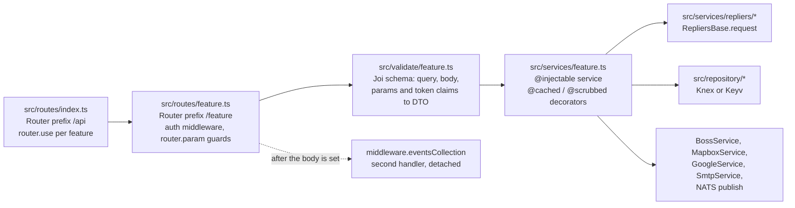
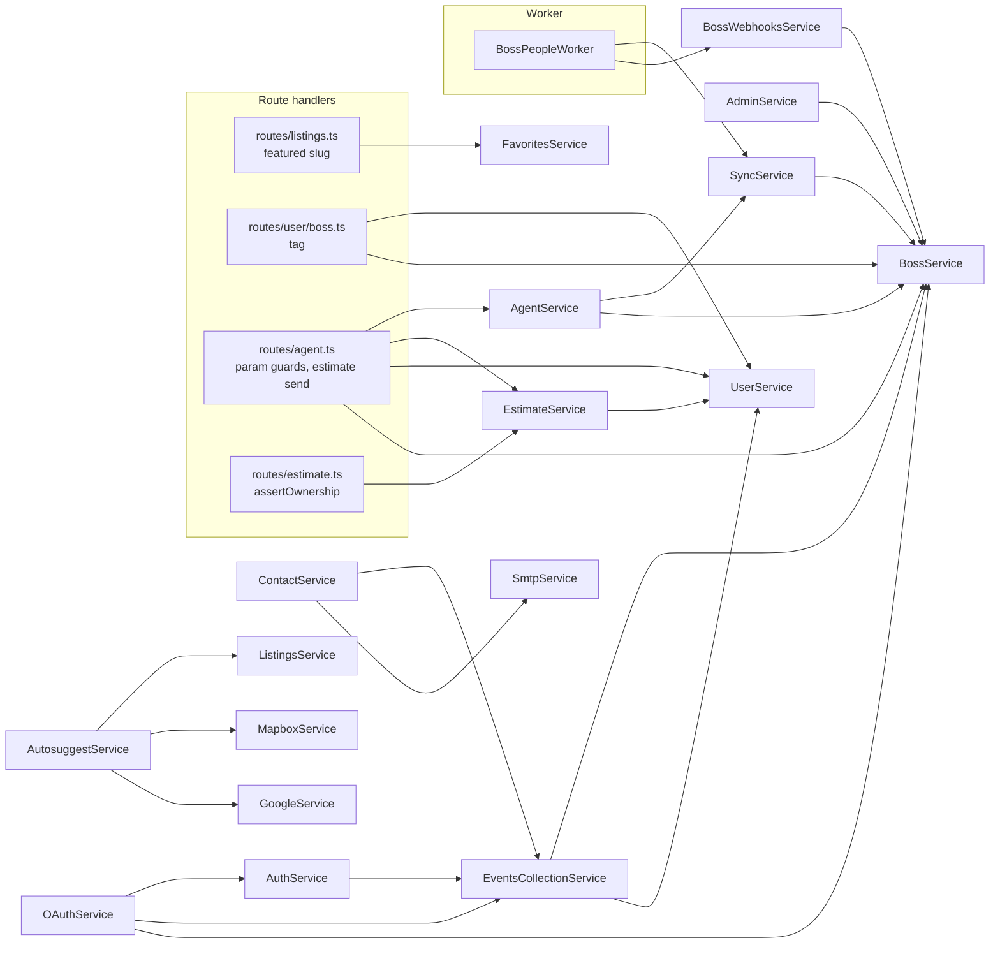

import { Callout } from 'nextra/components'

# Module catalogue

Every HTTP endpoint the backend serves and every worker entry, with the code that handles it: which middleware guards it, which Joi schema validates it, which service method does the work, which upstream client or repository that method calls, where the data lives, and which settings change the behaviour. Use it to answer "where does this path live and what does it touch?" before opening a route file. Terms are defined in the [Glossary](/glossary).

[Architecture overview](/architecture) | [Request lifecycle](/architecture/request-lifecycle) | [Data ownership](/architecture/data-ownership) | [Authentication](/architecture/authentication) | [API reference](/api-reference)

## How a module is wired

- **Mount.** `src/routes/index.ts` creates the `/api` router and mounts fifteen feature routers with `router.use(x.routes(), x.allowedMethods())`. `/user` mounts three sub-routers (`user/assets.ts`, `user/social.ts`, `user/boss.ts`); `/webhooks` mounts `webhooks/boss.ts`. The app mounts the `/api` router after the global middleware chain in `src/app.ts` (see [Request lifecycle](/architecture/request-lifecycle)).
- **Handler.** A handler builds a payload from `ctx.request.query`, the body (`getBody`), path parameters and token claims (`ctx.state.user.sub`, `.email`), validates it with one schema, resolves the service with `ctx.state.container.resolve(Service)` and assigns the result to `ctx.body`, or passes a `@cached` result to `sendCached`, which unwraps it and sets `Cache-Control`. Validation failures throw `ApiError(message, 400)`.
- **Auth.** Auth is middleware on the route, or on the whole router through `router.use`. The legend below names the tokens. Ownership checks sit in three places: route middleware or `router.param` guards, validator rules, and service methods.
- **Service.** Services reach Repliers through the `RepliersService` facade (`src/services/repliers.ts`, one property per client class) or by injecting a client class such as `RepliersClients` directly. Local tables go through `src/repository/*` (Knex), and short-lived state through Keyv stores. See [Data ownership](/architecture/data-ownership#ownership-map).
- **Second handler.** Routes that report engagement register a second handler that resolves `middleware.eventsCollection` with a selector. The first handler calls `next()` after setting the body, and the report is not awaited. See [Events & Messaging](/architecture/events-and-messaging).

**Auth legend.** **strict**: `middleware.jwt` (401 without a valid, unrevoked token). **passthrough**: `middleware.jwt.passthrough` (no token means [guest](/glossary#guest); an invalid token gets 401). **none**: no JWT middleware on the route or router. **roles**: `middleware.role([...])`, 403 `Insufficient privileges` otherwise. **FUB signature**: `middleware.boss.webhook.auth`. Both JWT tokens check the [`jti`](/glossary#jti) against the Keyv `blocklist` store (`middleware.jwt.config`, `isRevoked`). The roles, ownership check and guest behaviour of every endpoint are in the [endpoint access register](/architecture/authentication#endpoint-access).

**Store legend.** _Repliers X_ is an upstream record type. _Keyv `ns`_ is a cache namespace from `@cached` (`src/lib/decorators/cached.ts`) or a provider store; its TTL variable is in parentheses. _PG `table`_ is a local PostgreSQL table. _NATS_ is a JetStream publish on the stream `NATS_WORKER_CONSUMER_STREAM`. _FUB_ is the Follow Up Boss API through `BossService`, which returns `{}` without calling out when `BOSS_ENABLED=false`.

## Modules register

### `/api/auth`

Source: `src/routes/auth.ts`; validators `src/validate/auth.ts`, `src/validate/oauth.ts`; services `AuthService` (`src/services/auth.ts`), `OAuthService` (`src/services/oauth.ts`). `router.param("provider")` validates the provider with `oauthUrlSchema` (400) before every `{provider}` route. No route on this router uses role middleware.

| Endpoint                        | Auth / roles                                             | Validator                                                                      | Service                                                   | Upstream client / repository                                                                                                                           | Store                                                                             | Conditions                                                                                                                                    | Deep dive                                      |
| ------------------------------- | -------------------------------------------------------- | ------------------------------------------------------------------------------ | --------------------------------------------------------- | ------------------------------------------------------------------------------------------------------------------------------------------------------ | --------------------------------------------------------------------------------- | --------------------------------------------------------------------------------------------------------------------------------------------- | ---------------------------------------------- |
| `GET /api/auth/{provider}/url`  | none                                                     | `oauthUrlSchema`, `providerUrlSchema` (query)                                  | `OAuthService.url`                                        | OIDC config `oauth.<provider>`, `buildAuthorizationUrl`                                                                                                | none                                                                              | `redirect_uri` from the query, else the first configured one; 400 when neither. Only `oauth.google` is registered in `src/providers/index.ts` | [Auth](/api-reference/auth)                    |
| `POST /api/auth/{provider}/cb`  | none                                                     | `oauthUrlSchema`, `providerCallbackSchema` (body), `providerUrlSchema` (query) | `OAuthService.callback`, then `AuthService.generateToken` | Provider token exchange; `RepliersClients.filter` / `create`, `RepliersAgents.filter`; `BossService.getUsers` for an agent; `AclRepository.getUserAcl` | Repliers clients; PG `acl` (read)                                                 | An email with no client and no agent creates a client and reports a registration event                                                        | [Authentication](/architecture/authentication) |
| `POST /api/auth/login`          | none                                                     | `userLoginSchema`                                                              | `AuthService.login`, `sendOtp`                            | `RepliersClients.filter` (email or phone, `OR`), `RepliersClients.update` (mailing opt-in), `RepliersMessages.send`                                    | Keyv `otp`: code (`AUTH_OTP_TTL_MS`) and resend marker (`AUTH_OTP_RESEND_TTL_MS`) | 404 when no client matches; 403 with `Retry-After` inside the resend window; the code is in the body only with `DEBUG_AUTH_OTP_EXPOSE_CODE`   | [Auth](/api-reference/auth)                    |
| `POST /api/auth/otp`            | none                                                     | `userOtpSchema`                                                                | `AuthService.useOtp`                                      | `RepliersClients.get`, `AclRepository.getUserAcl`                                                                                                      | Keyv `otp` (read, then deleted)                                                   | 403 for an unknown or used code; `sub` = [`clientId`](/glossary#clientid)                                                                     | [Authentication](/architecture/authentication) |
| `POST /api/auth/refresh`        | strict                                                   | none                                                                           | `AuthService.refresh`                                     | `BlocklistRepository.create`, `AclRepository.getUserAcl`                                                                                               | Keyv `blocklist` (old `jti`)                                                      | The new token gets the old token's `exp - iat` span                                                                                           | [Authentication](/architecture/authentication) |
| `POST /api/auth/logout`         | strict                                                   | none                                                                           | `AuthService.logout`                                      | `BlocklistRepository.create`                                                                                                                           | Keyv `blocklist`                                                                  | none                                                                                                                                          | [Authentication](/architecture/authentication) |
| `POST /api/auth/signup`         | none                                                     | `userSignupSchema` (body plus `referer` header)                                | `AuthService.signup`, then `login`                        | `RepliersClients.create` (default agent), `RepliersMessages.send`                                                                                      | Repliers clients; Keyv `otp`                                                      | Registration event, not awaited                                                                                                               | [Auth](/api-reference/auth)                    |
| `POST /api/auth/repliers-token` | none                                                     | `authRepliersTokenSchema`                                                      | `AuthService.useRepliersToken`                            | `RepliersMessages.get` (by token), `RepliersClients.get`                                                                                               | none                                                                              | 400 unless `AUTH_EMAILTOKEN_ENABLED=true`; 403 for an unknown token                                                                           | [Auth](/api-reference/auth)                    |
| `POST /api/auth/embed`          | none; the service checks the FUB context signature (401) | `authEmbedSchema`                                                              | `AuthService.embedLogin`                                  | `isFromFollowUpBoss` with `BOSS_SYSTEM_KEY`; `AclRepository.getUserAcl`                                                                                | none                                                                              | Issues a token with role Agent and no `sub`, plus a `clientSignature` for the CRM person                                                      | [Follow Up Boss](/integrations/follow-up-boss) |

### `/api/listings`

Source: `src/routes/listings.ts`; validators `src/validate/listings.ts`; services `ListingsService` (`src/services/listings.ts`), `FavoritesService` (`src/services/favorites.ts`); client `RepliersListings` (`src/services/repliers/listings.ts`). Every route uses passthrough auth. `RepliersListings.search` always forces `displayInternetEntireListing=Y`, constrains `standardStatus` to `settings.allowedListingsStandardStatuses`, excludes restricted listings and applies the MLS-number prefix codec.

| Endpoint                                | Auth / roles | Validator                                                                                                                              | Service                                                                         | Upstream client / repository                                      | Store                                                                                                   | Conditions                                                                                                                                                                                      | Deep dive                                                                         |
| --------------------------------------- | ------------ | -------------------------------------------------------------------------------------------------------------------------------------- | ------------------------------------------------------------------------------- | ----------------------------------------------------------------- | ------------------------------------------------------------------------------------------------------- | ----------------------------------------------------------------------------------------------------------------------------------------------------------------------------------------------- | --------------------------------------------------------------------------------- |
| `POST /api/listings/search`             | passthrough  | `listingSearchSchema` (query, body, `app_state.user`)                                                                                  | `ListingsService.search` (`@scrubbed("listings")`)                              | `RepliersListings.search`, POST                                   | Repliers listings                                                                                       | Identity fields added to `fields` and `clusterFields`                                                                                                                                           | [Listings](/api-reference/listings), [Scrubbing](/architecture/scrubbing)         |
| `GET /api/listings/search`              | passthrough  | `listingSearchSchema` (query, `app_state.user`)                                                                                        | `ListingsService.search` (`@scrubbed("listings")`)                              | `RepliersListings.search`, POST as well                           | Repliers listings                                                                                       | Same service call as the POST route                                                                                                                                                             | [Listings](/api-reference/listings)                                               |
| `GET /api/listings/count`               | passthrough  | `listingCountSchema`                                                                                                                   | `ListingsService.count`                                                         | `RepliersListings.search` (`fields=timestamps.repliersUpdatedOn`) | Keyv `listings:count` (`CACHE_LISTINGS_COUNT_TTL`)                                                      | Returns `count` and `lastUpdatedOn`                                                                                                                                                             | [Listings](/api-reference/listings)                                               |
| `POST /api/listings/count`              | passthrough  | `listingCountArraySchema` (array body)                                                                                                 | `ListingsService.countArray`, `count` per item                                  | `RepliersListings.search` per item, in parallel                   | Keyv `listings:count` per item                                                                          | No `Cache-Control` header                                                                                                                                                                       | [Listings](/api-reference/listings)                                               |
| `GET /api/listings/{mlsNumber}/similar` | passthrough  | `listingSimilarSchema`                                                                                                                 | `ListingsService.similar` (`@scrubbed("similar")`)                              | `RepliersListings.similar`                                        | none                                                                                                    | Restricted listings dropped (`dropRestricted`)                                                                                                                                                  | [Scrubbing](/architecture/scrubbing)                                              |
| `GET /api/listings/locations`           | passthrough  | `listingsLocationsSchema` (class forced to residential and condo; `dropCoordinates` defaults to `settings.locations.drop_coordinates`) | `ListingsService.locations`                                                     | `RepliersListings.locations`                                      | Keyv `listings:autosuggest:locations` (`CACHE_STATSWIDGET_TTL`)                                         | Deprecated in favour of the `/locations` router (`@deprecated` JSDoc). Keeps only `settings.locations.boardId` and the allowed areas, merges condo areas into residential                       | [Search & Locations](/api-reference/search-and-locations)                         |
| `POST /api/listings/nlp`                | passthrough  | `nlpSchema`                                                                                                                            | `ListingsService.nlp`, then `search` when `statistics` or `aggregates` is asked | `RepliersListings.nlp` (`nlpVersion` from `settings.nlp.version`) | none                                                                                                    | The NLP result is not decorated; the follow-up search is scrubbed                                                                                                                               | [Listings](/api-reference/listings)                                               |
| `GET /api/listings/lastUpdatedOn`       | passthrough  | none                                                                                                                                   | `ListingsService.lastUpdatedOn`                                                 | None: computed in the method, no upstream call                    | Keyv `listings:lastUpdatedOn` (`CACHE_LISTINGS_LAST_UPDATED_ON_TTL`)                                    | **Not in OSS**                                                                                                                                                                                  | [Listings](/api-reference/listings)                                               |
| `GET /api/listings/featured/{slug}`     | passthrough  | `listingsFeaturedSchema` (`stripUnknown`)                                                                                              | `FavoritesService.featuredListings` (`@scrubbed("listings")`)                   | `RepliersFavorites.get` for the client mapped to the slug         | Keyv `favorites:featuredListings` (`CACHE_FEATURED_LISTINGS_TTL`), skipped when `lat` or `long` is sent | 404 when the slug is not in `SETTINGS_FEATURED_LISTINGS`                                                                                                                                        | [Listings](/api-reference/listings)                                               |
| `GET /api/listings/history`             | passthrough  | `listingsHistorySchema`                                                                                                                | `ListingsService.history` (`@scrubbed("history")`)                              | `RepliersListings.history`                                        | none                                                                                                    | Drops entries without a numeric `boardId`, with `displayInternetEntireListing=N`, or restricted                                                                                                 | [Scrubbing](/architecture/scrubbing)                                              |
| `GET /api/listings/{mlsNumber}`         | passthrough  | `listingsSingleSchema`                                                                                                                 | `ListingsService.single` (`@scrubbed()`)                                        | `RepliersListings.single`                                         | none                                                                                                    | Restricted, `displayInternetEntireListing=N` or hidden status: error with `APP_HIDE_UNAVAILABLE_LISTINGS_HTTP_CODE`. View event (`SelectViewPropertyParams`) for signed-in callers except Agent | [Listings](/api-reference/listings), [Events](/architecture/events-and-messaging) |

### `/api/autosuggest`

Source: `src/routes/autosuggest.ts`; validators `src/validate/autosuggest.ts`; service `AutosuggestService` (`src/services/autosuggest.ts`).

| Endpoint                         | Auth / roles | Validator                                            | Service                      | Upstream client / repository                                                                                                                                                                                                       | Store                                                           | Conditions                                                                                                 | Deep dive                                                                                       |
| -------------------------------- | ------------ | ---------------------------------------------------- | ---------------------------- | ---------------------------------------------------------------------------------------------------------------------------------------------------------------------------------------------------------------------------------- | --------------------------------------------------------------- | ---------------------------------------------------------------------------------------------------------- | ----------------------------------------------------------------------------------------------- |
| `GET /api/autosuggest`           | passthrough  | `autosuggestSchema`                                  | `AutosuggestService.search`  | In parallel: `MapboxService.suggest`, `ListingsService.search` (scrubbed), `RepliersLocations.autocomplete`; plus an MLS-number-only `ListingsService.search` when `mlsNumberPrefix` is set and the query looks like an MLS number | Repliers listings and locations                                 | Mapbox duplicates filtered by Jaro-Winkler distance; listing statuses from `repliers.autosuggest` settings | [Search & Locations](/api-reference/search-and-locations), [Geocoding](/integrations/geocoding) |
| `GET /api/autosuggest/locations` | none         | none (all parameters come from `settings.locations`) | `ListingsService.locations`  | `RepliersListings.locations`                                                                                                                                                                                                       | Keyv `listings:autosuggest:locations` (`CACHE_STATSWIDGET_TTL`) | **Deprecated** (`deprecated: true` in its `@openapi` block)                                                | [Search & Locations](/api-reference/search-and-locations)                                       |
| `GET /api/autosuggest/address`   | none         | `autosuggestAddressSchema`                           | `AutosuggestService.address` | `MapboxService.suggest` (types `address`), or `GoogleService.autocomplete` when `REPLIERS_AUTOSUGGEST_PROVIDER=googlemaps`                                                                                                         | none                                                            | Mapbox results filtered by `max_distance`                                                                  | [Geocoding](/integrations/geocoding)                                                            |

### `/api/favorites`

Source: `src/routes/favorites.ts`; validators `src/validate/favorites.ts`; service `FavoritesService` (`src/services/favorites.ts`); client `RepliersFavorites`. `clientId` comes from the token's [`sub`](/glossary#jwt-sub).

| Endpoint                             | Auth / roles                                                                   | Validator               | Service                   | Upstream client / repository           | Store                                                                               | Conditions                                       | Deep dive                                                             |
| ------------------------------------ | ------------------------------------------------------------------------------ | ----------------------- | ------------------------- | -------------------------------------- | ----------------------------------------------------------------------------------- | ------------------------------------------------ | --------------------------------------------------------------------- |
| `POST /api/favorites`                | strict                                                                         | `favoritesCreateSchema` | `FavoritesService.add`    | `RepliersFavorites.add`                | Repliers favorites; clears the `favorites:featuredListings` keys of a mapped client | Save-property event (`SelectSavePropertyParams`) | [User & Favorites](/api-reference/user-and-favorites)                 |
| `GET /api/favorites`                 | strict                                                                         | `favoritesGetSchema`    | `FavoritesService.get`    | `RepliersFavorites.get`                | Repliers favorites                                                                  | Restricted listings dropped                      | [User & Favorites](/api-reference/user-and-favorites)                 |
| `DELETE /api/favorites/{favoriteId}` | strict; ownership in the service (400 when the id is not in the caller's list) | `favoritesDeleteSchema` | `FavoritesService.delete` | `RepliersFavorites.get`, then `delete` | Repliers favorites; clears the featured cache of a mapped client                    | Ownership read from the unfiltered list          | [Data ownership](/architecture/data-ownership#identity-and-ownership) |

### `/api/contact`

Source: `src/routes/contact.ts`; validators `src/validate/contact.ts`; service `ContactService` (`src/services/contact.ts`). All routes use passthrough auth; `clientId` is `maybeClientId(sub)`, or the `REPLIERS_UNAUTHENTICATED_CLIENT_ID` client for guests. The `contactus`, `schedule`, `requestinfo` and `subscribe/newsletter` routes report an event for guests too (`allowIncognito: true`).

| Endpoint                                 | Auth / roles | Validator                                                                             | Service                           | Upstream client / repository                                                                                                                                                               | Store | Conditions                                         | Deep dive                                                                                |
| ---------------------------------------- | ------------ | ------------------------------------------------------------------------------------- | --------------------------------- | ------------------------------------------------------------------------------------------------------------------------------------------------------------------------------------------ | ----- | -------------------------------------------------- | ---------------------------------------------------------------------------------------- |
| `POST /api/contact/contactus`            | passthrough  | `contactSchema`, replaceable per deployment (see [Export variants](#export-variants)) | `ContactService.contactUs`        | `SmtpService.send` when `SMTP_ENABLED=true` and `REPLIERS_AGENT_EMAIL` is set, else `RepliersMessages.send`; `RepliersClients.get` for a signed-in caller's agent                          | none  | Body `OK`; event `SelectContactUsParams`           | [Contact, Stats & Tours](/api-reference/contact-and-stats), [Email](/integrations/email) |
| `POST /api/contact/schedule`             | passthrough  | `scheduleSchema`                                                                      | `ContactService.schedule`         | As for `contactus`                                                                                                                                                                         | none  | Body `OK`; event `SelectScheduleParams`            | [Contact, Stats & Tours](/api-reference/contact-and-stats)                               |
| `POST /api/contact/schedule/estimate`    | passthrough  | `scheduleEstimateSchema`                                                              | `ContactService.scheduleEstimate` | `RepliersEstimate.get`, `RepliersMessages.send` (never SMTP), `RepliersClients.get`, `RepliersAgents.get`; `EventsCollectionService.noteCreate` and `eventsCreate` from inside the service | none  | 404 for an unknown estimate; body `OK`             | [Events](/architecture/events-and-messaging)                                             |
| `POST /api/contact/requestinfo`          | passthrough  | `requestInfoSchema`, replaceable per deployment                                       | `ContactService.requestInfo`      | As for `contactus`                                                                                                                                                                         | none  | Body `OK`; event `SelectRequestInfoParams`         | [Contact, Stats & Tours](/api-reference/contact-and-stats)                               |
| `POST /api/contact/subscribe/newsletter` | passthrough  | `subscribeNewsletterSchema`                                                           | None: the route only validates    | FUB through the event middleware                                                                                                                                                           | FUB   | Body `OK`; event `SelectSubscribeNewsletterParams` | [Follow Up Boss](/integrations/follow-up-boss)                                           |

### `/api/searches`

Source: `src/routes/searches.ts`; validators `src/validate/searches.ts`; service `SearchesService` (`src/services/searches.ts`); client `RepliersSearches`.

| Endpoint                          | Auth / roles                           | Validator                                   | Service                  | Upstream client / repository                          | Store             | Conditions                                       | Deep dive                                                             |
| --------------------------------- | -------------------------------------- | ------------------------------------------- | ------------------------ | ----------------------------------------------------- | ----------------- | ------------------------------------------------ | --------------------------------------------------------------------- |
| `POST /api/searches`              | strict                                 | `searchesCreateSchema` (`clientId` = `sub`) | `SearchesService.create` | `RepliersSearches.create`                             | Repliers searches | Save-search event (`SelectSaveSearchParams`)     | [User & Favorites](/api-reference/user-and-favorites)                 |
| `PATCH /api/searches/{searchId}`  | strict                                 | `searchesUpdateSchema`                      | `SearchesService.update` | `RepliersSearches.update`                             | Repliers searches | none                                             | [Data ownership](/architecture/data-ownership#identity-and-ownership) |
| `GET /api/searches`               | strict                                 | `searchsFilterSchema`                       | `SearchesService.getAll` | `RepliersSearches.filter` (`clientId`, default agent) | Repliers searches | none                                             | [User & Favorites](/api-reference/user-and-favorites)                 |
| `DELETE /api/searches/{searchId}` | strict; ownership in the service (400) | `searchesDeleteSchema`                      | `SearchesService.delete` | `RepliersSearches.filter`, then `delete`              | Repliers searches | none                                             | [Data ownership](/architecture/data-ownership#identity-and-ownership) |
| `GET /api/searches/{searchId}`    | passthrough                            | `searchesGetSchema`                         | `SearchesService.getOne` | `RepliersSearches.get`                                | Repliers searches | `client` and `agentId` removed from the response | [User & Favorites](/api-reference/user-and-favorites)                 |

### `/api/user`

Source: `src/routes/user.ts` and its sub-routers `src/routes/user/assets.ts`, `user/social.ts`, `user/boss.ts`; validators `src/validate/user.ts`, `src/validate/user/*.ts`; services `UserService` (`src/services/user.ts`), `AssetsService` (`src/services/user/assets.ts`), `SocialService` (`src/services/user/social.ts`), `BossService` (`src/services/boss.ts`). Assets and social rows are keyed by the token's `email`.

| Endpoint                                  | Auth / roles | Validator                                          | Service                                                                                 | Upstream client / repository                                                                 | Store            | Conditions                                                                                          | Deep dive                                             |
| ----------------------------------------- | ------------ | -------------------------------------------------- | --------------------------------------------------------------------------------------- | -------------------------------------------------------------------------------------------- | ---------------- | --------------------------------------------------------------------------------------------------- | ----------------------------------------------------- |
| `PATCH /api/user`                         | strict       | `userUpdateSchema` (`clientId` = `sub`)            | `UserService.update`                                                                    | `RepliersClients.update`                                                                     | Repliers clients | Event `SelectUnsubscribedParams`, signed-in only                                                    | [User & Favorites](/api-reference/user-and-favorites) |
| `GET /api/user/me`                        | strict       | none                                               | `UserService.info`                                                                      | `RepliersClients.get`                                                                        | Repliers clients | Adds `communities` split from `tags`                                                                | [User & Favorites](/api-reference/user-and-favorites) |
| `GET /api/user/agent`                     | passthrough  | none                                               | `UserService.agent`                                                                     | `RepliersClients.get`, then `RepliersAgents.get`; for a guest, the `REPLIERS_AGENT_ID` agent | Repliers agents  | Returns `email`, `phone`, `fname`, `lname`, `avatar`, picked with `_.pick`                          | [User & Favorites](/api-reference/user-and-favorites) |
| `POST /api/user/assets/{type}`            | strict       | `userAssetsCreateSchema`                           | `AssetsService.create`                                                                  | `AssetsRepository.createAsset`                                                               | PG `assets`      | 201; 409 for an existing id                                                                         | [Persistence](/architecture/persistence)              |
| `GET /api/user/assets/{type}`             | strict       | `userAssetsGetSchema`                              | `AssetsService.get`                                                                     | `AssetsRepository.getAssets`                                                                 | PG `assets`      | none                                                                                                | [Persistence](/architecture/persistence)              |
| `POST /api/user/assets/{type}/remove`     | strict       | `userAssetsRemoveSchema`                           | `AssetsService.remove`                                                                  | `AssetsRepository.removeAsset`                                                               | PG `assets`      | none                                                                                                | [Persistence](/architecture/persistence)              |
| `GET /api/user/social/{provider}/url`     | strict       | `userSocialUrlSchema`                              | `SocialService.getUrl`                                                                  | `PinterestSocialProvider.getUrl` (the only `SocialProvider`)                                 | none             | none                                                                                                | [User & Favorites](/api-reference/user-and-favorites) |
| `GET /api/user/social/{provider}/cb`      | strict       | `userSocialCallbackSchema` (`code` from the query) | `SocialService.callback`                                                                | Provider token exchange; `SocialRepository.createTokens`                                     | PG `social`      | none                                                                                                | [Persistence](/architecture/persistence)              |
| `GET /api/user/social/{provider}/refresh` | strict       | `userSocialRefreshSchema`                          | `SocialService.refresh`                                                                 | `SocialRepository.getUserTokens`, provider refresh, `SocialRepository.updateAccessToken`     | PG `social`      | 400 without stored tokens                                                                           | [Persistence](/architecture/persistence)              |
| `GET /api/user/social/{provider}`         | strict       | `userSocialGetTokensSchema`                        | `SocialService.getTokens`                                                               | `SocialRepository.getUserTokens`                                                             | PG `social`      | The parameter is optional (path `/{:provider}`); without it, the caller's tokens for every provider | [User & Favorites](/api-reference/user-and-favorites) |
| `DELETE /api/user/social/{provider}`      | strict       | `userSocialUnlinkSchema`                           | `SocialService.unlinkAccount`                                                           | `SocialRepository.deleteTokens`                                                              | PG `social`      | none                                                                                                | [User & Favorites](/api-reference/user-and-favorites) |
| `POST /api/user/boss/tag`                 | strict       | `userBossTagSchema`                                | The route calls `UserService.info`, `BossService.getPeople`, `BossService.peopleUpdate` | `RepliersClients.get`; FUB person by the client's [`externalId`](/glossary#externalid)       | FUB people       | 404 without `externalId` or person; new tags merged with the existing ones; 201                     | [Follow Up Boss](/integrations/follow-up-boss)        |

### `/api/estimate`

Source: `src/routes/estimate.ts`; validators `src/validate/estimate.ts`; service `EstimateService` (`src/services/estimate.ts`); clients `RepliersEstimate`, `RepliersListings`. `assertOwnership` in the route file calls `EstimateService.checkOwnership` with role User: `sub` must equal the estimate's `clientId` (403).

| Endpoint                             | Auth / roles              | Validator                                                                                                                                                                                                                                     | Service                           | Upstream client / repository                                                                                                                                       | Store              | Conditions                                                                                                                                                                                                                                                                     | Deep dive                            |
| ------------------------------------ | ------------------------- | --------------------------------------------------------------------------------------------------------------------------------------------------------------------------------------------------------------------------------------------- | --------------------------------- | ------------------------------------------------------------------------------------------------------------------------------------------------------------------ | ------------------ | ------------------------------------------------------------------------------------------------------------------------------------------------------------------------------------------------------------------------------------------------------------------------------ | ------------------------------------ |
| `POST /api/estimate`                 | passthrough               | `estimateAddSchema` (`clientId` = `maybeClientId(sub)`)                                                                                                                                                                                       | `EstimateService.add`             | `RepliersEstimate.add`                                                                                                                                             | Repliers estimates | With a `clientId`: `data`, `sendEmailNow`, `sendEmailMonthly` sent upstream (defaults from `repliers.estimatesNotificationSettings`). Without: `data` withheld upstream and applied locally. Event `SelectEstimateParams` and note `SelectEstimateNoteParams`, guests included | [Estimates](/api-reference/estimate) |
| `PATCH /api/estimate/{estimateId}`   | strict, `assertOwnership` | `estimatePatchSchema`                                                                                                                                                                                                                         | `EstimateService.patch`           | `RepliersEstimate.get` (check), `RepliersEstimate.patch`                                                                                                           | Repliers estimates | none                                                                                                                                                                                                                                                                           | [Estimates](/api-reference/estimate) |
| `GET /api/estimate`                  | passthrough               | `estimateGetSchema` (`estimateId` up to `SETTINGS_MAX_ESTIMATE_ID`, or a 26-character `ulid`; the `defaults` preset sets `max_estimate_id` to 0, so there a positive numeric `estimateId` gets 400, see [Estimates](/api-reference/estimate)) | `EstimateService.get`             | `RepliersEstimate.get`                                                                                                                                             | Repliers estimates | `clientId` removed before the upstream call; 404 when none; view event (`SelectViewEstimateParams`), signed-in only                                                                                                                                                            | [Estimates](/api-reference/estimate) |
| `GET /api/estimate/my`               | strict                    | `estimatesByClientIdGetSchema`                                                                                                                                                                                                                | `EstimateService.getByClientId`   | `RepliersEstimate.get` (`clientId`)                                                                                                                                | Repliers estimates | Owner adjustments applied to each                                                                                                                                                                                                                                              | [Estimates](/api-reference/estimate) |
| `DELETE /api/estimate/{estimateId}`  | strict, `assertOwnership` | `deleteEstimateSchema`                                                                                                                                                                                                                        | `EstimateService.delete`          | `RepliersEstimate.get` (check), `RepliersEstimate.delete`                                                                                                          | Repliers estimates | 404 when the upstream returns nothing                                                                                                                                                                                                                                          | [Estimates](/api-reference/estimate) |
| `GET /api/estimate/property_details` | passthrough               | `estimatePropertyDetailsSchema`                                                                                                                                                                                                               | `EstimateService.propertyDetails` | `RepliersListings.search` (not `ListingsService`); a second `RepliersListings` on `REPLIERS_API_KEY_EXTRA` when set; `RepliersEstimate.get` for a signed-in caller | Repliers listings  | Previous estimate data merged at similarity 0.9 or more; `settings.extended_property_details` fills an empty result                                                                                                                                                            | [Estimates](/api-reference/estimate) |

### `/api/stats`

Source: `src/routes/stats.ts`; validators `src/validate/stats.ts`; service `StatsService` (`src/services/stats.ts`); client `RepliersListings`.

| Endpoint                              | Auth / roles | Validator                         | Service                             | Upstream client / repository                                                                                                 | Store                                                    | Conditions                                                             | Deep dive                                                  |
| ------------------------------------- | ------------ | --------------------------------- | ----------------------------------- | ---------------------------------------------------------------------------------------------------------------------------- | -------------------------------------------------------- | ---------------------------------------------------------------------- | ---------------------------------------------------------- |
| `GET /api/stats/widgets`              | passthrough  | `statsWidgetsSchema`              | `StatsService.widgets`              | Six `RepliersListings.search` calls in parallel                                                                              | Keyv `widgets` (`CACHE_STATSWIDGET_TTL`)                 | none                                                                   | [Contact, Stats & Tours](/api-reference/contact-and-stats) |
| `GET /api/stats/neighborhoodsranking` | passthrough  | `statsNeighborhoodsrankingSchema` | `StatsService.neighborhoodsranking` | Guest: a static stub, no upstream call. Signed in: `neighborhoodsrankingAuthorised`, `fetchStats`, `RepliersListings.search` | Keyv `nr` and `stats` (`CACHE_NEIGHBORHOODSRANKING_TTL`) | **Not in OSS**                                                         | [Contact, Stats & Tours](/api-reference/contact-and-stats) |
| `GET /api/stats/communities`          | none         | `statsCommunitiesSchema`          | `StatsService.getCommunities`       | In-process `data.communities` (`src/providers/data/communities.ts`)                                                          | none; the route sets a 24-hour `Cache-Control`           | 204 for an unknown `districtId`. The table's content is **Not in OSS** | [Contact, Stats & Tours](/api-reference/contact-and-stats) |

### `/api/vtour`

Source: `src/routes/vtour.ts`; validators `src/validate/vtour.ts`; service `VtourService` (`src/services/vtour.ts`), resolved once when the module loads. `router.param("slug")` validates the slug (`vtourSlugSchema`, 400) and loads the tour with `VtourService.getOne` (404). It runs before the route's JWT and role middleware (see [Gotchas](#gotchas)).

| Endpoint                   | Auth / roles                                                                  | Validator                                         | Service                                   | Upstream client / repository       | Store      | Conditions                       | Deep dive                                                  |
| -------------------------- | ----------------------------------------------------------------------------- | ------------------------------------------------- | ----------------------------------------- | ---------------------------------- | ---------- | -------------------------------- | ---------------------------------------------------------- |
| `POST /api/vtour`          | strict; roles Admin, Root                                                     | `vtourCreateSchema` (`owner_id` = `sub`)          | `VtourService.create`                     | `VtourRepository.create`           | PG `vtour` | 409 when the slug exists         | [Contact, Stats & Tours](/api-reference/contact-and-stats) |
| `DELETE /api/vtour/{slug}` | slug guard, then strict; roles Admin, Root; owner rule in the validator (400) | `vtourRemoveSchema` (`owner_id` must equal `sub`) | `VtourService.remove`                     | `VtourRepository.getOne`, `remove` | PG `vtour` | none                             | [Persistence](/architecture/persistence)                   |
| `PUT /api/vtour/{slug}`    | slug guard, then strict; roles Admin, Root; owner rule in the validator (400) | `vtourUpdateSchema`                               | `VtourService.update`                     | `VtourRepository.getOne`, `update` | PG `vtour` | none                             | [Persistence](/architecture/persistence)                   |
| `GET /api/vtour/{slug}`    | slug guard, then strict; any role                                             | `vtourSlugSchema`                                 | `VtourService.getOne` (in the slug guard) | `VtourRepository.getOne`           | PG `vtour` | Returns the row the guard loaded | [Contact, Stats & Tours](/api-reference/contact-and-stats) |

### `/api/agent`

Source: `src/routes/agent.ts`; validators `src/validate/agent.ts`; services `AgentService` (`src/services/agent.ts`), `EstimateService`. `router.use(middleware.jwt, middleware.role([Agent, Admin]))` guards every route. Two `router.param` guards follow it:

- **`clientId`**: with a query `s`, `AgentService.checkSignature` compares it with `calcSignature(clientId, AUTH_AGENTS_SIGNATURE_SALT)` (403 on mismatch); a match replaces `ctx.state.user.sub` with the client's own [`agentId`](/glossary#agentid) and skips the ownership check. Without `s`, `AgentService.checkClient` requires the client's `agentId` to equal `sub` (403).
- **`estimateId`**: loads the estimate (`EstimateService.get`); 403 when it has no `clientId`; then the same signature rule, else `EstimateService.checkOwnership` with role Agent.

| Endpoint                                     | Auth / roles                                   | Validator                                                                      | Service                       | Upstream client / repository                                                                                                                     | Store                                          | Conditions                                                                                                                                         | Deep dive                                       |
| -------------------------------------------- | ---------------------------------------------- | ------------------------------------------------------------------------------ | ----------------------------- | ------------------------------------------------------------------------------------------------------------------------------------------------ | ---------------------------------------------- | -------------------------------------------------------------------------------------------------------------------------------------------------- | ----------------------------------------------- |
| `POST /api/agent/client`                     | strict; roles Agent, Admin                     | `agentsCreateClientSchema` (`agentId` = `sub`, `status: true`)                 | `AgentService.createClient`   | `RepliersClients.create`                                                                                                                         | Repliers clients                               | Event `SelectAgentClientRegistrationParams`                                                                                                        | [Agent & Admin](/api-reference/agent-and-admin) |
| `GET /api/agent/client`                      | strict; roles Agent, Admin                     | `agentGetClientsSchema`                                                        | `AgentService.getClients`     | `RepliersClients.filter` (`agentId` = `sub`)                                                                                                     | Repliers clients                               | none                                                                                                                                               | [Agent & Admin](/api-reference/agent-and-admin) |
| `GET /api/agent/client/{clientId}`           | strict; roles Agent, Admin; `clientId` guard   | `agentGetSingleClientsSchema` (`s` removed)                                    | `AgentService.getClients`     | `RepliersClients.filter`                                                                                                                         | Repliers clients                               | none                                                                                                                                               | [Agent & Admin](/api-reference/agent-and-admin) |
| `PATCH /api/agent/client/{clientId}`         | strict; roles Agent, Admin; `clientId` guard   | `agentUpdateClientSchema`                                                      | `AgentService.updateClient`   | `RepliersClients.update`                                                                                                                         | Repliers clients                               | none                                                                                                                                               | [Agent & Admin](/api-reference/agent-and-admin) |
| `POST /api/agent/estimate/{clientId}`        | strict; roles Agent, Admin; `clientId` guard   | `agentsCreateEstimateSchema`                                                   | `AgentService.createEstimate` | `RepliersEstimate.add`                                                                                                                           | Repliers estimates                             | Event `SelectAgentEstimateParams`, note `SelectEstimateNoteParams`                                                                                 | [Estimates](/api-reference/estimate)            |
| `GET /api/agent/estimate/{clientId}`         | strict; roles Agent, Admin; `clientId` guard   | `agentsGetEstimateSchema`                                                      | `AgentService.getEstimate`    | `RepliersEstimate.get`                                                                                                                           | Repliers estimates                             | none                                                                                                                                               | [Agent & Admin](/api-reference/agent-and-admin) |
| `POST /api/agent/estimate/{estimateId}/send` | strict; roles Agent, Admin; `estimateId` guard | `agentsSendEstimateSchema`                                                     | `AgentService.sendEstimate`   | `RepliersEstimate.patch` (`sendEmailNow: true`)                                                                                                  | Repliers estimates                             | After the body is set, a second handler adds a FUB note (`BossService.getPeople` by `externalId`, else email; `noteCreate`); its errors are caught | [Follow Up Boss](/integrations/follow-up-boss)  |
| `PATCH /api/agent/estimate/{estimateId}`     | strict; roles Agent, Admin; `estimateId` guard | `agentsUpdateEstimateSchema`                                                   | `AgentService.updateEstimate` | `RepliersEstimate.patch`                                                                                                                         | Repliers estimates                             | `agentId` omitted before the call                                                                                                                  | [Agent & Admin](/api-reference/agent-and-admin) |
| `DELETE /api/agent/estimate/{estimateId}`    | strict; roles Agent, Admin; `estimateId` guard | `agentsDeleteEstimateSchema`                                                   | `EstimateService.delete`      | `RepliersEstimate.delete`                                                                                                                        | Repliers estimates                             | Status 200; the route sets no body                                                                                                                 | [Agent & Admin](/api-reference/agent-and-admin) |
| `POST /api/agent/messages/{clientId}`        | strict; roles Agent, Admin; `clientId` guard   | `agentsCreateMessageSchema`                                                    | `AgentService.createMessage`  | `RepliersMessages.send` (`sender: "agent"`)                                                                                                      | Repliers messages                              | none                                                                                                                                               | [Email](/integrations/email)                    |
| `GET /api/agent/messages/{clientId}`         | strict; roles Agent, Admin; `clientId` guard   | `agentsGetMessagesSchema`                                                      | `AgentService.getMessages`    | `RepliersMessages.get`                                                                                                                           | Repliers messages                              | none                                                                                                                                               | [Agent & Admin](/api-reference/agent-and-admin) |
| `GET /api/agent/boss/people`                 | strict; roles Agent, Admin                     | `agentGetBossPeopleSchema` (`assignedUserId` from the claim `external.fub_id`) | `AgentService.getBossPeople`  | `BossService.getPeople`                                                                                                                          | FUB people                                     | none                                                                                                                                               | [Follow Up Boss](/integrations/follow-up-boss)  |
| `POST /api/agent/boss/people`                | strict; roles Agent, Admin                     | `agentGetBossPeopleSchema` (query)                                             | `AgentService.syncBossPeople` | `BossService.getPeople`; `SyncRepository.startSync`, `PeopleSyncRepository.createPeople` in one transaction; `SyncService.publishUpsert` per row | PG `sync`, `people_sync`; NATS `people.upsert` | Returns `synced`; the worker does the client writes                                                                                                | [Follow Up Boss](/integrations/follow-up-boss)  |

### `/api/admin`

Source: `src/routes/admin.ts`; validators `src/validate/admin.ts`; service `AdminService` (`src/services/admin.ts`). `router.use(middleware.jwt, middleware.role([Admin, Root]))` guards every route.

| Endpoint                            | Auth / roles              | Validator                                  | Service                          | Upstream client / repository                                     | Store                      | Conditions                                                                                                                           | Deep dive                                       |
| ----------------------------------- | ------------------------- | ------------------------------------------ | -------------------------------- | ---------------------------------------------------------------- | -------------------------- | ------------------------------------------------------------------------------------------------------------------------------------ | ----------------------------------------------- |
| `GET /api/admin/agents`             | strict; roles Admin, Root | `adminGetAgentsSchema`                     | `AdminService.getAgents`         | `BossService.getUsers`, `RepliersAgents.filter` (`status: true`) | FUB users; Repliers agents | Each FUB user is listed with the Repliers agents that match by email or phone                                                        | [Agent & Admin](/api-reference/agent-and-admin) |
| `POST /api/admin/agents`            | strict; roles Admin, Root | `adminCreateAgentBatchSchema` (array body) | `AdminService.createAgentsBatch` | `RepliersAgents.create` per item, one after another              | Repliers agents            | One result or error string per item, in input order; an item without phone or email gets `Phone or email is missing` and is not sent | [Agent & Admin](/api-reference/agent-and-admin) |
| `PATCH /api/admin/agents/{agentId}` | strict; roles Admin, Root | `adminUpdateAgentSchema`                   | `AdminService.updateAgent`       | `RepliersAgents.update`                                          | Repliers agents            | Phone normalized; `data.lastSyncOn` set                                                                                              | [Agent & Admin](/api-reference/agent-and-admin) |

### `/api/webhooks`

Source: `src/routes/webhooks/index.ts`, `src/routes/webhooks/boss.ts`; validator `src/validate/webhooks.ts`; service `BossWebhooksService` (`src/services/boss/webhook.ts`).

| Endpoint                         | Auth / roles                                                                  | Validator                 | Service                                  | Upstream client / repository                                                                          | Store                                                                 | Conditions                                                              | Deep dive                                                                           |
| -------------------------------- | ----------------------------------------------------------------------------- | ------------------------- | ---------------------------------------- | ----------------------------------------------------------------------------------------------------- | --------------------------------------------------------------------- | ----------------------------------------------------------------------- | ----------------------------------------------------------------------------------- |
| `POST /api/webhooks/boss/people` | FUB signature: `fub-signature` over the raw body with `BOSS_SYSTEM_KEY` (401) | `bossWebhooksEventSchema` | `BossWebhooksService.handlePeopleEvents` | `BossService.getPeople` for created and updated people, in batches of 30; `WebhooksRepository.create` | PG `webhooks`; NATS `people.create`, `people.update`, `people.delete` | Answers 204 with no body for every event; unknown names are only logged | [Webhooks](/api-reference/webhooks), [Follow Up Boss](/integrations/follow-up-boss) |

### `/api/locations`

Source: `src/routes/locations.ts`; validators `src/validate/locations.ts`; service `LocationsService` (`src/services/locations.ts`); client `RepliersLocations`.

| Endpoint                          | Auth / roles | Validator                     | Service                         | Upstream client / repository     | Store                                        | Conditions | Deep dive                                                 |
| --------------------------------- | ------------ | ----------------------------- | ------------------------------- | -------------------------------- | -------------------------------------------- | ---------- | --------------------------------------------------------- |
| `GET /api/locations`              | passthrough  | `locationsGetSchema`          | `LocationsService.get`          | `RepliersLocations.get`          | Keyv `locations:get` (`CACHE_LOCATIONS_TTL`) | none       | [Search & Locations](/api-reference/search-and-locations) |
| `GET /api/locations/autocomplete` | passthrough  | `locationsAutocompleteSchema` | `LocationsService.autocomplete` | `RepliersLocations.autocomplete` | none                                         | none       | [Search & Locations](/api-reference/search-and-locations) |

### `/api/buildings`

Source: `src/routes/buildings.ts`; validators `src/validate/buildings.ts`; service `BuildingsService` (`src/services/buildings.ts`); client `RepliersBuildings`. No route on this router has JWT middleware.

| Endpoint                          | Auth / roles | Validator                          | Service                                 | Upstream client / repository     | Store                                                  | Conditions                                                                                                                                                          | Deep dive                                                 |
| --------------------------------- | ------------ | ---------------------------------- | --------------------------------------- | -------------------------------- | ------------------------------------------------------ | ------------------------------------------------------------------------------------------------------------------------------------------------------------------- | --------------------------------------------------------- |
| `POST /api/buildings`             | none         | `buildingsSchema` (query and body) | `BuildingsService.search(value, true)`  | `RepliersBuildings.search`, POST | Keyv `buildings:search` (`CACHE_BUILDINGS_SEARCH_TTL`) | none                                                                                                                                                                | [Search & Locations](/api-reference/search-and-locations) |
| `GET /api/buildings`              | none         | `buildingsSchema` (query)          | `BuildingsService.search(value, false)` | `RepliersBuildings.search`, GET  | Keyv `buildings:search` (`CACHE_BUILDINGS_SEARCH_TTL`) | none                                                                                                                                                                | [Search & Locations](/api-reference/search-and-locations) |
| `GET /api/buildings/{addressKey}` | none         | `buildingsSingleSchema`            | `BuildingsService.single`               | `RepliersBuildings.single`       | Keyv `buildings:single` (`CACHE_BUILDINGS_SINGLE_TTL`) | [`addressKey`](/glossary#addresskey) passed through. The route assigns the `@cached` wrapper to the body without `sendCached`, so the body is `{ result, expires }` | [Search & Locations](/api-reference/search-and-locations) |

### Worker entries

Source: `src/worker.ts`, `src/streams/index.ts`, `src/streams/boss/people.ts` (`BossPeopleWorker`). The worker is a separate process. It consumes the stream `NATS_WORKER_CONSUMER_STREAM` (default `boss-people`, subjects `<stream>.people.*`) with the durable consumer `NATS_WORKER_CONSUMER_NAME`, and only when `NATS_ENABLED=true`.

| Entry (subject)                                    | Producer                                                          | Handler                                                        | Service                                   | Upstream client / repository                                                                                                                                             | Store                                      | Deep dive                                                             |
| -------------------------------------------------- | ----------------------------------------------------------------- | -------------------------------------------------------------- | ----------------------------------------- | ------------------------------------------------------------------------------------------------------------------------------------------------------------------------ | ------------------------------------------ | --------------------------------------------------------------------- |
| `<stream>.people.upsert`                           | `SyncService.publishUpsert` (agent people sync route)             | `BossPeopleWorker.handleUpsert`                                | `SyncService.processUpsert`               | `RepliersClients.filter` / `create` / `update`; `BossService.peopleUpdate` (AVM link); `PeopleSyncRepository.getById` / `update`; `SyncRepository.updateLastProcessedAt` | Repliers clients; PG `people_sync`, `sync` | [Follow Up Boss](/integrations/follow-up-boss)                        |
| `<stream>.people.create`, `<stream>.people.update` | `BossWebhooksService.handlePeopleCreated` / `handlePeopleUpdated` | `BossPeopleWorker.handleWebhookCreate` / `handleWebhookUpdate` | `BossWebhooksService.processPeopleUpsert` | `RepliersAgents.filter` (by FUB user id), `RepliersClients.filter` / `create` / `update`; `BossService.peopleUpdate`; `WebhooksRepository.update`                        | Repliers clients; PG `webhooks`            | [Follow Up Boss](/integrations/follow-up-boss#worker-handoffs)        |
| `<stream>.people.delete`                           | `BossWebhooksService.handlePeopleDeleted`                         | `BossPeopleWorker.handleWebhookDelete`                         | `BossWebhooksService.processPeopleDelete` | `RepliersClients.filter` (`externalId`), `RepliersClients.delete`; `WebhooksRepository.update`                                                                           | Repliers clients; PG `webhooks`            | [Data ownership](/architecture/data-ownership#identity-and-ownership) |

## Service-call map

Which services call which other services, and which route handlers call more than one. Each service's own upstream clients and stores are in the table after the diagram.

`FavoritesService` does not call `ListingsService`: it shares the `scrubbed` decorator (`src/services/scrubber/listings.ts`) and `dropRestricted` (`src/services/listings/listingHelpers.ts`) with it, and the listings router calls it for the featured route. `AutosuggestService` calls `ListingsService.search`, so autosuggest listings are scrubbed. `EstimateService` calls `RepliersListings` directly.

| Service                                                        | Repliers clients                                                                                 | Repositories and stores                                                           | Other dependencies                                                                      |
| -------------------------------------------------------------- | ------------------------------------------------------------------------------------------------ | --------------------------------------------------------------------------------- | --------------------------------------------------------------------------------------- |
| `ListingsService`                                              | `RepliersService.listings`                                                                       | Keyv `listings:count`, `listings:autosuggest:locations`, `listings:lastUpdatedOn` | none                                                                                    |
| `FavoritesService`                                             | `RepliersService.favorites`                                                                      | Keyv `favorites:featuredListings` (read, write, invalidate)                       | none                                                                                    |
| `AutosuggestService`                                           | `RepliersLocations`                                                                              | none                                                                              | `ListingsService`, `MapboxService`, `GoogleService`                                     |
| `LocationsService`                                             | `RepliersService.locations`                                                                      | Keyv `locations:get`                                                              | none                                                                                    |
| `BuildingsService`                                             | `RepliersService.buildings`                                                                      | Keyv `buildings:search`, `buildings:single`                                       | none                                                                                    |
| `StatsService`                                                 | `RepliersListings`                                                                               | Keyv `widgets`, `stats`, `nr`; `data.communities`                                 | none                                                                                    |
| `EstimateService`                                              | `RepliersListings` (two instances, one switched to `REPLIERS_API_KEY_EXTRA`), `RepliersEstimate` | none                                                                              | `UserService`                                                                           |
| `UserService`                                                  | `RepliersService.clients`, `.agents`                                                             | none                                                                              | none                                                                                    |
| `SearchesService`                                              | `RepliersSearches`                                                                               | none                                                                              | none                                                                                    |
| `ContactService`                                               | `RepliersService.messages`, `.estimate`, `.clients`, `.agents`                                   | none                                                                              | `EventsCollectionService`, `SmtpService`, two selectors                                 |
| `AgentService`                                                 | `RepliersClients`, `RepliersEstimate`, `RepliersMessages`                                        | `SyncRepository`, `PeopleSyncRepository`                                          | `BossService`, `SyncService`                                                            |
| `AdminService`                                                 | `RepliersAgents`                                                                                 | none                                                                              | `BossService`                                                                           |
| `AuthService`                                                  | `RepliersClients`, `RepliersMessages`                                                            | `AclRepository`, `BlocklistRepository`, Keyv `otp`                                | `EventsCollectionService`, `Codegen`                                                    |
| `OAuthService`                                                 | `RepliersClients`, `RepliersAgents`                                                              | none                                                                              | `AuthService`, `EventsCollectionService`, `BossService`, OIDC config `oauth.<provider>` |
| `SyncService`                                                  | `RepliersClients`                                                                                | `SyncRepository`, `PeopleSyncRepository`; NATS                                    | `BossService`                                                                           |
| `BossWebhooksService`                                          | `RepliersClients`, `RepliersAgents`                                                              | `WebhooksRepository`; NATS                                                        | `BossService`                                                                           |
| `EventsCollectionService`                                      | none                                                                                             | none                                                                              | `BossService`, `UserService`                                                            |
| `AssetsService`, `SocialService`, `VtourService`               | none                                                                                             | `AssetsRepository`, `SocialRepository`, `VtourRepository`                         | `PinterestSocialProvider` (social)                                                      |
| `BossService`, `MapboxService`, `GoogleService`, `SmtpService` | none                                                                                             | none                                                                              | Their own HTTP or SMTP client, built in the constructor                                 |

## Export variants

<Callout type="info">Not in OSS</Callout>

The code below sits in `@oss-remove` regions or `@export-only` regions and files (markers in `scripts/internal/oss-copy.ts`). It is in this repository and in the exports for the deployments that use it, and absent from the open-source export.

| Code                                                                                                                                                                                                         | Marker         | Effect in the OSS export                                                                                                             |
| ------------------------------------------------------------------------------------------------------------------------------------------------------------------------------------------------------------ | -------------- | ------------------------------------------------------------------------------------------------------------------------------------ |
| The `lastUpdatedOn` route in `src/routes/listings.ts`, `ListingsService.lastUpdatedOn`, its response type in `src/services/repliers/listings.ts` and `cache.listingsLastUpdatedOn` in `src/config.ts`        | `@oss-remove`  | The route does not exist                                                                                                             |
| The `neighborhoodsranking` route and its schema import in `src/routes/stats.ts`, `StatsService.neighborhoodsrankingAuthorised` / `neighborhoodsranking` and the guest stub import in `src/services/stats.ts` | `@oss-remove`  | The route does not exist                                                                                                             |
| The table body in `src/services/stats/communities.ts`                                                                                                                                                        | `@oss-remove`  | The communities route stays; `communities` is an empty object                                                                        |
| The validator override module in `src/validate/overrides/`, its `case` in `overrides.ts` and the DTO union members in `src/validate/contact.ts`                                                              | `@export-only` | `overrides(config.settings.validationVersion)` returns `{}`, so the contact-us and request-info routes always use the shared schemas |

## Gotchas

1. **The GET search route goes upstream as a POST.** `ListingsService.search` and `ListingsService.count` pass `usePost = true` to `RepliersListings.search`. Source: `src/services/listings.ts` (`ListingsService.search`, `count`).
2. **The buildings routes run without JWT middleware.** No `middleware.jwt` or `middleware.jwt.passthrough` is resolved in the file, so `ctx.state.user` is never set there. Source: `src/routes/buildings.ts`, `src/services/buildings.ts` (`BuildingsService`).
3. **The single-building body keeps the cache wrapper.** The search routes pass the `@cached` result to `sendCached`; the `{addressKey}` route assigns it to `ctx.body` directly. Source: `src/routes/buildings.ts`, `sendCached` in `src/lib/decorators/cached.ts`.
4. **The vtour slug guard runs before authentication.** `@koa/router` puts `router.param` middleware ahead of the route's own middleware, so the slug is validated and looked up in PostgreSQL before `middleware.jwt` and `middleware.role` run. In `/agent` and `/admin` the auth sits in `router.use`, which runs before the param guards. Source: `src/routes/vtour.ts` (`router.param("slug")`), `src/routes/agent.ts` (`router.use`), `Layer._insertParamMiddleware` in `node_modules/@koa/router`.
5. **A valid agent signature swaps `sub`.** With a matching `s`, the `clientId` and `estimateId` guards set `ctx.state.user.sub` to the client's own agent and skip the ownership check; every later handler then reads that `sub`. Source: `src/routes/agent.ts` (`router.param("clientId")`, `router.param("estimateId")`), `src/services/agent.ts` (`AgentService.checkSignature`).
6. **Role lists differ between routers.** `/agent` admits Agent and Admin; `/admin` and the vtour write routes admit Admin and Root; GET on a vtour slug admits any role. Source: `src/routes/agent.ts`, `src/routes/admin.ts`, `src/routes/vtour.ts` (`roleMiddleware`).
7. **Ownership is checked in three layers, with different statuses.** Route middleware or param guards answer 403 (`assertOwnership` in `src/routes/estimate.ts`, the guards in `src/routes/agent.ts`). Validator rules answer 400 (`vtourRemoveSchema`, `vtourUpdateSchema` in `src/validate/vtour.ts`). Services answer 400 (`FavoritesService.delete` in `src/services/favorites.ts`, `SearchesService.delete` in `src/services/searches.ts`).
8. **Three services are resolved once, at module load.** `AssetsService`, `SocialService` and `VtourService` are resolved from the root container when the route file is imported, so one instance serves every request; `src/routes/user/boss.ts` resolves `BossService` from the root container on each request. Every other route uses `ctx.state.container.resolve`. Source: `src/routes/user/assets.ts`, `src/routes/user/social.ts`, `src/routes/vtour.ts`, `src/routes/user/boss.ts`.
9. **Both locations endpoints share one cache namespace.** The listings and autosuggest locations routes both call `ListingsService.locations`, cached as `listings:autosuggest:locations` with `config.cache.statswidget.ttl_ms`; the two build different parameters, so their keys differ. Source: `src/services/listings.ts` (`ListingsService.locations`), `src/routes/autosuggest.ts`.
10. **Engagement reports depend on `BOSS_ENABLED`.** With it set to `false`, `middleware.eventsCollection` returns an empty middleware, so the newsletter route does nothing beyond validation. Source: `src/providers/middleware/eventsCollection.ts`, `src/routes/contact.ts`.
11. **Some contact validators can be swapped per deployment.** `contactSchema` and `requestInfoSchema` are taken from `overrides(config.settings.validationVersion)` when it returns one (`SETTINGS_VALIDATION_VERSION`). Source: `src/validate/contact.ts`, `src/validate/overrides/overrides.ts` (`overrides`).
12. **Route order matters for `/listings`.** The static paths (`history`, `locations`, `lastUpdatedOn`, `featured/{slug}`) are registered before the `{mlsNumber}` route, which would otherwise match them. Source: `src/routes/listings.ts` (comment above the history route).

Verified against portal-backend `997ae3e`, 2026-10-20.
