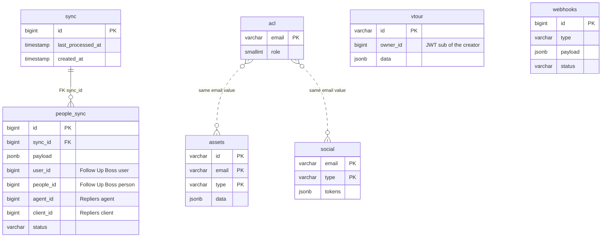

# Persistence

The backend keeps a small PostgreSQL database for data that has no upstream home: roles, per-user assets, social tokens, virtual tours and the CRM sync log. Everything else (listings, clients, agents, favorites, searches, estimates) lives upstream; see [Data ownership](/architecture/data-ownership) for the ownership map. Short-lived state (blocklist, OTP, caches) is in Keyv, not here.

PostgreSQL is accessed through **knex**. The connection is part of `AppConfig` (`config.db`); `src/knexfile.ts` re-exports it, so migrations and the running app share one configuration. `src/repository/` is the only place that holds knex queries.

## Connection

| Setting                                                   | Origin | Behaviour                                                                                                                                                                   | Source                                |
| --------------------------------------------------------- | ------ | --------------------------------------------------------------------------------------------------------------------------------------------------------------------------- | ------------------------------------- |
| `DATABASE_URL`                                            | env    | Used as `connectionString` when set; otherwise the individual variables apply                                                                                               | `src/config.ts` (`db.connection`)     |
| `DB_HOST`, `DB_PORT`, `DB_USER`, `DB_PASSWORD`, `DB_NAME` | env    | Defaults `localhost`, `5432`, `postgres`, `postgrespw`, `repliers`                                                                                                          | `src/config.ts` (`db.connection`)     |
| `DB_USE_SSL`                                              | env    | Only the exact value `true` turns TLS on                                                                                                                                    | `src/config.ts` (`db.connection.ssl`) |
| Pool                                                      | code   | `min: 1`, `max: 5` per process; the server and the worker are separate processes with a pool each                                                                           | `src/config.ts` (`db.pool`)           |
| Client creation                                           | code   | One Knex instance per process (`instanceCachingFactory`: every container, child containers included, gets the same one); nothing in `src/` attempts a connection at startup | `src/providers/db.ts`                 |

### TLS to a managed database

Managed PostgreSQL services that require TLS refuse unencrypted connections. Set `DB_USE_SSL=true` for those and leave it unset for a local database. How environment values and presets combine is on [Configuration resolution](/architecture/configuration-resolution).

## What lives in the database

### Local persistence

| Table         | Migration                       | Keys / relations                                                                                                 | Readers                                                                                                        | Writers                                                                                                                                                                          | Cleanup              | Source                                                                                 |
| ------------- | ------------------------------- | ---------------------------------------------------------------------------------------------------------------- | -------------------------------------------------------------------------------------------------------------- | -------------------------------------------------------------------------------------------------------------------------------------------------------------------------------- | -------------------- | -------------------------------------------------------------------------------------- |
| `acl`         | `20240817170531_zero.ts`        | PK `email`; `role smallint` (`UserRole`). No FK                                                                  | `AclRepository.getUserAcl`, from `AuthService.generateToken` (skipped when the flag is on)                     | **None in `src/`**: rows are created outside the application                                                                                                                     | None                 | `src/repository/acl.ts`, `src/services/auth.ts`                                        |
| `assets`      | `20240817183922_user_assets.ts` | PK `(id, email, type)`; `data jsonb`. `email` is an application key, no FK                                       | `AssetsRepository.getAssets` (`GET /api/user/assets/:type`)                                                    | `createAsset` insert, conflict ignored (`POST /api/user/assets/:type`); `removeAsset` delete (`POST /api/user/assets/:type/remove`)                                              | Explicit delete only | `src/repository/assets.ts`, `src/services/user/assets.ts`, `src/routes/user/assets.ts` |
| `vtour`       | `20240825164157_vtour.ts`       | PK `id` (the slug); `owner_id bigint` nullable, no FK; `data jsonb`                                              | `VtourRepository.getOne`: `GET /api/vtour/:slug` and the `slug` param handler of the `PUT` and `DELETE` routes | `create` (`POST /api/vtour`, conflict ignored), `update` (`PUT`), `remove` (`DELETE`)                                                                                            | Explicit delete only | `src/repository/vtour.ts`, `src/services/vtour.ts`, `src/routes/vtour.ts`              |
| `social`      | `20240922132113_social.ts`      | PK `(email, type)`; `tokens jsonb`. No FK                                                                        | `SocialRepository.getUserTokens` (`GET /api/user/social` and `/:provider`, and the refresh route)              | `createTokens` upsert (callback route), `updateAccessToken` rewrites `tokens.access_token` in place (refresh route), `deleteTokens` delete (`DELETE /api/user/social/:provider`) | Explicit delete only | `src/repository/social.ts`, `src/services/user/social.ts`, `src/routes/user/social.ts` |
| `sync`        | `20250112155921_sync.ts`        | PK `id` identity; `last_processed_at` nullable                                                                   | `getLatestSync` and `getSyncs` exist but nothing calls them                                                    | `SyncRepository.startSync` insert (`POST /api/agent/boss/people`); `updateLastProcessedAt` update (worker)                                                                       | None                 | `src/repository/sync.ts`, `src/services/agent.ts`, `src/services/sync.ts`              |
| `people_sync` | `20250112160526_sync_people.ts` | PK `id` identity; `sync_id` **FK to `sync(id)`**; `user_id`, `people_id`, `agent_id`, `client_id` plain `bigint` | `PeopleSyncRepository.getById` (worker `people.upsert`)                                                        | `createPeople` insert in the sync transaction; `update` sets `client_id` and `status` (worker)                                                                                   | None                 | `src/repository/people_sync.ts`, `src/services/agent.ts`, `src/services/sync.ts`       |
| `webhooks`    | `20250202212534_webhooks.ts`    | PK `id` identity; `type` is the event name (`peopleCreated`, `peopleUpdated`, `peopleDeleted`); no FK            | None: only the ids returned by the insert are used                                                             | `WebhooksRepository.create` (`POST /api/webhooks/boss/people`); `update` sets `status` (worker)                                                                                  | None                 | `src/repository/webhooks.ts`, `src/services/boss/webhook.ts`                           |

Every table has `created_at timestamp` without time zone defaulting to `CURRENT_TIMESTAMP`; `vtour` and `social` also have `updated_at`. Migrations are timestamped knex files in `src/migrations/`, each with a `down`; the directory is the fixed path `./migrations` in `config.db.migrations`.

### D08 — Entity relationships

Only one relation is declared in the schema. Dotted lines connect tables that share the same key value (the token's email); no code joins them and the database enforces nothing. Id columns such as `user_id` or `client_id` hold Follow Up Boss or Repliers ids.

`vtour` and `webhooks` have no relation in the diagram: `vtour.owner_id` is the `sub` claim of the admin who created the tour (see [Data ownership](/architecture/data-ownership#identity-and-ownership)), and a `webhooks` row reaches its job only through the `id` carried in the NATS message.

## Keyv vs SQL

Not every repository is SQL. `BlocklistRepository` (`src/repository/blocklist.ts`) wraps the `keyv.blocklist` Keyv store: `create` stores the revoked `jti` with a TTL equal to the token's remaining lifetime, `isRevoked` is `has`, and `cleanupExpired` is a stub that returns `true` (expiry is the TTL). There is no blocklist table. Keyv stores are in memory per process unless `REDIS_KEYV_ENABLE` is set; see [Keyv stores own their data](/architecture/data-ownership#keyv-stores-own-their-data). The other six repositories take the `db` Knex instance and are SQL.

## Running without a database

`APP_DISABLE_PERSISTENCE` (`app.disable_persistence`) is **not** a universal switch. It is read in exactly two places:

| Reader                      | Effect when `true`                                                                                                                             | Source                             |
| --------------------------- | ---------------------------------------------------------------------------------------------------------------------------------------------- | ---------------------------------- |
| `AuthService.generateToken` | Skips the `acl` lookup: no role from `acl`, no per-role expiry override                                                                        | `src/services/auth.ts`             |
| `db:migrate:prod` script    | Exits before running migrations. It reads the **environment variable**, not the merged preset value, so a preset and the variable can disagree | `package.json` (`db:migrate:prod`) |

No repository, route or worker handler checks the flag, and the `db` provider builds its Knex client either way. What each consumer does with the flag on and no reachable database, read from the code and not executed:

| Consumer                                                                  | Touches the database                             | With persistence off                                                                                                                                                                                       |
| ------------------------------------------------------------------------- | ------------------------------------------------ | ---------------------------------------------------------------------------------------------------------------------------------------------------------------------------------------------------------- |
| Token issue (`AuthService.generateToken`)                                 | `acl` read                                       | Skipped by the flag, so it works; role consequences on [Authentication](/architecture/authentication)                                                                                                      |
| Logout, refresh, revocation check                                         | None (Keyv)                                      | Works; unaffected by the flag                                                                                                                                                                              |
| `/api/user/assets/...`                                                    | `assets`                                         | Not guarded. The query rejects; the error is not an `ApiError`, so the global error middleware answers `500 Internal Server Error`                                                                         |
| `/api/user/social/...`                                                    | `social` (the provider URL route does not query) | Same `500` on every route that reads or writes tokens                                                                                                                                                      |
| `/api/vtour`                                                              | `vtour`                                          | Same `500`; `GET`, `PUT` and `DELETE` already fail in the `slug` param handler                                                                                                                             |
| `POST /api/agent/boss/people`                                             | `sync`, `people_sync`                            | When Follow Up Boss returns people, fails at `startSync`, before any message is published; an empty result returns `{ synced: 0 }` first. `GET /api/agent/boss/people` reads only Follow Up Boss and works |
| `POST /api/webhooks/boss/people`                                          | `webhooks`                                       | The insert rejects, no NATS message is published and the request fails                                                                                                                                     |
| Worker `people.upsert`, `people.create`, `people.update`, `people.delete` | `people_sync`, `webhooks`                        | Lookups and status updates reject; the handler throws                                                                                                                                                      |

With the flag on, assets, social links, tours, the people sync and the Follow Up Boss webhooks still run their queries. No code path checks the flag outside the two readers above.

## Migrations

| Command                            | What it does                                                                                                                                                                                                                                  | Source                  |
| ---------------------------------- | --------------------------------------------------------------------------------------------------------------------------------------------------------------------------------------------------------------------------------------------- | ----------------------- |
| `npm run db:migrate`               | `knex migrate:latest` against `src/knexfile.ts`                                                                                                                                                                                               | `package.json`          |
| `npm run db:migrate:test`          | Same with `DB_PORT=5555` and `test.env`                                                                                                                                                                                                       | `package.json`          |
| `npm run db:migrate:prod`          | Reads the raw shell variable `APP_DISABLE_PERSISTENCE`, not the preset value. `true` skips; unset or `false` runs `db:jsts_check`, then `knex:prod migrate:latest` against the compiled `dist/knexfile.js`; any other value fails the command | `package.json`          |
| `npm run knex migrate:make <name>` | Creates a timestamped migration                                                                                                                                                                                                               | `package.json` (`knex`) |

`db:jsts_check` (`scripts/jsts_check.sh`) compares the file counts of `src/migrations` and `dist/migrations`; when they differ and no terminal is attached it runs `npm run build` itself, so a release step compiles before it migrates. As a release step, any `APP_DISABLE_PERSISTENCE` value other than `true`, `false` or unset (for example `TRUE`) makes the script exit non-zero without migrating, which fails the release.

## Transaction boundaries

Every repository call is a single autocommit statement except one flow. `AgentService.syncBossPeople` opens a transaction in `SyncRepository.startSync` (inserting one `sync` row), inserts all `people_sync` rows through it in `PeopleSyncRepository.createPeople`, commits (only the commit is written; there is no rollback path), and only then publishes one `people.upsert` message per row. Later status changes (`people_sync.status`, `sync.last_processed_at`) are separate statements in the worker. `WebhooksRepository.create` inserts all events of one webhook in one statement and the messages are published after it. A publish failure after the insert leaves rows in `PENDING`; nothing re-publishes them.

## Gotchas

1. **The flag does not disable the database features.** Only token issuing and migrations read it. Source: `src/services/auth.ts` (`AuthService.generateToken`), `package.json` (`db:migrate:prod`).
2. **Roles come only from pre-existing `acl` rows.** Source: `src/repository/acl.ts` (`AclRepository.getUserAcl`).
3. **`VtourRepository.update` never sets `updated_at`.** The column keeps its insert value. Source: `src/repository/vtour.ts` (`VtourRepository.update`).

## Evidence

| Claim                                                      | Source (file and symbol)                                                                                                         |
| ---------------------------------------------------------- | -------------------------------------------------------------------------------------------------------------------------------- |
| Seven tables; only `people_sync.sync_id` has a foreign key | `src/migrations/*` (`REFERENCES sync(id)` in `20250112160526_sync_people.ts`)                                                    |
| Flag read only in token issue and the migrate script       | `src/services/auth.ts` (`generateToken`), `package.json` (`db:migrate:prod`); no other reader of `disable_persistence` in `src/` |
| Blocklist is Keyv-backed                                   | `src/repository/blocklist.ts`, `src/providers/keyv.blocklist.ts`                                                                 |
| Knex is created lazily; nothing checks the connection      | `src/providers/db.ts` (`instanceCachingFactory`)                                                                                 |
| Non-`ApiError` failures answer `500`                       | `src/app.ts` (error middleware, final branch)                                                                                    |
| TLS option                                                 | `src/config.ts` (`db.connection.ssl`)                                                                                            |

Verified against portal-backend `997ae3e`, 2026-10-20.
