# Process lifecycle

What the two long-running processes do between `node` starting them and the process ending: the
order of the startup steps, which step can stop a process and with what exit code, when the
Follow Up Boss webhooks are registered and removed, how the worker sets up and keeps its consume
loop, and what a signal does to each process. The failure of a single request is on
[Failure & degradation](/architecture/failure-and-degradation); terms are in the
[Glossary](/glossary).

[Architecture overview](/architecture#processes) ·
[Configuration resolution](/architecture/configuration-resolution#startup-prerequisites) ·
[Follow Up Boss: the NATS worker](/integrations/follow-up-boss#the-nats-worker) ·
[Deployment](/operations/deployment#procfile) ·
[Troubleshooting](/operations/troubleshooting)

## D10 — Startup and shutdown lanes

Each box is one step in the order the entry module runs it. Dashed arrows are the branches the
configuration chooses; the outcome of a failing step is in the [table below](#what-stops-a-step).

```mermaid
flowchart TD
  subgraph web["Web process: src/index.ts"]
    w1["Import providers/index.ts: config.ts loads the env file, asserts, merges the preset"]
    w2["Import app.ts: middleware resolved, route modules resolve middleware.jwt and read the key files"]
    w3["Register uncaughtExceptionMonitor"]
    w4["createServer(app.callback()).listen(PORT): requests are served from here on, the callback only logs"]
    w5["Resolve BossWebhooksService: the nats factory starts, nothing awaits it"]
    w6{"BOSS_WEBHOOK_ENABLED true and BOSS_ENABLED not false?"}
    w7["await installHooks: optional ngrok, removeOldHooks, three webhookCreate calls"]
    w8["Register SIGINT and SIGTERM handlers"]
    w9["Keep serving until a signal"]
    w10["Signal: log Shutting down, uninstallHooks deletes the remembered ids in turn"]
    w11["process.exit(0) in finally"]
    w1 --> w2 --> w3 --> w4 --> w5 --> w6
    w6 -.->|no: log and return| w8
    w6 -.->|yes| w7 --> w8
    w8 --> w9 -->|SIGINT or SIGTERM| w10 --> w11
  end
  subgraph wrk["Worker process: src/worker.ts"]
    k1["Import providers/index.ts: same config.ts asserts"]
    k2["Register uncaughtExceptionMonitor"]
    k3["pRetry around container.resolve of nats"]
    k4["jsc.consumers.get(stream, durable consumer)"]
    k5["Find the worker class by stream name, resolve it from the root container"]
    k6{"NATS_ENABLED true?"}
    k7["Warn NATS is disabled, not starting worker; the module ends"]
    k8["await consumer.consume()"]
    k9["for await each message: bind correlationId, await worker.process"]
    k1 --> k2 --> k3 --> k4 --> k5 --> k6
    k6 -.->|no: DummyNats was resolved| k7
    k6 -.->|yes| k8 --> k9
    k9 -->|iteration error: log err.message, no delay| k8
  end
```

Two orderings follow from the web lane. The port is bound before the webhooks are
installed, so requests are served while `installHooks` is still running; and the signal handlers
exist only after `installHooks` has resolved. Observed with webhooks disabled: the
`Webhooks are disabled` line is logged before `Server is running on port ...`, because the listen
callback runs after the synchronous part of `installHooks`.

## What stops a step

| Step                 | Process | On failure                                                                                                                                                                                                                                                                                                                                                                                       | Exit | Source                                                                                               |
| -------------------- | ------- | ------------------------------------------------------------------------------------------------------------------------------------------------------------------------------------------------------------------------------------------------------------------------------------------------------------------------------------------------------------------------------------------------ | ---- | ---------------------------------------------------------------------------------------------------- |
| Configuration import | both    | An `assert` or a thrown URL-assembly error at import ([startup prerequisites](/architecture/configuration-resolution#startup-prerequisites)). It happens before `uncaughtExceptionMonitor` is registered, so only Node's own stack trace reaches stderr                                                                                                                                          | 1    | `src/config.ts`, `src/lib/settings.ts` (`constructEventsCollectionUrls`)                             |
| JWT key files        | web     | `fs.readFileSync` throws while a route module resolves `middleware.jwt` at import; the worker never reads the keys                                                                                                                                                                                                                                                                               | 1    | `src/providers/middleware/jwt/config.keys.ts`, module-level `container.resolve` in `src/routes/*.ts` |
| Port bind            | web     | The server has no `error` listener, so a bind error (for example the port in use) is an uncaught exception                                                                                                                                                                                                                                                                                       | 1    | `src/index.ts`                                                                                       |
| NATS connect         | web     | With `NATS_ENABLED=true`, the connection promise is created by resolving `BossWebhooksService` and stored unawaited; when the connection is refused it is an unhandled rejection. Observed: logged as `Fatal` with `origin: "unhandledRejection"`, then Node exits, the HTTP server already listening                                                                                            | 1    | `src/index.ts`, `src/services/boss/webhook.ts` (constructor), `src/providers/nats.ts`                |
| Webhook install      | web     | `installHooks` is awaited at the top level; a FUB error (or an ngrok error) rejects that `await`. Old webhooks may already be deleted and some new ones created; the signal handlers are not registered yet                                                                                                                                                                                      | 1    | `src/index.ts`, `src/services/boss/webhook.ts` (`installHooks`, `removeOldHooks`)                    |
| NATS connect         | worker  | `pRetry` with its defaults (10 retries, delays 1 s, 2 s, 4 s and so on). `instanceCachingFactory` keeps the first promise, so every attempt awaits the same rejected promise and no new connection is made. Observed: attempts logged at 0 s, 1 s and 3 s as `Establishing NATS connection, attempt <n> failed. There are <m> retries left.`; after the last retry the top-level `await` rejects | 1    | `src/worker.ts`, `src/providers/nats.ts`                                                             |
| Consumer lookup      | worker  | `jsc.consumers.get` rejects (for example an unknown consumer); the provider created the durable consumer when it was absent                                                                                                                                                                                                                                                                      | 1    | `src/worker.ts`, `src/providers/nats.ts`                                                             |
| Worker class         | worker  | `Error("Worker class not found for stream ...")` when no stream in `src/streams/index.ts` has the configured name                                                                                                                                                                                                                                                                                | 1    | `src/worker.ts`                                                                                      |
| `consume()`          | worker  | The call sits outside the `try`, so a rejection ends the loop and the module                                                                                                                                                                                                                                                                                                                     | 1    | `src/worker.ts`                                                                                      |
| Message iteration    | worker  | Caught: the error message (`err.message`) is logged and `consume()` is called again at once                                                                                                                                                                                                                                                                                                      | none | `src/worker.ts`                                                                                      |
| One message          | worker  | Caught inside `StreamWorker.process` (`nak`, or `term` for an unknown subject); the loop continues. Outcomes per subject are on [Follow Up Boss](/integrations/follow-up-boss#outcomes-acknowledgement-status-record)                                                                                                                                                                            | none | `src/streams/worker.ts`                                                                              |

A rejected top-level `await` ends the process even while the HTTP server is listening (observed
with Node's ESM loader, exit code 1).

## Process-level errors

Both entry points register the same observer after their imports:
`process.on("uncaughtExceptionMonitor", ...)` writes one `fatal` line, `Fatal`, with `err` and
`origin`, through `logger.global`. It only observes: Node then prints the stack to stderr and
exits with code 1.

| Event                                      | Behaviour                                                                                                                                                                         | Source                                         |
| ------------------------------------------ | --------------------------------------------------------------------------------------------------------------------------------------------------------------------------------- | ---------------------------------------------- |
| Error thrown inside a request              | Answered by the error handler in `src/app.ts`; the process keeps running ([error handling](/architecture/request-lifecycle#error-handling))                                       | `src/app.ts`                                   |
| Uncaught exception                         | `Fatal` line with `origin: "uncaughtException"`, then exit 1                                                                                                                      | `src/index.ts`, `src/worker.ts`                |
| Unhandled rejection                        | Node's default `throw` mode turns it into an uncaught exception: `Fatal` line with `origin: "unhandledRejection"`, then exit 1 (observed)                                         | same                                           |
| Rejection inside a detached second handler | Caught by the `.catch` in `middleware.eventsCollection`, logged as `Events collection failed` ([D06](/architecture/events-and-messaging#d06--second-handler-and-detached-report)) | `src/providers/middleware/eventsCollection.ts` |

## Shutdown

|                                              | Web                                                                                                                                                                                                                                                                           | Worker                                                                                                                                                                        |
| -------------------------------------------- | ----------------------------------------------------------------------------------------------------------------------------------------------------------------------------------------------------------------------------------------------------------------------------- | ----------------------------------------------------------------------------------------------------------------------------------------------------------------------------- |
| Handlers                                     | `SIGINT` and `SIGTERM`, registered after `installHooks`                                                                                                                                                                                                                       | none                                                                                                                                                                          |
| On the signal                                | log `Shutting down`; `uninstallHooks()`: returns at once when webhooks are disabled, else deletes each id in `runningWebhooksIds` with FUB `DELETE /webhooks/{id}`, one after the other, and stops at the first failure; `process.exit(0)` in `finally`, whatever the outcome | Node's default action: the process ends without running any code                                                                                                              |
| HTTP server                                  | not closed; requests in flight end with the process                                                                                                                                                                                                                           | n/a                                                                                                                                                                           |
| Message in flight                            | n/a                                                                                                                                                                                                                                                                           | not acknowledged; redelivery is up to the server's ack wait ([consumer settings](/integrations/follow-up-boss#the-nats-worker)). Repliers and FUB writes it already made stay |
| Database pool, Keyv clients, NATS connection | not closed or drained by the code                                                                                                                                                                                                                                             | not closed or drained by the code                                                                                                                                             |

A signal that arrives before the web process has registered its handlers (during `installHooks`)
gets Node's default action, so `uninstallHooks` does not run.

## State each process holds

| State                                                       | Web                                                          | Worker                                     | Created                                                                                                                                                                    | Source                                                    |
| ----------------------------------------------------------- | ------------------------------------------------------------ | ------------------------------------------ | -------------------------------------------------------------------------------------------------------------------------------------------------------------------------- | --------------------------------------------------------- |
| HTTP server                                                 | yes                                                          | no                                         | at startup                                                                                                                                                                 | `src/index.ts`                                            |
| NATS connection, stream update or add, durable consumer add | when `NATS_ENABLED=true`                                     | when `NATS_ENABLED=true`                   | when `nats` is first resolved: by `BossWebhooksService` in the web process, by the retry wrapper in the worker                                                             | `src/providers/nats.ts`                                   |
| Knex pool (`min: 1`, `max: 5`)                              | yes                                                          | yes                                        | Knex instance when `db` is first resolved; no connection is attempted at startup ([Persistence](/architecture/persistence#connection))                                     | `src/providers/db.ts`                                     |
| Keyv stores                                                 | yes                                                          | those of the modules it imports            | `@cached` namespaces when the decorated class is defined (module load); `keyv.otp` and `keyv.blocklist` when first resolved ([Caching](/architecture/caching#keyv-stores)) | `src/lib/decorators/cached.ts`, `src/providers/keyv.*.ts` |
| Repliers throttles                                          | yes                                                          | yes, used by the worker's Repliers clients | on first resolve; process-wide                                                                                                                                             | `src/providers/throttler/*.ts`                            |
| Remembered webhook ids                                      | yes, `runningWebhooksIds` of the instance created at startup | no                                         | by `installHooks`                                                                                                                                                          | `src/services/boss/webhook.ts`                            |

There is no health or readiness route under `/api` (`src/routes/index.ts`); a bound port is the
only sign the web process gives that it started, and it is given before the webhooks are
installed.

## Variation

- **NATS disabled** (the default): the `nats` token is `DummyNats`; the web process holds no
  connection, and the worker logs `NATS is disabled, not starting worker` and ends with exit code
  0 (observed); see [Deployment](/operations/deployment#procfile) for how to run it then.
- **Webhooks disabled** (the default): `installHooks` logs and returns, `uninstallHooks` returns at
  once; the webhook route stays mounted.
- **Webhooks enabled with `BOSS_ENABLED=false`**: `installHooks` logs an error and returns; nothing
  is installed and the process starts.
- **ngrok** (`BOSS_WEBHOOK_USE_NGROK=true`): `installHooks` opens a listener on the app port and
  uses its URL as the callback origin; the code does not close it.
- **`npm run dev`**: nodemon restarts the processes with its default signal `SIGUSR2` (nodemon
  3.1.14 default), for which no handler is registered, so a restart does not run
  `uninstallHooks`. The next start's `removeOldHooks` deletes what FUB still lists.
- **Process name**: the NATS connection name is suffixed with `backend` for an entry file named
  `index`, `worker` for `worker` and `unknown` for anything else (`getProcessName` in
  `src/lib/introspection.ts`).

## Evidence

- Source: `src/index.ts`, `src/worker.ts`, `src/providers/nats.ts`, `src/providers/index.ts`,
  `src/services/boss/webhook.ts` (`installHooks`, `uninstallHooks`), `src/streams/worker.ts`,
  `src/lib/dummy.nats.ts`. Libraries read in `node_modules`: `p-retry` 8.0.1 defaults,
  `tsyringe` 4.10.0 `instanceCachingFactory`, `@nats-io/nats-core` 3.4.0 connection options,
  nodemon 3.1.14 defaults.
- Executed on 2026-10-20 (Node 26.10.0; `package.json` requires `^24.21.0`), each entry module run
  with placeholder values for the four required variables, no env file, `PORT=0` and no upstream
  reachable: the web process with `NATS_ENABLED=true` and a closed NATS port (exit 1 after about
  4 s, `Fatal` line with `origin: "unhandledRejection"`); the worker with NATS disabled (exit 0
  after the warning); the worker with a closed NATS port (three attempts in 12 s, then stopped by
  the probe); a plain ESM module whose top-level `await` rejects while a server listens (exit 1).
- Not executed: signals (the probes ran on Windows, where `SIGTERM` cannot be delivered to a Node
  process from outside), webhook installation against FUB, a NATS server that goes away after the
  connection was made. What the NATS client and the consume iterator do during a reconnect is
  library behaviour, unverified; the client options are the library defaults (reconnect on, 10
  attempts, 2 s apart, read in `@nats-io/nats-core`).

## Gotchas

1. **The worker's startup retry never reconnects.** Each attempt awaits the promise cached by the
   `nats` provider. Source: `src/worker.ts`, `src/providers/nats.ts`.
2. **Import-time failures bypass the `Fatal` log line.** The monitor is registered after the
   imports. Source: `src/index.ts`, `src/worker.ts`.

Verified against portal-backend `997ae3e`, 2026-10-20.
