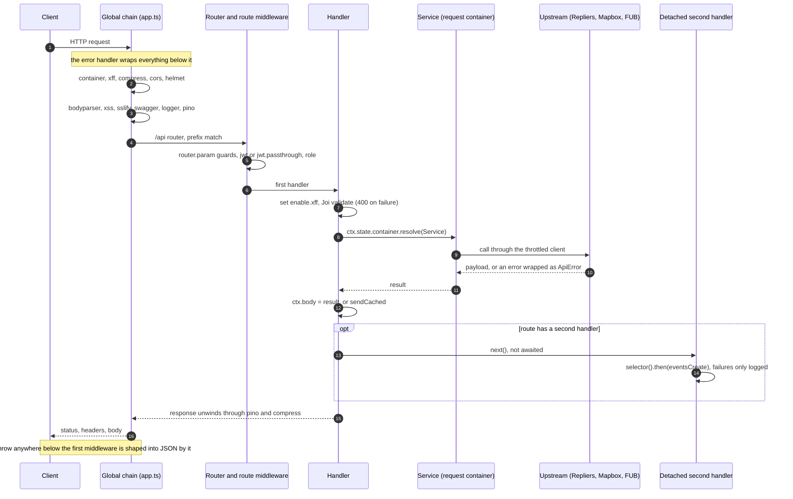

# Request lifecycle

What happens to one HTTP request between the socket and the response: the order of the global middleware, what each one reads or changes, where the per-request container is created and what is resolved from it, how a handler is shaped, what runs after the body is set, and which branch of the error handler turns a thrown value into a response. Terms are defined in the [Glossary](/glossary).

[Architecture overview](/architecture) | [Module catalogue](/architecture/modules) | [API reference: HTTP semantics](/api-reference#http-semantics) | [Authentication](/architecture/authentication) | [Events & Messaging](/architecture/events-and-messaging)

## One request, end to end



Registration happens once at startup (`src/providers/index.ts` builds the root container and every `middleware.*` token). Resolution happens on each request from the child container that `middleware.container` creates. The two are not interchangeable: see [Registration vs resolution](#registration-vs-resolution).

## Middleware chain

`src/app.ts` composes the chain with `app.use`. Koa runs the middleware in this order on the way in and in reverse order on the way out. Every entry after the error handler is resolved from the root container by its token.

| #   | Token                                        | Job                                                                                                                                                                                                                                                  | Source                                                                                               | Environment                                               |
| --- | -------------------------------------------- | ---------------------------------------------------------------------------------------------------------------------------------------------------------------------------------------------------------------------------------------------------- | ---------------------------------------------------------------------------------------------------- | --------------------------------------------------------- |
| 1   | inline error handler                         | `try { await next() } catch`: logs the error and shapes the response ([five branches](#error-handling))                                                                                                                                              | `src/app.ts`                                                                                         | all                                                       |
| 2   | `middleware.container`                       | creates a child container per request and stores it in `ctx.state.container`                                                                                                                                                                         | `src/lib/middleware/container.ts`, `src/providers/middleware/container.ts`                           | all                                                       |
| 3   | `middleware.container.xff`                   | registers a lazy factory for `XForwardedFor` (an `XFFProvider` built from this `ctx`) in the child container                                                                                                                                         | `src/providers/middleware/container/xff.ts`, `XFFProvider.getMiddleware` in `src/lib/xffprovider.ts` | all                                                       |
| 4   | `middleware.compress`                        | response compression with `koa-compress` defaults                                                                                                                                                                                                    | `src/providers/middleware/compress.ts`                                                               | all                                                       |
| 5   | `middleware.cors`                            | production: reflects the request `Origin` when it matches an entry of `app.cors.validDomains`, otherwise answers with the first entry; other environments: `origin: "*"`                                                                             | `src/providers/middleware/cors.ts`                                                                   | behaviour differs                                         |
| 6   | `middleware.helmet`                          | security headers and a content security policy that allows the Swagger UI assets; `crossOriginResourcePolicy` is off                                                                                                                                 | `src/providers/middleware/helmet.ts`                                                                 | production only, a pass-through elsewhere                 |
| 7   | `middleware.bodyparser`                      | `koa-body`: JSON, urlencoded, text and multipart bodies for `POST`, `PUT`, `PATCH` only; see [Body parsing](/api-reference#body-parsing)                                                                                                             | `src/providers/middleware/body.ts`                                                                   | all                                                       |
| 8   | `middleware.xss`                             | replaces every string in `request.body`, `headers`, `query` (and `ctx.body` if already set) with its `xss`-library-filtered form                                                                                                                     | `src/lib/middleware/xss.ts`, `src/providers/middleware/xss.ts`                                       | all                                                       |
| 9   | `middleware.sslify`                          | redirects non-HTTPS requests, deciding by the `x-forwarded-proto` header (`koa-sslify`)                                                                                                                                                              | `src/providers/middleware/sslify.ts`                                                                 | production only, a pass-through elsewhere                 |
| 10  | `middleware.swagger`                         | serves the Swagger UI at `/swagger` and the generated spec                                                                                                                                                                                           | `src/providers/middleware/swagger.ts`                                                                | only when `APP_USESWAGGER=true`, a pass-through otherwise |
| 11  | `middleware.logger`                          | takes `x-correlation-id` when it is a UUID (otherwise generates one), builds a child logger carrying `url`, `endpoint`, `body`, `referer`, `x-forwarded-for` and `correlationId`, and runs the rest of the chain inside an `AsyncLocalStorage` scope | `src/providers/middleware/logger.ts`                                                                 | all                                                       |
| 12  | `middleware.pino`                            | request and response log lines (`Request: ...`, `Response: <status> <ms> ...`) with the correlation id                                                                                                                                               | `src/providers/middleware/pino.ts`                                                                   | all                                                       |
| 13  | `router.routes()`, `router.allowedMethods()` | the `/api` router (see the [module catalogue](/architecture/modules)) and the 404/405/OPTIONS answers of `@koa/router`                                                                                                                               | `src/app.ts`, `src/routes/index.ts`                                                                  | all                                                       |

Three things follow from the order:

- The body parser runs before `middleware.xss`, so the sanitizer sees the parsed body. It also runs before `middleware.logger`, so the child logger's `body` field is the parsed and sanitized body.
- `middleware.container` is second, so everything after it, including the route middleware, can resolve request-scoped objects. Only the error handler runs without a container on `ctx.state`.
- There is no authentication in the global chain. Authentication, role checks and ownership checks are route-level and are described in [Authentication middlewares](#authentication-middlewares).

## Registration vs resolution

| Concern                                | Registration                                                                       | Resolution                                                                            | Lifetime                                      |
| -------------------------------------- | ---------------------------------------------------------------------------------- | ------------------------------------------------------------------------------------- | --------------------------------------------- |
| Middleware (`middleware.*`)            | `src/providers/middleware/*.ts`, each an `instanceCachingFactory`                  | `container.resolve("middleware.x")` at module load in `src/app.ts` and in route files | one instance per process                      |
| Per-request container                  | `container.createChildContainer()` in `src/lib/middleware/container.ts`            | `ctx.state.container`                                                                 | one per request                               |
| `XForwardedFor`                        | `ctx.state.container.register(..., { useFactory })` in `XFFProvider.getMiddleware` | the first service that needs it, on the child container                               | one `XFFProvider` per request, created lazily |
| Services and repositories              | `@injectable()` classes                                                            | `ctx.state.container.resolve(Service)` inside the handler                             | a new instance each time it is resolved       |
| Config, loggers, database, Keyv stores | `src/providers/index.ts`                                                           | injected by token (`"config"`, `"logger"`, `"db"`)                                    | shared in the root container                  |

- **Lazy `XFFProvider`.** The factory is registered by the global chain, but `XFFProvider` reads `ctx.state['enable.xff']` when it is asked (`skipReason`), not when it is built. That is why a handler can set the flag after middleware has already resolved a service.
- **Module-level resolution.** A router file that calls `container.resolve(...)` at import time (for example the `VtourService` instance in `src/routes/vtour.ts`) holds a process-wide instance, not a request-scoped one. Handlers that call `ctx.state.container.resolve` get a new instance per resolution, so startup-only logic does not belong in a service constructor.
- **`logger`.** The `logger` token returns the child logger from the `AsyncLocalStorage` store when one is active, otherwise the global logger (`src/providers/logger.ts`).

## The handler pattern

Every route handler follows the same shape:

```ts
router.post('/', authMiddleware, async (ctx) => {
  ctx.state['enable.xff'] = true // 1. mark user-facing
  const { error, value } = schema.validate({
    // 2. Joi-validate
    ...getBody(ctx.request.body),
    clientId: ctx.state['user'].sub
  })
  if (error) ctx.throw(new ApiError(error.message, 400))
  const service = ctx.state.container.resolve(MyService) // 3. per-request resolve
  ctx.body = await service.method(value) // 4. DTO in, payload out
})
```

- **`ctx.state['enable.xff'] = true`.** Set by user-facing routes. `XFFProvider.skipReason` returns `route-flag-missing` when it is absent, and the Repliers call then goes out without `x-repliers-forwarded-for`. The forwarding rules are on [Client IP forwarding](/architecture/client-ip-forwarding).
- **Input provenance.** A handler builds one payload from the query string (`ctx.request.query`), the body (`getBody(ctx.request.body)`), path parameters (`ctx.params`) and token claims (`ctx.state.user.sub`, `.email`), and validates it with one schema from `src/validate/`. Where the same key appears in more than one source, the later spread wins, and the order of the spreads differs per route (for example `GET /api/listings/:mlsNumber` puts the path parameter before the query, `GET /api/listings/featured/:slug` after it). The payload shapes are listed per route in the [module catalogue](/architecture/modules).
- **Validation.** `schema.validate(payload)` with Joi's defaults: first error only, unknown keys rejected, values converted. The details are in [HTTP semantics](/api-reference#http-semantics). The service receives `value`, never the raw body.
- **Output.** `ctx.body = await service.method(value)` for plain results; `sendCached(ctx, data)` for results of `@cached` methods (unwraps `{ result, expires }` and sets `Cache-Control`). A handler that sets no body leaves Koa's 404; the `contact` routes set the string `"OK"`.

### Detached second handlers

Routes that report engagement to Follow Up Boss pass a second handler after the first one:

```ts
router.post(
  '/contactus',
  authMiddleware,
  async (ctx, next) => {
    // validate, call the service, ctx.body = "OK"
    next() // not awaited, not returned
  },
  (ctx, next) => {
    const collector = eventsCollectionMiddleware({
      selector,
      options: { allowIncognito: true }
    })
    return collector(ctx, next)
  }
)
```

- **When it runs.** After the first handler has set `ctx.body` and called `next()`. The first handler does not await it, so the response is not held for it.
- **What it does.** `middleware.eventsCollection` (`src/providers/middleware/eventsCollection.ts`) acts only when `allowIncognito` is true or `ctx.state.user` exists. It calls `selector(ctx)` (and `notesSelector(ctx)` if given) and, on the resolved properties, `eventsCreate` / `noteCreate`, all in `.then` chains. A rejection is caught and logged as `Events collection failed`; it never reaches the response.
- **Disabled.** With `BOSS_ENABLED=false` the factory returns a function that yields the empty middleware, so the second handler does nothing.
- **Consequence for errors.** A failure in the second handler cannot change a response that has already been decided. A failure in the first handler happens before `next()`, so the second handler does not run. The engagement register is on [Events & Messaging](/architecture/events-and-messaging).

## Authentication middlewares

Two variants, both built from the same `middleware.jwt.config` (`RS256`, issuer from `auth.jwt.issuer`, public key from `middleware.jwt.config.keys`) and resolved from the root container (see [Authentication](/architecture/authentication)):

- `middleware.jwt` (`src/providers/middleware/jwt/jwt.ts`): strict. `koa-jwt` throws a koa `HttpError` with status 401 when the token is missing or invalid.
- `middleware.jwt.passthrough` (`src/providers/middleware/jwt/passthrough.ts`): guest-allowed. A missing token passes through with no `ctx.state.user`; any other `koa-jwt` error is rethrown as `ApiError(error.message, 401)`.

Both use the same revocation hook (`isRevoked` in `src/providers/middleware/jwt/config.ts`): a token without a string `jti`, or whose `jti` `AuthService.isRevoked` reports as revoked, fails as an invalid token.

The decoded payload lands in `ctx.state["user"]`; what `sub` holds depends on how the token was issued ([`sub`](/glossary#jwt-sub)). The claims, the middleware outcomes per request shape and revocation are on [Authentication](/architecture/authentication#sessions--jwt).

Other route-level guards:

| Guard                    | Source                                                                                                                                | Behaviour                                                                                |
| ------------------------ | ------------------------------------------------------------------------------------------------------------------------------------- | ---------------------------------------------------------------------------------------- |
| `router.param("x", ...)` | the route file (for example `slug` in `src/routes/vtour.ts`)                                                                          | runs before the route's own middleware, for every route with that path parameter         |
| `middleware.role([...])` | `src/providers/middleware/role.ts`                                                                                                    | `ApiError("Insufficient privileges", 403)` when `ctx.state.user.role` is not in the list |
| ownership check          | route middleware (`assertOwnership` in `src/routes/estimate.ts`, the `ctx.assert` calls in `src/routes/agent.ts`) or a service method | per route; see the [module catalogue](/architecture/modules)                             |

## Return path

After the last handler returns, Koa sends the response and the middleware unwind in reverse: `middleware.logger` leaves its `AsyncLocalStorage` scope, `middleware.pino` writes the `Response:` line with status and elapsed milliseconds, and `compress` encodes the body. Nothing in the chain rewrites a body after the handler.

Three responses never reach the error handler's branches, because nothing is thrown: Koa's own `404 Not Found` for a path the router does not match or a handler that sets no body, `405 Method Not Allowed` with an `Allow` header for a known path with the wrong method, and `200` with an `Allow` header for a plain `OPTIONS` on a known path (a CORS preflight is answered earlier, by `middleware.cors`). Their bodies are plain text.

## Error handling

Throw `ApiError` (`src/lib/errors.ts`) via `ctx.throw(new ApiError(message, status))`; do not wrap route bodies in try/catch. The first middleware in `src/app.ts` catches everything thrown below it, logs it (`logger.error(err)`, resolved from the root container, outside the `AsyncLocalStorage` scope that `middleware.logger` opens) and answers by the first branch that matches:

| Order | Branch (test in `src/app.ts`)                 | Status                                    | Body                                                                                                                                                           |
| ----- | --------------------------------------------- | ----------------------------------------- | -------------------------------------------------------------------------------------------------------------------------------------------------------------- |
| 1     | `err instanceof ApiError`                     | `err.status`, or 500 when it is undefined | `{ "message": "<status> - <message> - <path>", "userMessage": "<message>", "info": <opts> }`; `Retry-After` is set first when `opts["Retry-After"]` is present |
| 2     | `err instanceof HttpError` (koa's own export) | `err.status`                              | `{ "message": "<message>" }`; for errors with `originalError` (`koa-jwt`) the message is `<message>: <originalError.message>`                                  |
| 3     | `"httpCode" in err`                           | `err.httpCode`                            | `{ "message": "<message>" }` (errors raised inside the multipart parser)                                                                                       |
| 4     | `"status" in err`                             | `err.status`                              | `{ "message": "<message>" }`                                                                                                                                   |
| 5     | anything else                                 | 500                                       | `{ "message": "Internal Server Error" }`; outside production also `err`, `stack` and `file`                                                                    |

The same table with an example trigger for each branch is on [API reference: error variants](/api-reference#error-variants). Points that are easy to get wrong:

- **Only branch 1 has `userMessage` and `info`.** Branches 2 to 4 carry `message` alone.
- **`Retry-After` follows the options, not the status.** Any `ApiError` whose `opts` has `Retry-After` sets the header; today only the OTP resend cooldown (403) does.
- **`ctx.assert` and `ctx.throw`.** `http-assert` loads its own copy of `http-errors`, so with the installed `koa` and `http-assert` an assertion error is indeed not an `instanceof` the exported `HttpError`, but it carries a numeric `status`, so branch 4 answers it: the status given to `ctx.assert` is kept and the body is `{ "message": "<assert message>" }`. Routes that call it: `src/routes/agent.ts` (403), `assertOwnership` in `src/routes/estimate.ts` (403), `router.param("slug")` in `src/routes/vtour.ts` (`ctx.assert(vtour, 404)`, message `Not Found`). The result differs from `ctx.throw(new ApiError(...))` only in the body shape.
- **Upstream errors become `ApiError`.** `RepliersBase.request` wraps a failed Repliers call as `ApiError("Repliers API error: <status>", <status>, <response data>)`. The upstream status is relayed and the upstream body arrives in `info`. When the call fails without a response (timeout, connection error) the status is undefined, so branch 1 answers 500 and the message text contains `undefined`.
- **Parsing errors.** Raised by `koa-body` (through `co-body` and `raw-body`) before any route code. A body over the size limit is a koa `HttpError` with status 413 and message `request entity too large`, answered by branch 2. A malformed JSON body has status 400 and is not an `HttpError`, so branch 4 answers it. Multipart parser errors go to branch 3. Established by running `koa-body` with this configuration behind the same branch order: 1.1 MB JSON and 60 kB text bodies gave 413 via `instanceof HttpError`; `{bad` gave 400 via `status`.

Per-dependency outcomes and retry layers: [Failure & degradation](/architecture/failure-and-degradation).

## Gotchas

1. **`ctx.assert` errors are answered by the `"status" in err` branch** with `{ "message": ... }`, no `userMessage` or `info`.
2. **The error handler logs every thrown value, 4xx included**, at `error` level (`src/app.ts`).
3. **`next()` in a first handler is neither awaited nor returned** (`src/routes/contact.ts`, `src/routes/favorites.ts`, `src/routes/user.ts` and others), which is what makes the second handler detached.
4. **`router.param` guards run before route-level middleware**, so a guard cannot assume authentication has run (`slug` in `src/routes/vtour.ts`).
5. **A service resolved at module load is shared by all requests** (`VtourService` in `src/routes/vtour.ts`); one resolved through `ctx.state.container` is not.
6. **Helmet, sslify and the production CORS allow-list are production-only.** In other environments `middleware.helmet` and `middleware.sslify` are pass-throughs and CORS answers `*` (`src/providers/middleware/helmet.ts`, `sslify.ts`, `cors.ts`).

Verified against portal-backend `997ae3e`, 2026-10-20.
