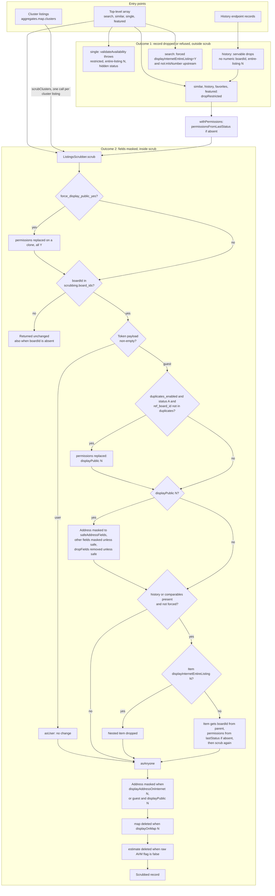

import { Callout } from 'nextra/components'

# Scrubbing & Restrictions

Board regulations restrict what a non-authenticated visitor may see of a listing: sold prices, full addresses, history. This page answers which endpoints return listing data, which of them pass through the scrubber, what the scrubber masks, drops or leaves alone for a guest and for a signed-in caller, and how scrubbing is ordered against field projection, the MLS-number prefix codec and the restricted-listing exclusions. Terms are defined in the [Glossary](/glossary).

[Module catalogue](/architecture/modules) | [Restricted listings](/architecture/restricted-listings) | [MLS-number prefix](/architecture/mls-number-prefix) | [Repliers proxy](/architecture/repliers-proxy) | [Listings API](/api-reference/listings)

## Visibility register

One row per endpoint that returns listing data, or that is built on a listings search. "Scrubber path" is the code that scrubs the response, or "none" when the endpoint does not pass through the scrubber; Guest and User then show "—". Guest means no token payload on the request; user means any non-empty payload (see [Who gets scrubbed](#who-gets-scrubbed)).

| Endpoint                                                                                                                                             | Scrubber path                                                                                                                             | Guest                      | User                              | Board gate                                                        | Field masking                                                                                                                                        | Record dropping                                                                                                                                                                                               | Nested coverage                                                                                   | Source                                                                                                                                                                                                            |
| ---------------------------------------------------------------------------------------------------------------------------------------------------- | ----------------------------------------------------------------------------------------------------------------------------------------- | -------------------------- | --------------------------------- | ----------------------------------------------------------------- | ---------------------------------------------------------------------------------------------------------------------------------------------------- | ------------------------------------------------------------------------------------------------------------------------------------------------------------------------------------------------------------- | ------------------------------------------------------------------------------------------------- | ----------------------------------------------------------------------------------------------------------------------------------------------------------------------------------------------------------------- |
| `POST /api/listings/search`, `GET /api/listings/search`                                                                                              | `@scrubbed("listings")` on `ListingsService.search` (`src/services/listings.ts`)                                                          | `asGuest`, then `asAnyone` | `asUser` (no-op), then `asAnyone` | Per listing, on `boardId`                                         | Guest: `displayPublic=N` masks. Both: address on `displayAddressOnInternet=N`; `map` deleted on `displayOnMap=N`; `estimate` deleted on the AVM flag | None in the scrubber. Upstream: `displayInternetEntireListing=Y` forced; `not:mlsNumber` for the [restricted list](/architecture/restricted-listings)                                                         | `aggregates.map.clusters[].listings` (`scrubClusters`); `history` and `comparables` in `asGuest`  | `src/routes/listings.ts`; `src/services/listings.ts` (`ListingsService.search`); `scrubbed` in `src/services/scrubber/listings.ts`                                                                                |
| `GET /api/listings/count`, `POST /api/listings/count`                                                                                                | none: `ListingsService.count` returns `count` and `lastUpdatedOn` only                                                                    | —                          | —                                 | n/a                                                               | n/a                                                                                                                                                  | Counted through `RepliersListings.search`, so the forced filter and the `not:` exclusion apply                                                                                                                | n/a                                                                                               | `src/routes/listings.ts`; `src/services/listings.ts` (`ListingsService.count`)                                                                                                                                    |
| `GET /api/listings/{mlsNumber}`                                                                                                                      | `@scrubbed()` on `ListingsService.single`                                                                                                 | `asGuest`, `asAnyone`      | `asUser`, `asAnyone`              | Per listing                                                       | As search                                                                                                                                            | The listing is refused, not stripped: a restricted number, `displayInternetEntireListing=N` or a hidden status throws `ApiError` with `settings.hide_unavailable_listings_http_code` (`validateAvailability`) | `history` and `comparables` in `asGuest`; items with `displayInternetEntireListing=N` are dropped | `src/routes/listings.ts`; `src/services/listings.ts` (`ListingsService.single`, `validateAvailability`); `scrubbed` in `src/services/scrubber/listings.ts`                                                        |
| `GET /api/listings/{mlsNumber}/similar`                                                                                                              | `@scrubbed("similar")` on `ListingsService.similar`                                                                                       | `asGuest`, `asAnyone`      | `asUser`, `asAnyone`              | Per listing                                                       | As search                                                                                                                                            | `dropRestricted` runs inside the method, before the decorator                                                                                                                                                 | As single, per similar listing                                                                    | `src/routes/listings.ts`; `src/services/listings.ts` (`ListingsService.similar`); `dropRestricted` in `src/services/listings/listingHelpers.ts`; `src/services/repliers/listings.ts` (`RepliersListings.similar`) |
| `GET /api/listings/history`                                                                                                                          | `@scrubbed("history")` on `ListingsService.history`                                                                                       | `asGuest`, `asAnyone`      | `asUser`, `asAnyone`              | Per record; records without a numeric `boardId` are dropped first | As search; a record without `permissions` gets them from `permissionsFromLastStatus`                                                                 | `servable` (no numeric `boardId`, or `displayInternetEntireListing=N`) and `dropRestricted`                                                                                                                   | None: each record is scrubbed alone                                                               | `src/routes/listings.ts`; `src/services/listings.ts` (`ListingsService.history`, `servable`, `withPermissions`)                                                                                                   |
| `GET /api/listings/featured/{slug}`                                                                                                                  | `@scrubbed("listings")` on `FavoritesService.featuredListings` (`src/services/favorites.ts`)                                              | `asGuest`, `asAnyone`      | `asUser`, `asAnyone`              | Per listing                                                       | As search                                                                                                                                            | `dropRestricted` inside `FavoritesService.get`, before the cache                                                                                                                                              | `history` and `comparables` in `asGuest`                                                          | `src/routes/listings.ts`; `src/services/favorites.ts` (`FavoritesService.featuredListings`, `get`)                                                                                                                |
| `POST /api/listings/nlp`                                                                                                                             | The NLP result is not decorated; the follow-up `this.search` (only when `statistics` or `aggregates` is asked, with `listings: false`) is | As search                  | As search                         | Per cluster listing                                               | Cluster listings as search                                                                                                                           | The follow-up search carries the forced filter and `not:`                                                                                                                                                     | `aggregates.map.clusters[].listings`, copied into `request.aggregates` after `scrubClusters`      | `src/routes/listings.ts`; `src/services/listings.ts` (`ListingsService.nlp`)                                                                                                                                      |
| `GET /api/autosuggest` (listings block)                                                                                                              | `ListingsService.search`, called by `AutosuggestService.search` with `app_state`, including the MLS-number leg                            | As search                  | As search                         | Per listing                                                       | As search                                                                                                                                            | As search                                                                                                                                                                                                     | As search                                                                                         | `src/routes/autosuggest.ts`; `src/services/autosuggest.ts` (`AutosuggestService.search`)                                                                                                                          |
| `GET /api/favorites`                                                                                                                                 | none: `FavoritesService.get` returns the Repliers records; `count`, `numPages` and `pageSize` are passed through unadjusted               | Strict JWT: no guest       | —                                 | None                                                              | None                                                                                                                                                 | `dropRestricted`                                                                                                                                                                                              | None                                                                                              | `src/routes/favorites.ts`; `src/services/favorites.ts` (`FavoritesService.get`)                                                                                                                                   |
| `GET /api/estimate/property_details`                                                                                                                 | none: `EstimateService.propertyDetails` calls `RepliersListings.search` directly                                                          | —                          | —                                 | None                                                              | None                                                                                                                                                 | Forced filter and `not:` apply (inside `RepliersListings.search`); the response is the first match, projected to `propertyDetailsFields`                                                                      | None                                                                                              | `src/routes/estimate.ts`; `src/services/estimate.ts` (`EstimateService.propertyDetails`)                                                                                                                          |
| `POST /api/estimate`, `GET /api/estimate`, `GET /api/estimate/my`, `PATCH` and `DELETE /api/estimate/{estimateId}`, the `/api/agent/estimate` routes | none: the estimate payload comes from `RepliersEstimate`                                                                                  | —                          | —                                 | None                                                              | None                                                                                                                                                 | None                                                                                                                                                                                                          | None                                                                                              | `src/routes/estimate.ts`, `src/routes/agent.ts`; `src/services/estimate.ts`, `src/services/agent.ts`                                                                                                              |
| `GET /api/stats/widgets`                                                                                                                             | none: `StatsService.widgets` runs `RepliersListings.search` with `listings: false` and keeps `statistics`                                 | —                          | —                                 | n/a                                                               | n/a                                                                                                                                                  | Forced filter and `not:` apply to the aggregated set                                                                                                                                                          | n/a                                                                                               | `src/routes/stats.ts`; `src/services/stats.ts` (`StatsService.widgets`)                                                                                                                                           |
| `GET /api/stats/neighborhoodsranking` (**Not in OSS**)                                                                                               | none: `StatsService.fetchStats` runs `RepliersListings.search` with `listings: false`                                                     | —                          | —                                 | n/a                                                               | n/a                                                                                                                                                  | As widgets                                                                                                                                                                                                    | n/a                                                                                               | `src/routes/stats.ts`; `src/services/stats.ts` (`StatsService.fetchStats`)                                                                                                                                        |
| `GET /api/locations`, `GET /api/locations/autocomplete`, `GET /api/listings/locations`, `GET /api/autosuggest/locations`                             | none: hierarchies and counts, no listing records                                                                                          | —                          | —                                 | n/a                                                               | n/a                                                                                                                                                  | n/a                                                                                                                                                                                                           | n/a                                                                                               | `src/routes/locations.ts`, `src/routes/listings.ts`, `src/routes/autosuggest.ts`                                                                                                                                  |
| `GET /api/buildings`, `POST /api/buildings`, `GET /api/buildings/{addressKey}`                                                                       | none: building records                                                                                                                    | —                          | —                                 | None                                                              | None                                                                                                                                                 | None                                                                                                                                                                                                          | None                                                                                              | `src/routes/buildings.ts`; `src/services/buildings.ts` (`BuildingsService`)                                                                                                                                       |

<Callout type="info">
  Saved searches (`/api/searches`) carry search criteria, not listing records,
  and no scrubber touches them.
</Callout>

## Scrubbing decision flow



There are two separate outcomes. Dropping or refusing a top-level record happens outside `scrub()`: `validateAvailability` for single, `servable` and `dropRestricted` for history, `dropRestricted` for similar, favorites and featured, and the upstream filters for search. Masking happens inside `scrub()`, which never removes a top-level listing; it drops only nested `history` and `comparables` items. Cluster listings reach `scrub` through `scrubClusters` and are not subject to `servable` or `dropRestricted`; the search request that produced them carries the upstream filters. The duplicates rule still runs after `force_display_public_yes` for a guest.

## The scrubbing pipeline

The scrubber lives in `src/services/scrubber/listings.ts` (`ListingsScrubber`), with primitives in `src/services/scrubber/base.ts` (`BaseScrubber`):

- `dropFields` removes configured fields entirely (`history`, `agents`, `raw` by default) unless the field is in the safe list. A dotted safe entry such as `raw.City` keeps only that sub-key and deletes the rest of the object.
- `valueScrubber` masks what remains: a string that `isoDateRegExp` finds becomes `1900-06-21T01:39:00.000Z`; every other string becomes `!scrubbed!`; a number becomes the string `!scrubbed!` too. Other values (booleans, `null`) pass through. The expression is unanchored and matches only a date-time with a zone (`Z` or an offset, with or without seconds and fraction): a date-only or zone-less value becomes `!scrubbed!`, and any string that merely contains such a timestamp becomes the date sentinel.
- `objectScrubber` walks an object: keys in the safe list stay, nested objects recurse with the dotted sub-list, arrays are scrubbed element by element.
- For a guest on `displayPublic=N` the order is: address through `safeAddressFields`, then `objectScrubber` with `safeFields` over the record, then `dropFields`. The default `dropFields` removes `history` before the nested pass can run, and `comparables` is blanket-masked by `objectScrubber` before any item is processed.
- Safe lists (`safeFields`, `safeAddressFields`) name what survives untouched. Defaults are in the [settings table](#variation).

### Applied declaratively

Services do not call the scrubber for the normal paths. Methods are wrapped with the `@scrubbed(key)` decorator (bottom of `src/services/scrubber/listings.ts`):

```ts
@scrubbed("listings") async search(...)   // scrubs result.listings[]
@scrubbed("similar")  async similar(...)  // scrubs result.similar[]
@scrubbed("history")  async history(...)  // scrubs result.history[]
@scrubbed()           async single(...)   // scrubs the whole result
```

The decorator awaits the method, builds one `ListingsScrubber` from the call arguments, maps `scrub` over `_.get(result, key)` (or over `[result]` without a key), then calls `scrubClusters(result?.aggregates)` and writes the array back under `key`. `FavoritesService.featuredListings` uses the same decorator.

### Who gets scrubbed

- Guest versus user is decided by `app_state.user`. The listings, autosuggest, NLP and featured routes pass `app_state: { user: ctx.state["user"] }`; a guest arrives with `user: undefined`. `isUser` is true when `app_state.user` is defined and has at least one key.
- A guest listing is masked when `permissions.displayPublic === "N"`.
- With `scrubbing.duplicates_enabled`, an active listing (`status === "A"`) whose `duplicates` is not an array containing `scrubbing.ref_board_id` has its `permissions` replaced by an object with `displayPublic: "N"` before that test, so it is masked too.
- **Board gate.** `scrub()` returns the listing unchanged when its `boardId` is not in `scrubbing.board_ids`, which includes a listing without `boardId`; the nested paths below supply `boardId` for that reason.

## Permission fields as the code uses them

| Field                                     | Where it is read                                                                                               | Effect                                                                                                                                                                                                                                                                                    |
| ----------------------------------------- | -------------------------------------------------------------------------------------------------------------- | ----------------------------------------------------------------------------------------------------------------------------------------------------------------------------------------------------------------------------------------------------------------------------------------- |
| `displayPublic`                           | `asGuest`; `shouldScrubAddress` (guest branch)                                                                 | `N` for a guest: `objectScrubber` over the record with `safeFields`, address through `safeAddressFields`, then `dropFields`. No effect for a user. Autosuggest also sends it upstream as a filter when `REPLIERS_AUTOSUGGEST_DISPLAY_PUBLIC_VALUE` is set (`src/services/autosuggest.ts`) |
| `displayAddressOnInternet`                | `shouldScrubAddress` in `asAnyone`                                                                             | `N`: `address` masked to `safeAddressFields`, for guest and user alike                                                                                                                                                                                                                    |
| `displayOnMap`                            | `asAnyone`                                                                                                     | `N`: the `map` property is deleted. The record stays                                                                                                                                                                                                                                      |
| `displayInternetEntireListing`            | `RepliersListings.search` (forced `Y` in the query); `validateAvailability`; `servable`; `scrubNestedListings` | Read outside `scrub()`. Search never asks for `N`; single refuses it; history and nested items drop it                                                                                                                                                                                    |
| `raw.InternetAutomatedValuationDisplayYN` | `asAnyone`                                                                                                     | `false`: `estimate` deleted, for guest and user                                                                                                                                                                                                                                           |

## Map clusters — the nested-listing trap

The Repliers map aggregate (`aggregates.map.clusters[]`) inlines full listing objects into small clusters. Those nested listings are not in the array `@scrubbed("listings")` maps over. Two mechanisms cover them:

- `ListingsScrubber.scrubClusters(aggregates)` walks `clusters[].listings` and runs each through `scrub`, in place. The `scrubbed` decorator calls it right after the top-level pass, so every `@scrubbed` method gets cluster coverage. It is a no-op without `aggregates.map.clusters`.
- `ensureRequiredFields` appends the identity fields `status, permissions, address, duplicates, boardId` to `fields`, and to `clusterFields` when the request has one (`withRequiredFields` in `src/lib/utils.ts`), so a cluster listing carries what the scrubber needs even for a narrow `clusterFields`.

Both rely on Repliers returning `boardId` on each cluster listing when `clusterFields` names it, including for an account with a single board, since the [board gate](#who-gets-scrubbed) reads it. Upstream behaviour, observed 2026-07-20 against the sample-data account: with `clusterFields=listPrice,map,mlsNumber`, every cluster listing came back with `boardId`, `permissions`, `status`, `address` and `duplicates`. Not re-run for this checkout.

## Listing history

`GET /api/listings/history` records are scrubbed one by one, because each has its own `boardId` and `permissions` and there is no parent listing. Before the decorator runs, `ListingsService.history` applies two steps (helpers in `src/services/listings.ts`):

- `servable` drops records without a numeric `boardId` (the board gate reads it) and records with `displayInternetEntireListing=N`; `dropRestricted` then removes restricted numbers.
- `withPermissions` gives a record without `permissions` the object from `permissionsFromLastStatus`: `displayPublic: "Y"` when `status` is `A` or `lastStatus` is one of `New`, `Pc`, `Ext`, `Cs`, otherwise `"N"`. Without it a closed record would carry no `displayPublic: "N"` for `asGuest` to act on.

The history nested in a listing detail, and `comparables`, are handled by `scrubNestedListings` inside `asGuest`: each item is extended with the parent's `importantFields` (`boardId` by default; `extend` overwrites the item's own value with the parent's), dropped on `displayInternetEntireListing=N`, given `permissionsFromLastStatus` when it has no permissions, then passed to `scrub`. A `null` `history` or `comparables` is skipped.

## Ordering

| Step                              | Where                                                                                                                                            | Consequence                                                                                                                                                                                                                                                                                                                                                                                                                                                                                                                                                                                                                                                                         |
| --------------------------------- | ------------------------------------------------------------------------------------------------------------------------------------------------ | ----------------------------------------------------------------------------------------------------------------------------------------------------------------------------------------------------------------------------------------------------------------------------------------------------------------------------------------------------------------------------------------------------------------------------------------------------------------------------------------------------------------------------------------------------------------------------------------------------------------------------------------------------------------------------------- |
| 1. Identity fields added          | `ListingsService.ensureRequiredFields`, before the Repliers call (search and similar; `count` then overrides `fields`)                           | Projection happens upstream, so the scrubber only sees fields Repliers returned. The added fields are not removed again: a client that asked for `fields=listPrice` also receives `status`, `permissions`, `address`, `duplicates`, `boardId`. When `fields` is absent, `withRequiredFields(undefined, …)` returns just those five names and the search and similar schemas set no default, so the request to Repliers carries `fields=status,permissions,address,duplicates,boardId` where the caller sent none. Repliers then returns only those five keys per listing, not the full document (observed 2026-10-20 against sample data): the request no longer means "all fields" |
| 2. Prefix codec                   | `RepliersListings.search` adds the prefix to the request (`addMlsNumbers`), then `stripMlsNumbers` cleans the response, deep, except under `raw` | Everything above the Repliers client, including the scrubber and `dropRestricted`, compares clean numbers. See [MLS-number prefix](/architecture/mls-number-prefix)                                                                                                                                                                                                                                                                                                                                                                                                                                                                                                                 |
| 3. Restricted exclusion on search | `excludeRestrictedListings`, after `addMlsNumbers` and before the request                                                                        | The helper prefixes the `not:` entries itself. See [Restricted listings](/architecture/restricted-listings)                                                                                                                                                                                                                                                                                                                                                                                                                                                                                                                                                                         |
| 4. Restricted drop on other exits | `dropRestricted` in `similar`, `history` and favorites; `validateAvailability` in `single`                                                       | Runs on the stripped response, before the decorator scrubs it                                                                                                                                                                                                                                                                                                                                                                                                                                                                                                                                                                                                                       |
| 5. Scrubbing                      | `scrubbed` decorator, after the method resolves                                                                                                  | Always last; the cached featured list is scrubbed per request, after the user-agnostic cache                                                                                                                                                                                                                                                                                                                                                                                                                                                                                                                                                                                        |

## Variation

| Setting                               | Env var                                         | Default in code                                                                                                                                   | Effect                                                                                                                                                                        |
| ------------------------------------- | ----------------------------------------------- | ------------------------------------------------------------------------------------------------------------------------------------------------- | ----------------------------------------------------------------------------------------------------------------------------------------------------------------------------- |
| `scrubbing.board_ids`                 | `SETTINGS_SCRUBBING_BOARDIDS`                   | `12`                                                                                                                                              | Board gate                                                                                                                                                                    |
| `scrubbing.ref_board_id`              | `DUPLICATES_REFERENCE_BOARD_RESOURCE_ID`        | `9997`                                                                                                                                            | Board id the duplicates rule looks for                                                                                                                                        |
| `scrubbing.duplicates_enabled`        | `SETTINGS_SCRUBBING_PROCESS_DUPLICATES_ENABLED` | on unless the value is `false`                                                                                                                    | Duplicates rule                                                                                                                                                               |
| `scrubbing.force_display_public_yes`  | `SETTINGS_SCRUBBING_FORCE_DISPLAY_PUBLIC_YES`   | off                                                                                                                                               | Replaces `permissions` on a clone with all `Y` before the gate, and skips nested `history` and `comparables` scrubbing. The duplicates rule still runs afterwards for a guest |
| `scrubbing.dropFields`                | `SETTINGS_SCRUBBING_DROP_FIELDS`                | `history,agents,raw`                                                                                                                              | Removed for a guest on `displayPublic=N`                                                                                                                                      |
| `scrubbing.safeFields`                | `SETTINGS_SCRUBBING_SAFE_FIELDS`                | `address,class,map,propertyType,type,mlsNumber,permissions,status,boardId,listDate,imageInsights,duplicates,resource,images`                      | Survive masking and dropping; dotted entries keep sub-keys                                                                                                                    |
| `scrubbing.safeAddressFields`         | `SETTINGS_SCRUBBING_SAFE_ADDRESS_FIELDS`        | `area,city,streetDirection,streetName,streetDirectionPrefix,district,streetSuffix,neighborhood,state,majorIntersection,communityCode,country,zip` | Survive address masking                                                                                                                                                       |
| `scrubbing.importantFields`           | `SETTINGS_SCRUBBING_IMPORTANT_FIELDS`           | `boardId`                                                                                                                                         | Copied from the parent onto nested items                                                                                                                                      |
| `hide_unavailable_listings_http_code` | `APP_HIDE_UNAVAILABLE_LISTINGS_HTTP_CODE`       | `410`                                                                                                                                             | Status of the refusal in `single`                                                                                                                                             |

Presets override these values (arrays replace, they do not merge); see [Configuration resolution](/architecture/configuration-resolution).

## Restricted listings

Moved to [Restricted listings](/architecture/restricted-listings): the blocklist setting, the exit table and the rules for placing the exclusion.

### Placing `not:` on a search

Moved to [Restricted listings: placing `not:` on a search](/architecture/restricted-listings#placing-not-on-a-search).

## Gotchas

1. **Numbers mask to the string `!scrubbed!`.** `valueScrubber` returns the same sentinel for strings and numbers, so a scrubbed number is not `0`; the date sentinel applies only to strings containing a zoned date-time. Source: `src/services/scrubber/base.ts` (`valueScrubber`); asserted for history in `test/routes/listings.test.ts`.
2. **`displayOnMap=N` removes a property, not a record.** `asAnyone` deletes `data.map`; the listing stays in the array. Source: `src/services/scrubber/listings.ts` (`asAnyone`).
3. **`displayInternetEntireListing` is enforced outside `scrub()`.** The guard in `asGuest` is commented out; the field is handled by the forced search filter, `validateAvailability`, `servable` and `scrubNestedListings`. Source: `src/services/scrubber/listings.ts`, `src/services/repliers/listings.ts` (`search`), `src/services/listings.ts`.
4. **Any non-empty token payload is a user.** `isUser` does not look at `role`. Source: `src/services/scrubber/listings.ts` (`isUser`).
5. **A call without `app_state.user` is scrubbed as a guest.** The decorator reads `args[0].app_state`; `AutosuggestService` and the NLP follow-up pass it on explicitly. Source: `scrubbed`, `isUser` in `src/services/scrubber/listings.ts`; `src/services/autosuggest.ts`, `src/services/listings.ts` (`nlp`).
6. **`force_display_public_yes` also disables nested scrubbing.** The `history` and `comparables` branches in `asGuest` check the flag. Source: `src/services/scrubber/listings.ts` (`asGuest`, `scrub`).
7. **The featured list is cached before scrubbing.** The cache holds the user-agnostic result; the decorator scrubs each response. Source: `src/services/favorites.ts` (`featuredListings`, `cachedFeaturedListings`).

## Evidence

- `test/services/scrubber/listings.test.ts`: guest and user paths, address and map rules, nested arrays, comparables, history, duplicates on and off, estimate flag, config-driven drop and safe lists, the decorator's cluster wiring.
- `test/services/scrubber/clusters.test.ts`: `scrubClusters` on restricted, public and absent aggregates.
- `test/services/listings/history.test.ts`: `servable`, `withPermissions`.
- `test/routes/listings.test.ts`: scrubbed history through the route.

Verified against portal-backend `997ae3e`, 2026-10-20.
