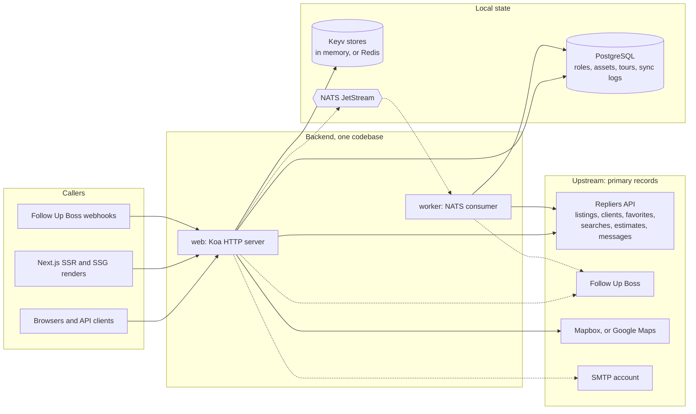

# Backend Docs

The portal backend (`portal-backend`) is the API server behind the white-label real
estate portal. It is a **proxy in front of the Repliers MLS API** — the frontend never
calls Repliers directly — plus a small amount of state of its own and the integrations
around it. This page shows what it is made of, which page answers which question, and
where each cross-cutting register lives.

What it does:

- **Proxies and shapes MLS data** — listings search, counts, similar listings,
  locations, autosuggest. Requests to Repliers are throttled and time-limited; a failed
  call is not retried ([retry layers](/architecture/failure-and-degradation#retry-layers)).
  Listing data is scrubbed for board rules before it is returned
  ([Scrubbing](/architecture/scrubbing)).
- **Keeps little data of its own** — clients, favorites, saved searches and estimates are
  Repliers records, read and written through the Repliers API. PostgreSQL holds only roles
  (`acl`), uploaded assets, social tokens, virtual tours and the CRM sync and webhook logs;
  one-time codes, revoked tokens and result caches are in Keyv stores
  ([Data ownership](/architecture/data-ownership#ownership-map)).
- **Handles authentication** — JWT sessions, OTP / email-token login, OAuth providers,
  agent authentication ([Authentication](/architecture/authentication)).
- **Reports engagement** — contact forms, listing views, saves and estimate events go to
  the CRM integration (Follow Up Boss) after the response
  ([Events & Messaging](/architecture/events-and-messaging)).
- **Sends messages** — OTP codes and inquiry notifications through the Repliers Messages
  API or a static SMTP account ([Email](/integrations/email)).

## Component map

A compact version of the [full component map](/architecture#component-map), which carries
the per-edge evidence. Solid arrows are dependencies no setting switches off; dashed arrows
are dependencies a setting turns off or selects
([required and optional dependencies](/architecture#required-and-optional-dependencies)).

## Process model

One codebase, two long-running processes and a release command, all in the `Procfile`:
`web` (`src/index.ts`, every `/api` route) and `worker` (`src/worker.ts`, the NATS
consumer, needed only with `NATS_ENABLED=true`). What each one starts, holds and stops is
on [Processes](/architecture#processes) and [Process lifecycle](/architecture/process-lifecycle).

Four values have no default and stop the process when missing: the Repliers key, the
Mapbox token and the two JWT key paths; other checks depend on settings
([startup prerequisites](/architecture/configuration-resolution#startup-prerequisites)).
PostgreSQL is not contacted at startup, the Keyv stores run in memory without Redis, and
NATS falls back to a dummy client; what each missing service turns off is in the
[feature dependencies](/architecture/configuration-resolution#feature-dependencies) register.

## Stack at a glance

Koa 3 + `@koa/router` · TypeScript (ESM, Node 24) · tsyringe DI · Joi validation ·
knex + PostgreSQL · Keyv/Redis caching · pino logging · NATS JetStream · mocha tests.

## Reading map

| Question                                                                  | Page                                                                                                                                                                                                                                           |
| ------------------------------------------------------------------------- | ---------------------------------------------------------------------------------------------------------------------------------------------------------------------------------------------------------------------------------------------- |
| How do I run it, and what do the first requests look like?                | [Setup](/getting-started), [First requests](/getting-started/first-requests), [Database & Services](/getting-started/database)                                                                                                                 |
| Which variable or preset sets a value, and which one wins?                | [Configuration Model](/getting-started/configuration), [Environment Variables](/getting-started/environment-variables), [Configuration resolution](/architecture/configuration-resolution)                                                     |
| What is the backend made of, and what does dependency injection hand out? | [Architecture Overview](/architecture)                                                                                                                                                                                                         |
| Which route reaches which service, upstream client and store?             | [Module catalogue](/architecture/modules)                                                                                                                                                                                                      |
| What happens to one request, from middleware to the error body?           | [Request lifecycle](/architecture/request-lifecycle)                                                                                                                                                                                           |
| How are paths, bodies, query arrays, pagination and errors handled?       | [API Conventions](/api-reference)                                                                                                                                                                                                              |
| What does a listings endpoint accept, send upstream and return?           | [Listings](/api-reference/listings), [Search & count](/api-reference/listings/search), [Detail, similar & history](/api-reference/listings/detail-similar-history), [NLP, featured, locations](/api-reference/listings/nlp-featured-locations) |
| How does the search box answer?                                           | [Autosuggest](/api-reference/search-and-locations/autosuggest), [Locations & Buildings](/api-reference/search-and-locations/locations-and-buildings), [Geocoding](/integrations/geocoding)                                                     |
| What can a signed-in user store and change?                               | [User & Favorites](/api-reference/user-and-favorites), [Saved searches](/api-reference/user-and-favorites/saved-searches)                                                                                                                      |
| How is an estimate built, owned and sent?                                 | [Estimates](/api-reference/estimate), [Estimate pipeline](/api-reference/estimate/pipeline)                                                                                                                                                    |
| What can agents and admins do?                                            | [Agent & Admin](/api-reference/agent-and-admin), [Agent clients, estimates & messages](/api-reference/agent-and-admin/agent-clients)                                                                                                           |
| Contact forms, statistics, virtual tours, webhooks?                       | [Contact, Stats & Tours](/api-reference/contact-and-stats), [Webhooks](/api-reference/webhooks)                                                                                                                                                |
| How does login work, and who may call an endpoint?                        | [Authentication](/architecture/authentication), [Auth endpoints](/api-reference/auth)                                                                                                                                                          |
| What does a guest see compared with a signed-in user?                     | [Scrubbing & Restrictions](/architecture/scrubbing), [Restricted listings](/architecture/restricted-listings)                                                                                                                                  |
| What does the proxy add to a Repliers call, and with which key?           | [Repliers Proxy](/architecture/repliers-proxy), [Repliers API](/integrations/repliers-api), [MLS-number prefix](/architecture/mls-number-prefix)                                                                                               |
| Which client IP does Repliers see, and how is an SSG build told apart?    | [Client IP forwarding](/architecture/client-ip-forwarding)                                                                                                                                                                                     |
| Who owns a record, and how does one identifier map to another?            | [Data ownership](/architecture/data-ownership), [Glossary](/glossary)                                                                                                                                                                          |
| What is stored locally, and what is cached?                               | [Persistence](/architecture/persistence), [Caching](/architecture/caching)                                                                                                                                                                     |
| What reaches the CRM, and how does the FUB sync run?                      | [Events & Messaging](/architecture/events-and-messaging), [Follow Up Boss](/integrations/follow-up-boss)                                                                                                                                       |
| How is mail delivered?                                                    | [Email](/integrations/email)                                                                                                                                                                                                                   |
| What happens when a dependency fails, and what has already happened?      | [Failure & degradation](/architecture/failure-and-degradation)                                                                                                                                                                                 |
| What does each process do at startup and on a signal?                     | [Process lifecycle](/architecture/process-lifecycle)                                                                                                                                                                                           |
| How does a whole workflow run, with a worked trace?                       | [Workflows W1–W10](/architecture/flows)                                                                                                                                                                                                        |
| How do I deploy, test and add a deployment?                               | [Deployment](/operations/deployment), [CI/CD](/operations/ci-cd), [Testing](/operations/testing), [Instances](/operations/instances), [Adding an instance](/tutorials/adding-an-instance)                                                      |
| What ships in the open-source export?                                     | [Export variants](/architecture/modules#export-variants)                                                                                                                                                 |
| Something is wrong: where do I look?                                      | [Troubleshooting](/operations/troubleshooting)                                                                                                                                                                                                 |
| How do I add an endpoint or an engagement report?                         | [Adding an endpoint](/tutorials/adding-an-endpoint), [Adding an event selector](/tutorials/adding-an-event-selector)                                                                                                                           |
| What is verified, and what is not?                                        | [Coverage](/coverage)                                                                                                                                                                                                                          |

Suggested route for a new reader: this page → [Architecture Overview](/architecture) →
[Request lifecycle](/architecture/request-lifecycle) → [Workflows](/architecture/flows) → the
domain page you need.

## Cross-cutting registers

Each register has one home; other pages link to it.

| Topic                                                               | Register                                                                                                                                               |
| ------------------------------------------------------------------- | ------------------------------------------------------------------------------------------------------------------------------------------------------ |
| Routes → validators → services → upstream clients and stores        | [Modules register](/architecture/modules#modules-register), [service-call map](/architecture/modules#service-call-map)                                 |
| Middleware, roles, ownership check and guest behaviour per endpoint | [Endpoint access](/architecture/authentication#endpoint-access)                                                                                        |
| Every internal caller of the listings search                        | [Listing callers](/api-reference/listings/search#listing-callers-register)                                                                             |
| What each endpoint masks or drops for a guest and a user            | [Visibility register](/architecture/scrubbing#visibility-register), [restricted-listing exits](/architecture/restricted-listings#enforcement-register) |
| Where each setting comes from and when it is applied                | [Effective configuration](/architecture/configuration-resolution#effective-configuration)                                                              |
| What each feature needs, and what happens without it                | [Feature dependencies](/architecture/configuration-resolution#feature-dependencies)                                                                    |
| Identifiers, conversions, owners, missing matches                   | [Identity and ownership](/architecture/data-ownership#identity-and-ownership)                                                                          |
| Local tables, readers, writers, cleanup                             | [Local persistence](/architecture/persistence#local-persistence)                                                                                       |
| Cache namespaces, keys, TTLs, invalidation                          | [Cache state](/architecture/caching#cache-state)                                                                                                       |
| Routes that report to the CRM, awaited or detached                  | [Engagement reporting](/architecture/events-and-messaging#engagement-reporting)                                                                        |
| NATS subjects, payloads, jobs, acknowledgements                     | [Worker handoffs](/integrations/follow-up-boss#worker-handoffs)                                                                                        |
| Backend method → Repliers endpoint, key, caching                    | [Repliers endpoints](/integrations/repliers-api#repliers-endpoints)                                                                                    |
| Caller contexts, key and throttle choice                            | [Contexts register](/architecture/client-ip-forwarding#contexts-register)                                                                              |
| Failure per stage: propagation, result, completed side effects      | [Failure outcomes](/architecture/failure-and-degradation#failure-outcomes), [retry layers](/architecture/failure-and-degradation#retry-layers)         |
| Error bodies and status codes                                       | [Error variants](/api-reference#error-variants), [status catalogue](/api-reference#status-catalogue)                                                   |
| Code absent from the open-source export                             | [Export variants](/architecture/modules#export-variants)                                                                                               |
| Evidence and its limits                                             | [Evidence coverage](/coverage#evidence-coverage)                                                                                                       |

## How this site is organized

- [Getting Started](/getting-started) — run the backend locally, configure it, make the
  first requests.
- [Tutorials](/tutorials) — add an endpoint, an event selector, a deployment.
- [Architecture](/architecture) — processes, request lifecycle, configuration, the
  Repliers proxy, scrubbing, data ownership, persistence, caching, auth, events, failures,
  workflows.
- [API Reference](/api-reference) — the `/api` surface by domain and its conventions; the
  exact contracts are the `@openapi` annotations, served as a Swagger UI when
  `APP_USESWAGGER=true`.
- [Integrations](/integrations) — Repliers, Follow Up Boss, geocoding, email.
- [Operations](/operations) — deployment, CI/CD, per-instance configuration, testing,
  troubleshooting, the OSS export.
- [Glossary](/glossary) and [Coverage](/coverage).

Verified against portal-backend `997ae3e`, 2026-10-20.
