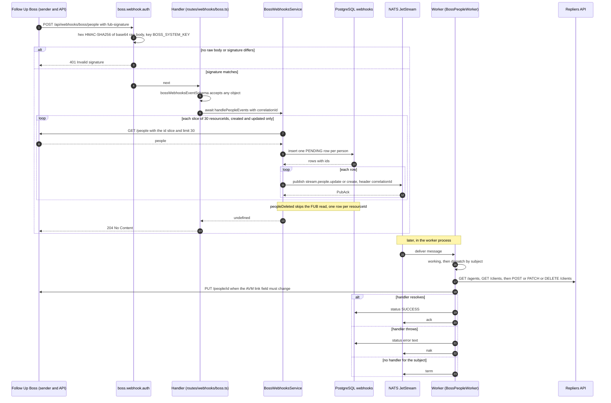

# Follow Up Boss

How the backend talks to Follow Up Boss (FUB), the CRM: which paths read or write FUB, what the
webhook handler does before it answers, how a job reaches the NATS worker, and which of the
outcomes (broker acknowledgement, task status, record update) each step produces. The master
switch for FUB API calls is `BOSS_ENABLED`. Four paths are covered here: event reporting, the
tagging route, the agent-run people sync and the FUB people webhooks; the last two finish in the
worker process. `BossService` has other callers, each described with its route:
`GET /api/agent/boss/people` (`AgentService.getBossPeople`) and the FUB note after
`POST /api/agent/estimate/{estimateId}/send` ([Agent & Admin](/api-reference/agent-and-admin)),
the FUB users listing of `GET /api/admin/agents` (`AdminService.getAgents`, same page), and the
OAuth agent sign-in that looks up the FUB user for the claim `external.fub_id`
(`OAuthService`, [Authentication](/architecture/authentication)); the full list is in the
[Module catalogue](/architecture/modules). Identifiers are defined in the [Glossary](/glossary) and their owners in
[Data ownership](/architecture/data-ownership#identity-and-ownership).

[Webhooks endpoint](/api-reference/webhooks) · [Events & Messaging](/architecture/events-and-messaging) · [Persistence](/architecture/persistence#what-lives-in-the-database) · [Module catalogue](/architecture/modules) · [Workflow W8](/architecture/flows) · [Client IP forwarding](/architecture/client-ip-forwarding)

## Worker handoffs

Every message the backend publishes to NATS, and what happens to it. `<stream>` is
`NATS_WORKER_CONSUMER_STREAM` (default `boss-people`); the stream's subjects are
`<stream>.people.*`. Each producer inserts its job row, then publishes one message per row and
awaits each publish before the next.

| Subject                               | Producer                                                                                                                                            | Serialized payload                                                                                                                     | Persisted job                                                                          | Consumer                                                                           | Result / status                                                                                                                                                                                       | ack / nak / term                                      | Source                                                                                                |
| ------------------------------------- | --------------------------------------------------------------------------------------------------------------------------------------------------- | -------------------------------------------------------------------------------------------------------------------------------------- | -------------------------------------------------------------------------------------- | ---------------------------------------------------------------------------------- | ----------------------------------------------------------------------------------------------------------------------------------------------------------------------------------------------------- | ----------------------------------------------------- | ----------------------------------------------------------------------------------------------------- |
| `<stream>.people.upsert`              | `SyncService.publishUpsert`, called by `AgentService.syncBossPeople` (`POST /api/agent/boss/people`) after the commit, one call per row; no headers | `JSON.stringify({ id, payload })`: `id` is the `people_sync.id`, `payload` the FUB person as `GET /people` returned it                 | `people_sync` row, `status` `PENDING`, inserted with its `sync` row in one transaction | `BossPeopleWorker.handleUpsert` → `SyncService.processUpsert`                      | `people_sync.status` `SUCCESS` with `client_id`, then `sync.last_processed_at`; on error `status` becomes `{"error": …}` (plus `info` for an `ApiError`) or `UNKNOWN ERROR` and the error is rethrown | `ack` when the handler resolves; `nak` when it throws | `src/services/sync.ts` (`publishUpsert`, `processUpsert`), `src/services/agent.ts` (`syncBossPeople`) |
| `<stream>.people.create`              | `BossWebhooksService.handlePeopleCreated` (FUB `peopleCreated` webhook)                                                                             | `JSON.stringify({ id, payload })`: `id` is the `webhooks.id`, `payload` is `{ person }` from FUB `GET /people`; header `correlationId` | `webhooks` row, `type` `peopleCreated`, `status` `PENDING`                             | `BossPeopleWorker.handleWebhookCreate` → `BossWebhooksService.processPeopleUpsert` | `webhooks.status` `SUCCESS`; on error the same JSON text as above (an `ApiWarning` such as `No tags found` included), then rethrown                                                                   | `ack` / `nak` as above                                | `src/services/boss/webhook.ts` (`handlePeopleCreated`, `processPeopleUpsert`, `catchProcessingError`) |
| `<stream>.people.update`              | `BossWebhooksService.handlePeopleUpdated` (FUB `peopleUpdated` webhook)                                                                             | as `create`                                                                                                                            | `webhooks` row, `type` `peopleUpdated`, `PENDING`                                      | `BossPeopleWorker.handleWebhookUpdate` → `BossWebhooksService.processPeopleUpsert` | as `create`                                                                                                                                                                                           | `ack` / `nak` as above                                | `src/services/boss/webhook.ts` (`handlePeopleUpdated`)                                                |
| `<stream>.people.delete`              | `BossWebhooksService.handlePeopleDeleted` (FUB `peopleDeleted` webhook); no FUB read                                                                | `JSON.stringify({ id, payload })` with `payload` `{ id: <FUB person id> }`; header `correlationId`                                     | `webhooks` row, `type` `peopleDeleted`, `PENDING`                                      | `BossPeopleWorker.handleWebhookDelete` → `BossWebhooksService.processPeopleDelete` | `SUCCESS` after `RepliersClients.delete`; with no client for the `externalId`: `{"error":"Missing client on Repliers side"}`, rethrown                                                                | `ack` / `nak` as above                                | `src/services/boss/webhook.ts` (`handlePeopleDeleted`, `processPeopleDelete`)                         |
| any other `<stream>.people.*` subject | none in `src/`                                                                                                                                      | —                                                                                                                                      | —                                                                                      | `StreamWorker.process` finds no entry in `eventMap`                                | no handler runs, no status written                                                                                                                                                                    | `term`                                                | `src/streams/worker.ts` (`StreamWorker.process`)                                                      |

The ids are `bigint` identity columns and `src/providers/db.ts` registers no type parser, so
node-postgres returns them as strings and the message carries `"id": "42"`, not `42`.

## D07 — Webhook to worker

The FUB people webhook, from the signature check to the broker acknowledgement. Everything above
the "later" note happens before the HTTP response; the worker runs in another process, on its own
schedule.

The values of one update are
followed in [W8](/architecture/flows).

## 1. Event reporting (portal → FUB)

User interactions become FUB **events** and **notes** through the events-collection layer:
selectors, tags, assignment and which routes await their CRM call are described in
[Events & Messaging](/architecture/events-and-messaging). This page keeps only the FUB settings
those events read.

Links inside events are built from templates:

| Setting                 | Default template                                              |
| ----------------------- | ------------------------------------------------------------- |
| `BOSS_PROPERTY_URL`     | `https://example.tld/listing/[MLS_NUMBER]?boardId=[BOARD_ID]` |
| `BOSS_CLIENT_URL`       | `https://example.tld/agent/client/[CLIENT_ID]`                |
| `BOSS_ESTIMATE_URL`     | `https://example.tld/estimate/[ESTIMATE_ID]`                  |
| `BOSS_SAVED_SEARCH_URL` | none (the saved-search link is left out)                      |

A relative template is prefixed with `SETTINGS_EVENTS_COLLECTOR_URL_HOST` at startup
([Configuration resolution](/architecture/configuration-resolution)). `BOSS_CLIENT_URL` is also
the base of the AVM link the workers write into FUB.

- `BOSS_DEFAULT_SOURCE` becomes the `source` of every event (`defaultEventFields`).
- `BOSS_DEFAULT_TAGS` is prepended to the person's tags (`assignTags`) on every event except one
  sent with `ignoreDefaultTags`; `EventsCollectionService.eventsCreate` then keeps only the
  person's own tags. `ContactService` sets it on the estimate `Property Inquiry` event
  (`src/services/contact.ts`).
- `BOSS_DEFAULT_ASSIGNED_TO` is read into `eventsCollection.defaultPersonFields.assignedTo`, and
  no code in `src/` reads that field: the line in `EventsCollectionService.assignAgent` that used
  it is commented out. A new lead created by an event is therefore not given this name.
- `BOSS_CUSTOM_AVM_FIELD` names a custom FUB person field that holds the user's AVM link. The
  registration selectors write it, `BossService.getPeople` adds it to its default `fields`, and the
  workers check and correct it (below).
- `BOSS_CUSTOM_FIELDS_STRATEGY` is read into `eventsCollection.customFieldsStrategy`; nothing in
  `src/` reads it.

## 2. Tagging API (`POST /api/user/boss/tag`)

Strict JWT. The route validates `tags` (array of strings, required), reads the client of the
token's `sub` with `UserService.info` and answers `404 User not found` when the client has no
[`externalId`](/glossary#externalid). It then reads that FUB person (`BossService.getPeople` with
`id` = the `externalId`; `404 Person not found` when none comes back), adds the new tags to the
person's current ones, sends the union with `PUT /people/{id}`, and answers `201 { result }`. The
union is sent because a FUB tag update replaces the whole list (upstream behaviour, unverified;
noted in `src/routes/user/boss.ts`). See
[User & Favorites](/api-reference/user-and-favorites).

## 3. People sync (FUB ⇄ portal, via NATS)

Two producers create jobs for the worker: an agent's bulk sync and the FUB people webhooks. Both
store a job row in PostgreSQL, publish its id to NATS and return; the worker then writes the
Repliers client and the job's status. Both need the database tables (`sync`, `people_sync`,
`webhooks`; [Persistence](/architecture/persistence#what-lives-in-the-database)) and NATS.

### Entry points

| Entry                            | Caller                                                                       | Starts                                                                                                                                                                                                                                                                                                                                                                | Source                                                                                            |
| -------------------------------- | ---------------------------------------------------------------------------- | --------------------------------------------------------------------------------------------------------------------------------------------------------------------------------------------------------------------------------------------------------------------------------------------------------------------------------------------------------------------- | ------------------------------------------------------------------------------------------------- |
| `POST /api/agent/boss/people`    | an Agent or Admin token whose claim `external.fub_id` is set (400 otherwise) | `AgentService.syncBossPeople`: FUB `GET /people` with `assignedUserId`, `agentId` and the optional `tags` from the query, no `limit` or `offset` (one FUB page); `{ synced: 0 }` when FUB returns nobody; else one `sync` row and one `people_sync` row per person in one transaction, commit, then one `people.upsert` publish per row; returns `{ synced: <rows> }` | `src/routes/agent.ts` (`router.post('/boss/people')`), `src/services/agent.ts` (`syncBossPeople`) |
| `POST /api/webhooks/boss/people` | FUB, signed with `BOSS_SYSTEM_KEY`                                           | `BossWebhooksService.handlePeopleEvents` (below)                                                                                                                                                                                                                                                                                                                      | `src/routes/webhooks/boss.ts`                                                                     |
| the NATS worker                  | messages on `<stream>.people.*`                                              | `BossPeopleWorker` (below)                                                                                                                                                                                                                                                                                                                                            | `src/worker.ts`, `src/streams/boss/people.ts`                                                     |

### Webhook handler before the response

The route awaits the whole handler, so every call below has finished (or failed) before FUB gets
its answer.

| Step                        | What happens                                                                                                                                                                                                                                                                                                                                 | Source                                                                                                                             |
| --------------------------- | -------------------------------------------------------------------------------------------------------------------------------------------------------------------------------------------------------------------------------------------------------------------------------------------------------------------------------------------- | ---------------------------------------------------------------------------------------------------------------------------------- |
| Signature                   | `middleware.boss.webhook.auth` reads `ctx.req.rawBody` (kept by `koaBody` with `includeUnparsed` and `patchNode`) and the `fub-signature` header; `isFromFollowUpBoss` compares the header with `createHmac("sha256", BOSS_SYSTEM_KEY).update(base64(rawBody)).digest("hex")`. No raw body or no match: `ApiError("Invalid signature", 401)` | `src/providers/middleware/boss.webhook.auth.ts`, `src/lib/boss/auth.ts` (`isFromFollowUpBoss`), `src/providers/middleware/body.ts` |
| Validation                  | `bossWebhooksEventSchema` is `Joi.object().unknown()`: any object passes, nothing is coerced; the body is logged                                                                                                                                                                                                                             | `src/validate/webhooks.ts`, `src/routes/webhooks/boss.ts`                                                                          |
| Correlation                 | the request's `correlationId` (from `x-correlation-id` when it is a UUID, else a new UUID) is added to the DTO                                                                                                                                                                                                                               | `src/providers/middleware/logger.ts`, `src/routes/webhooks/boss.ts`                                                                |
| Dispatch                    | `handlePeopleEvents` switches on `event`: `peopleUpdated`, `peopleCreated`, `peopleDeleted`; any other name is logged as a warning and the method returns                                                                                                                                                                                    | `src/services/boss/webhook.ts` (`handlePeopleEvents`)                                                                              |
| FUB read (created, updated) | `resourceIds` in slices of 30 (`WEBHOOK_BATCH_SIZE`); per slice `BossService.getPeople({ id: slice, limit: 30 })`. When a slice returns no people the method logs a warning and returns, so later slices are not read                                                                                                                        | `handlePeopleUpdated`, `handlePeopleCreated`                                                                                       |
| Task write                  | `WebhooksRepository.create` inserts one row per returned person (`type`, `payload: { person }`, `status: "PENDING"`) in one statement, returning the rows                                                                                                                                                                                    | `src/repository/webhooks.ts` (`create`)                                                                                            |
| Publish                     | one `jsc.publish` per row, each awaited (JetStream waits for the stream's `PubAck`), with the header `correlationId`                                                                                                                                                                                                                         | `handlePeopleUpdated`, `handlePeopleCreated`                                                                                       |
| Deleted                     | no FUB read: one row per id (`payload: { id }`), then the same publish loop on `<stream>.people.delete`                                                                                                                                                                                                                                      | `handlePeopleDeleted`                                                                                                              |
| Response                    | every branch resolves to `undefined`; the handler sets `ctx.body = undefined` and Koa answers `204` with no body                                                                                                                                                                                                                             | `src/routes/webhooks/boss.ts`                                                                                                      |

An error at any step propagates to the global error handler
([error variants](/api-reference)): a FUB failure is an `ApiError("Boss API error")` carrying
FUB's status (500 without a response), a database or NATS error is a 500. Rows inserted and
messages published before the error stay as they are.

### Webhook installation

FUB sends these webhooks only to a callback the backend has registered. The web process does that
itself.

| Step            | What happens                                                                                                                                                                                                                                                | Source                                                                                 |
| --------------- | ----------------------------------------------------------------------------------------------------------------------------------------------------------------------------------------------------------------------------------------------------------- | -------------------------------------------------------------------------------------- |
| Start           | `src/index.ts` calls `listen()` (its callback only logs), then `await`s `BossWebhooksService.installHooks()`, then registers the `SIGINT` and `SIGTERM` handlers                                                                                            | `src/index.ts`                                                                         |
| Switches        | `BOSS_WEBHOOK_ENABLED` not `true` (the default): an info log, nothing installed. Enabled with `BOSS_ENABLED=false`: an error log, nothing installed                                                                                                         | `installHooks`                                                                         |
| Startup asserts | with `BOSS_WEBHOOK_ENABLED=true`, `BOSS_SYSTEM` must be non-empty, and with `BOSS_WEBHOOK_USE_NGROK=true` `NGROK_AUTHTOKEN` must be set                                                                                                                     | `src/config.ts`                                                                        |
| Tunnel          | `BOSS_WEBHOOK_USE_NGROK=true`: an ngrok listener on the app port; its URL replaces `BOSS_WEBHOOK_BASEURL`                                                                                                                                                   | `installHooks`                                                                         |
| Clean-up        | `removeOldHooks`: FUB `GET /webhooks`, then `DELETE /webhooks/{id}` for every webhook listed                                                                                                                                                                | `removeOldHooks`                                                                       |
| Register        | three `POST /webhooks` calls, for `peopleCreated`, `peopleUpdated` and `peopleDeleted`, each with `url = new URL("/api/webhooks/boss/people", baseUrl)`; each returned `id` is kept in `runningWebhooksIds`, a response without `id` is logged as a warning | `installPeopleCreateWebhook`, `installPeopleUpdateWebook`, `installPeopleRemoveWebook` |
| Shutdown        | on `SIGINT` / `SIGTERM`: `uninstallHooks` deletes each id in `runningWebhooksIds` in turn (only when webhooks are enabled), then `process.exit(0)` in `finally`                                                                                             | `src/index.ts`, `uninstallHooks`                                                       |

Which webhooks FUB lists for `GET /webhooks` (for example whether the list is limited to the
calling `X-System`) is upstream behaviour, unverified; see the
[FUB API documentation](https://docs.followupboss.com/).

Configuration:

| Variable                                     | Default                                 | Purpose                                                                                   |
| -------------------------------------------- | --------------------------------------- | ----------------------------------------------------------------------------------------- |
| `BOSS_WEBHOOK_ENABLED`                       | `false`                                 | Install the webhooks at startup and remove them on shutdown                               |
| `BOSS_WEBHOOK_BASEURL`                       | `https://localhost:3000/webhook`        | Origin of the callback URL; its path is replaced (see Gotchas)                            |
| `BOSS_WEBHOOK_CLIENT_TAGS_CSV`               | empty                                   | Tags of which a FUB person needs at least one for the worker to create or update a client |
| `BOSS_WEBHOOK_USE_NGROK` + `NGROK_AUTHTOKEN` | `false` / empty                         | Tunnel for local webhook development                                                      |
| `BOSS_SYSTEM_KEY`                            | set a unique secret on every deployment | HMAC key of the signature check (and the FUB `X-System-Key` header)                       |

### The NATS worker

The worker is a separate entry point, `src/worker.ts` (`npm run dev:worker` in development). It
consumes one stream and runs the handlers of the [Worker handoffs](#worker-handoffs) register.

| Phase               | What happens                                                                                                                                                                                                                                                                                                                                                                                                                                                                                                                                                                                                                            | Source                                                                 |
| ------------------- | --------------------------------------------------------------------------------------------------------------------------------------------------------------------------------------------------------------------------------------------------------------------------------------------------------------------------------------------------------------------------------------------------------------------------------------------------------------------------------------------------------------------------------------------------------------------------------------------------------------------------------------- | ---------------------------------------------------------------------- |
| Provider            | the `nats` token is an `instanceCachingFactory` around an async factory, so each process gets one promise. With `NATS_ENABLED` not `true` it resolves to `DummyNats`. Otherwise it connects with `NATS_SERVER`, the name `<NATS_NAME>:<postfix>`, where `getProcessName()` gives `backend` for an `index` entry file, `worker` for `worker` and `unknown` for any other, and, when `NATS_CREDS` is non-empty, a creds authenticator; then for every stream in `src/streams/index.ts` it updates the stream (or adds it when absent) and adds the durable consumer only when it does not exist; it returns `pRetry(() => jetstream(nc))` | `src/providers/nats.ts`, `src/lib/introspection.ts` (`getProcessName`) |
| Stream and consumer | stream `NATS_WORKER_CONSUMER_STREAM`, subjects `<stream>.people.*`, `max_bytes` 100 MiB; consumer `{ durable_name: NATS_WORKER_CONSUMER_NAME }` and no other consumer setting                                                                                                                                                                                                                                                                                                                                                                                                                                                           | `src/streams/boss/people.ts` (default export)                          |
| Who connects        | the worker at start; the web process too, because `src/index.ts` resolves `BossWebhooksService`, whose constructor injects `nats`                                                                                                                                                                                                                                                                                                                                                                                                                                                                                                       | `src/index.ts`, `src/services/boss/webhook.ts` (constructor)           |
| Worker start        | `pRetry(() => container.resolve("nats"))` with the p-retry defaults (10 retries, exponential delay from 1 s). `instanceCachingFactory` keeps the first promise, so each attempt awaits that same promise                                                                                                                                                                                                                                                                                                                                                                                                                                | `src/worker.ts`                                                        |
| Binding             | `jsc.consumers.get(stream, consumer)`; the worker class is looked up by stream name (an `Error` when none matches) and resolved from the root container, so its Repliers clients use `DummyXFFProvider` ([Client IP forwarding](/architecture/client-ip-forwarding))                                                                                                                                                                                                                                                                                                                                                                    | `src/worker.ts`                                                        |
| Loop                | only when `NATS_ENABLED=true`: `while (true)` calls `consumer.consume()` and iterates it; for each message it binds the `correlationId` header into the global logger and awaits `worker.process(m)`, so one process handles one message at a time. An error thrown out of the iteration is logged (message only) and the loop calls `consume()` again, with no delay                                                                                                                                                                                                                                                                   | `src/worker.ts`                                                        |
| Dummy mode          | with NATS disabled the loop is skipped and the worker logs `NATS is disabled, not starting worker`                                                                                                                                                                                                                                                                                                                                                                                                                                                                                                                                      | `src/worker.ts`                                                        |
| Dispatch            | `StreamWorker.process`: `message.working()`; a subject found in `eventMap` → `await handler(message)` → `message.ack()`; no entry → `message.term()`; a thrown error → `console.error`, then `message.nak()` with no delay                                                                                                                                                                                                                                                                                                                                                                                                              | `src/streams/worker.ts`                                                |

The consumer is created with `durable_name` only, so its acknowledgement policy, acknowledgement
wait and maximum deliveries are whatever the NATS server applies by default (upstream behaviour,
unverified; see the [NATS consumer documentation](https://docs.nats.io/nats-concepts/jetstream/consumers)).
`nak()` asks for redelivery; how many times a message is redelivered is set by those server
defaults, not by the code. `working()` is sent once, at the start of a message.

Startup failures and shutdown: [Process lifecycle](/architecture/process-lifecycle).

### Matching a FUB person to a Repliers client

The two upsert handlers look the client up before they write, with different filters. Identifier
ownership is on [Data ownership](/architecture/data-ownership#identity-and-ownership).

| Step     | Sync worker (`SyncService.processUpsert`)                                                                         | Webhook worker (`BossWebhooksService.processPeopleUpsert`)                                                                                                                                                                                                    |
| -------- | ----------------------------------------------------------------------------------------------------------------- | ------------------------------------------------------------------------------------------------------------------------------------------------------------------------------------------------------------------------------------------------------------- |
| Job row  | `PeopleSyncRepository.getById(id)`; missing row → `Error("Sync information not found")`                           | not read; only updated at the end                                                                                                                                                                                                                             |
| Tag gate | none                                                                                                              | `BossService.checkTags`: at least one person tag must be in `BOSS_WEBHOOK_CLIENT_TAGS_CSV`, else `ApiWarning("No tags found")`                                                                                                                                |
| Contact  | primary email and phone: `status === "Valid"` and `isPrimary === 1`; neither → `Error("No email or phone found")` | same selection; neither → `ApiWarning`. The phone goes through `normalizePhoneNumber` (a `+1` number keeps its digits without the `+`, a 10-digit number gets a leading `1`, an 11-digit number starting with `1` is kept, anything else becomes `undefined`) |
| Agent    | `people_sync.agent_id` (the `sub` of the agent who ran the sync)                                                  | `RepliersAgents.filter({ externalId: assignedUserId })`, first agent's `agentId`; no `assignedUserId` or no match → `REPLIERS_AGENT_ID`                                                                                                                       |
| Lookup   | `RepliersClients.filter({ externalId, email, phone, operator: "OR" })`, raw phone                                 | `RepliersClients.filter({ externalId, operator: "OR", email })`, or the normalized `phone` when there is no email                                                                                                                                             |
| No match | `RepliersClients.create` with `status: true`, `data.fub.addresses`                                                | `create` with `status: true`, `data.lastSyncOn` and `data.fub.addresses`                                                                                                                                                                                      |
| Match    | `RepliersClients.update` of the first client, `data` merged over the client's                                     | `update` of the first client, `data` merged over the client's                                                                                                                                                                                                 |
| AVM link | `makeSureAVMLink` writes when `fieldName && !isString(existing) \|\| isEmpty(existing)` is true                   | `makeSureAVMLink` returns when `BOSS_CUSTOM_AVM_FIELD` is unset; otherwise writes when the stored value differs from the link                                                                                                                                 |
| Status   | `people_sync` `SUCCESS` + `client_id`, then `sync.last_processed_at`                                              | `webhooks` `SUCCESS`                                                                                                                                                                                                                                          |

The AVM link is `BOSS_CLIENT_URL` with the `clientId`, plus `?s=<calcSignature(clientId, salt)>`
when `AUTH_AGENTS_SIGNATURE_SALT` is non-empty (`secureFubAvmLink`, `src/lib/utils.ts`); it is
written with FUB `PUT /people/{id}`. The delete handler looks the client up by `externalId` only
and deletes the first match, with no tag check.

### Outcomes: acknowledgement, status, record

One webhook or sync produces four separate outcomes, at different times and in different places.

| Outcome                 | Where it lives                                                                                  | Set by                                        | When                                                                          |
| ----------------------- | ----------------------------------------------------------------------------------------------- | --------------------------------------------- | ----------------------------------------------------------------------------- |
| Publish acknowledgement | the `PubAck` returned by `jsc.publish` (with `DummyNats`, `undefined` and nothing stored)       | NATS JetStream                                | before the HTTP response, one per row                                         |
| Task status             | `webhooks.status` / `people_sync.status`: `PENDING` at insert, then `SUCCESS` or the error text | the producer at insert; the worker afterwards | the worker writes it after the external writes, and again on every redelivery |
| External record         | the Repliers client (created, updated, deleted) and the FUB person's AVM field                  | the worker                                    | before the status write; a later error does not undo it                       |
| Delivery result         | `ack`, `nak` or `term` on the message                                                           | `StreamWorker.process`                        | after the status write                                                        |

What the code establishes and what it does not:

- **Ordering**: rows of one request are published in the order the insert returns them, each publish awaited; one
  worker process handles one message at a time. Order across several worker processes is not
  established.
- **Retry**: the message is redelivered after `nak`, or after the server's ack wait expires
  without an ack (server defaults, unverified). FUB and Repliers calls are not retried, and nothing
  re-publishes a `PENDING` row.
- **Deduplication**: no `Nats-Msg-Id` is set and FUB's `eventId` is not stored, so a repeated
  webhook creates new rows and messages. The lookup before `create` decides between creating and
  updating a client.

### Variation

- **`BOSS_ENABLED=false`.** `BossService.request` logs a warning and returns `{}` without calling
  FUB. The webhook route still answers: created and updated events then end in a 500 (`people` is
  missing on `{}`), deleted events are stored and published. Installation is skipped with an error
  log when `BOSS_WEBHOOK_ENABLED=true`.
- **`NATS_ENABLED=false` (the default).** `DummyNats.publish` returns without storing anything, so
  rows stay `PENDING`; the worker does not start its loop.
- **`BOSS_WEBHOOK_ENABLED=false` (the default).** Nothing is registered with FUB; the route is
  mounted and checks signatures all the same.
- **Empty `BOSS_WEBHOOK_CLIENT_TAGS_CSV`.** `checkTags` splits `""` into `[""]`, so no person
  passes and every create and update job ends with `No tags found`.
- **No `BOSS_CUSTOM_AVM_FIELD`.** `getPeople` omits the field from `fields`; the webhook worker
  skips the AVM step. In the sync worker the stored value is `null`, so the condition is true and
  the worker sends FUB `PUT /people/{id}` with a field named `undefined` holding the link
  (`src/services/sync.ts`, `makeSureAVMLink`).
- **No database.** The three job tables are required; see
  [Running without a database](/architecture/persistence#running-without-a-database).

## FUB API access

`BossService` (`src/services/boss.ts`) is the only FUB client. It sends Basic auth with
`BOSS_USERNAME` / `BOSS_PASSWORD`, the headers `X-System: BOSS_SYSTEM` and
`X-System-Key: BOSS_SYSTEM_KEY`, to `BOSS_BASEURL` (default `https://api.followupboss.com/v1`),
with the axios timeout `BOSS_TIMEOUT_MS` (default `30000`). Calls are not throttled or retried. A
failed call becomes `ApiError("Boss API error", <FUB status>, <FUB body>)`. With
`BOSS_ENABLED=false` every call returns `{}`. `getPeople` sends a default `fields` list
(`id,name,firstName,lastName,emails,phones,picture,tags,assignedUserId,addresses`, plus
`BOSS_CUSTOM_AVM_FIELD`) unless the caller passes `fields`. axios serializes an array `id` as
`id[]=501&id[]=502`; how FUB reads that form is upstream behaviour, unverified (see the
[FUB API documentation](https://docs.followupboss.com/)).

## Gotchas

1. **The callback path is fixed.** `new URL("/api/webhooks/boss/people", baseUrl)` keeps only the
   origin of `BOSS_WEBHOOK_BASEURL`; the default `https://localhost:3000/webhook` gives
   `https://localhost:3000/api/webhooks/boss/people`. Source: `src/services/boss/webhook.ts`
   (`WEBHOOK_BASEPATH`, `installPeopleCreateWebhook`).
2. **The AVM write is a FUB person update.** Whether FUB then sends a `peopleUpdated` webhook for
   it is upstream behaviour, unverified; when it does, the worker reads a link equal to the one it
   wrote and skips the next write. Source: `src/services/boss/webhook.ts` (`makeSureAVMLink`).
3. **`upsert` messages carry no `correlationId`.** `publishUpsert` passes no headers, so the
   worker binds `undefined`. Bindings accumulate on the worker's global logger for the life of the
   process, so an upsert's lines carry the ids of earlier webhook messages
   ([Troubleshooting](/operations/troubleshooting#finding-one-request-in-the-logs)). Source:
   `src/services/sync.ts` (`publishUpsert`), `src/worker.ts` (`logger.setBindings`).

## Evidence

- Read: `src/routes/webhooks/{index,boss}.ts`, `src/providers/middleware/boss.webhook.auth.ts`,
  `src/lib/boss/auth.ts`, `src/providers/middleware/body.ts`, `src/services/boss.ts`,
  `src/services/boss/webhook.ts`, `src/services/sync.ts`, `src/services/agent.ts`,
  `src/streams/{index,worker}.ts`, `src/streams/boss/people.ts`, `src/worker.ts`, `src/index.ts`,
  `src/providers/nats.ts`, `src/lib/dummy.nats.ts`, `src/repository/{people_sync,sync,webhooks}.ts`,
  `src/migrations/*`, `src/config.ts`.
- Libraries read in `node_modules`: Koa 3.2.1 `response.body` setter (`undefined` → 204), koa-body
  8.0.0 `patchNodeAndKoa` (`ctx.req.rawBody`), tsyringe 4.10.0 `instanceCachingFactory`,
  `@nats-io/jetstream` 3.4.0 `publish` (awaits the `PubAck`), p-retry 8.0.1 defaults. axios
  1.20.0 array serialization checked with `axios.getUri`.
- No test in `test/` covers the webhook route, the workers, `SyncService` or the NATS provider.
- Not executed: the webhook and the workers write Repliers clients and FUB people. Not
  established by this checkout: FUB's retry policy for a failed callback, the scope of
  `GET /webhooks`, how FUB reads `id[]`, and the NATS server's consumer defaults.

Verified against portal-backend `997ae3e`, 2026-10-20.
