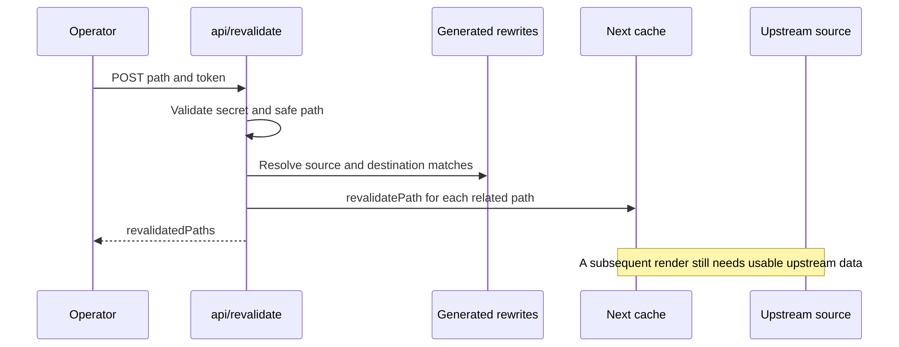

# Caching and Revalidation

Source review: `e30dd9b47`, 2026-11-02. There is no single “portal cache”. First
identify whether the stale value is browser state, a request memo, generated data,
a Next page/fetch result or a deployment/CDN artifact.

## Cache ownership

| Layer | Owner / lifetime | Refresh boundary |
| --- | --- | --- |
| Search results and open listing | React providers; mounted browser subtree | A successful fetch replaces results; a URL replacement alone is not a fetch |
| Profile, recents, NLP history | Browser storage consumers | Owner-specific update/clear; backend changes do not push into localStorage |
| Request memoization | React `cache`, e.g. listing route `fetchListing`, `loadStaticTree` | Deduplicates within the render/request scope; not a durable content store |
| Generated location tree | `public/<tenant>/locations.json` | Explicit generation; page ISR does not regenerate this file |
| Location count map | `services/LocationsTree/static.ts`, module promise | Process-lifetime memo; regenerating the file does not invalidate an existing process memo |
| CMS fetch data | CMS clients; WordPress default revalidate 3600 | Client fetch policy and invalidation; distinct from the page interval |
| Next route data | Route declarations below | Time-based regeneration or `revalidatePath` |
| Self-hosted Next cache | `cache-handler.js`; production outside Vercel | Redis namespace includes generated deployment id; tags can invalidate entries |
| Browser/CDN HTML and assets | Deployment-specific infrastructure | Must stay consistent with the deployed JavaScript; not controlled by a React provider |

## Route interval register

These are declarations in the current `src/app` route files, not a promise of
freshness at exactly that wall-clock interval. Runtime dependencies and request
APIs can change how a route renders.

| Route family | Declared behavior |
| --- | --- |
| Home | `revalidate = 3600` |
| Locations catch-all | `revalidate = 3600`, `dynamic = 'force-static'` |
| Dashboard city / residential / condos reports | `revalidate = 86400`, `force-static`, dynamic params enabled |
| Blog index, post, category, tag and pagination | `revalidate = 3600` |
| Authors, author detail | `revalidate = 86400` |
| CMS page and pages catalog | `revalidate = 86400` |
| Buildings / building / condo catalog and detail | `revalidate = 86400` |
| Estimate catch-all | `revalidate = 86400` declaration; inspect its request/auth path separately |
| Embedded estimate and demo; widgets; admin revalidation page | Explicit `force-dynamic` |
| Search and listing detail | Request-dependent paths, including metadata/header use |
| Robots, sitemap index, docs sitemap | Explicit `force-static` |
| Content sitemap, listing sitemap index and chunks | `revalidate = 3600` |

## Redis behavior

`next.config.js` enables the custom handler only when `NODE_ENV` is production
and `VERCEL` is absent; it also disables Next's in-memory cache in that branch.
The handler selects `REDISCLOUD_URL || REDIS_URL` and prefixes keys with
`portal:slug:<deployment-id>:`. Missing/unavailable Redis returns a miss on get
and skips writes. Do not diagnose this as proof that a particular fallback cache
is durable: persistence also depends on the hosting runtime.

Finite positive revalidation periods receive a Redis TTL of that period plus
3600 seconds. Other entries are written without that TTL. Tag invalidation uses
stored timestamps compared with the entry's last modification. Maps and Buffers
have explicit serialization, required for page segments and route-handler bodies.
The Next `expireTime` is 90000 seconds, above the largest declared daily interval.

## On-demand refresh

Use the [handler contract](/technical-guide/api-routes#revalidation-contract).
Validate rendered content after invalidation, not just the success response.
Do not put the secret into screenshots or public example URLs.

## Failure diagnosis

An upstream timeout can exhaust server retries before reaching a page's catch
branch. The listing page deliberately renders its fallback template and marks
transient metadata failures `noindex`; other routes may throw. “Every failed ISR
serves stale” is not a safe universal description of these page implementations.
See [Failure and Degradation](/technical-guide/failure-and-degradation).

The Redis path, provider caches and generated artifacts were read, not exercised
against a production cache. Cache invalidation was not invoked during this audit.
