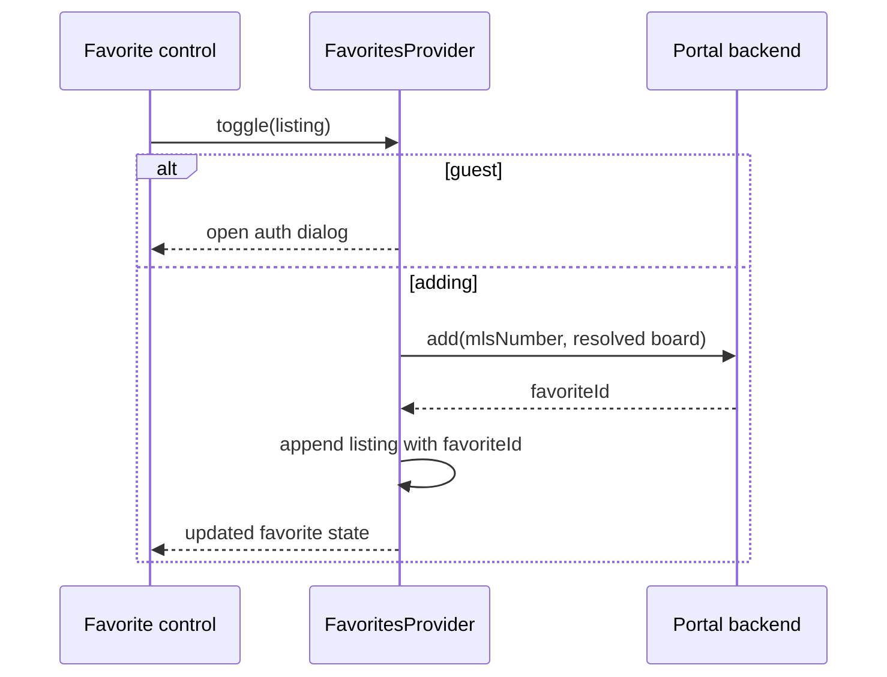

# State and data ownership

A URL, React context, browser storage and a backend record have different lifetimes. Identify the owner before changing a value or describing a reset. The provider hierarchy is in [State Management](/technical-guide/state-management); this page owns persistence and identity semantics.

## Ownership register

| Value | Owner / location | Writers and readers | Lifetime / reset |
| --- | --- | --- | --- |
| JWT | Cookie named by `storage.tokenKey` | `utils/tokens`; APIBase attaches it as Bearer | Set with a 30-day cookie expiry; actual validity uses JWT `exp`. Client logout removes it; server cookie deletion can be unavailable in a render |
| User profile | UserProvider state + `localStorage[profileKey]` | `saveProfile`, `processAuthResponse`, mount effect | Restored after mount; removed on logout. A stored profile is not proof of a valid token |
| Logged-in UI state | `UserProvider` React state | Mount effect, successful auth, logout | Starts false for hydration; becomes true after a valid cookie is found or auth succeeds |
| Search filters | Route initialization + `SearchProvider` | Controls through provider actions; fetch/URL effects read them | Scoped provider lifetime; URL stores non-default values for a later visit |
| Drawn polygon / loaded region | SearchProvider | Drawing or saved-search initialization | `clearPolygon` clears both; drawing clears the loaded region |
| Selected external locations | Filter IDs + resolved map locations | URL parser admits configured resolvers; map resolver loads geometry | Listing fetch waits while selected IDs remain unresolved |
| Camera, style, layers and orientation | `MapOptionsProvider` and map callbacks | Map controls/movement; URL writer | Scoped map state; selected presentation values serialized for sharing |
| Listing results / clusters / statistics | SearchProvider saved response | `save` maps API fields; grid/map read it | Replaced by a successful response; a swallowed request error does not write an empty result |
| Open listing / multi-unit selection | SearchProvider | `saveCachedListing`, `saveMultiUnits`, clear actions | Scoped UI cache, not a backend record |
| Favorite listings | Backend records + FavoritesProvider cache | `APIFavorites`, `add`, `remove`, `fetch` | Hydrated for a logged-in user role; successful mutations change the cache |
| Favorite images | Backend records + ImageFavoritesProvider cache | `APIImageFavorites` | Similar role-gated hydration; image identifiers are separate from favorite-listing IDs |
| Saved searches | Backend records + SaveSearchProvider cache | `APISavedSearch`, provider create/update/delete | A saved search survives page navigation; current map state does not create one automatically |
| Autosuggest session token | Module variable in `utils/tokens.ts` | `getSessionToken` generates a UUID on first use | Module-instance lifetime; not the JWT and not a cookie |
| Recently viewed | `hooks/useRecents.ts` and `localStorage[recentsKey]` | Read/add/clear operations in the hook | Browser history collection; not a favorite backend record |
| Built-in NLP conversation | ChatContent state and `nlpTokenKey` / `nlpHistoryKey` | Submit, response, reset and hydration | Persists across reloads; result carousel snapshots belong to individual history items |
| Iframe conversation | SupportAgent local state and generated session id | NLP extraction and message handlers | Separate from built-in history; protocol reset-name mismatch is documented in F03 |
| Estimate draft | RHF values and `EstimateProvider/hooks/useStorage.ts` | Save/read/reset of `estimateDataKey` | Draft persistence is not a submitted estimate; declared storage keys without consumers are not additional state |
| Estimate record/result | EstimateProvider data hooks plus backend | Create/update/fetch; ULID or numeric identity | Successful result changes route state; failure retains/reopens form state |
| CMS content/metadata | CmsService clients and resolver | Remote content, local metadata override, renderer | Fetch/page cache policy; no browser provider owns the editorial record |
| Generated geography/counts | LocationsTree static loader and process memo | Generator writes; routes/overlays read | Explicit generation plus file/process lifecycle, separate from page ISR |

Storage key literals come from `src/configs/defaults/storage.ts` and may be overridden. Do not assume every key declared there is an actively used persistence mechanism; locate its consumer first.

## Identity conversions

| Identity | Conversion / use | Source |
| --- | --- | --- |
| Listing | `mlsNumber` plus the applicable board context identifies the record being linked/fetched | `utils/listings/seo.ts`, listing route utilities; [Listing Detail](/product-guide/listing-detail/technical) |
| Favorite | `favoriteId` returned by add is stored on the cached listing and used by removal | `FavoritesProvider.tsx` |
| Saved search | `searchId` selects a stored query; it is not a listing ID | `SaveSearchProvider`, `app/search/[layout]/page.tsx` |
| Saved-search fields | `styles` → `style`, `minBeds` → `minBedrooms`, `keywords` → `search`; boundary values converted to the UI's unset representation | `getFiltersFromSavedSearch` in search route `_utils.ts` |
| UI property/status choice | `listingType` / `listingStatus` transform into API fragments; `type` is sale/lease | `services/Search/adapter.ts`, `declarations.ts`, `types.ts` |
| External overlay location | ID resolves to geometry; the ID itself is not the MLS search constraint | Search parser, `utils/map/externalLocations.ts`, `getSearchArea` |

## A successful mutation changes two things

The provider updates its cache after the API resolves. In the inspected implementation, favorite add/fetch/remove catches errors silently and clears the relevant progress flag in `finally`. Do not document an optimistic rollback or an error toast that this code does not implement. Image favorites have their own response checks. [Failure outcomes](/technical-guide/failure-and-degradation) records the differences.

## Authentication cleanup boundary

`UserProvider.logout` clears the client cookie, profile state and localStorage profile, removes a URL token, then reloads the page. Although `APIAuth` exposes a `/auth/logout` method, this provider's logout implementation does not call it. Local sign-out therefore must not be described as demonstrated backend token revocation. `APIBase` also attempts token clearing on a 401; that alone does not synchronously update every provider's React state.

## Evidence and limits

Source-read against portal monorepo `e30dd9b47`, 2026-11-02: `src/utils/tokens.ts`, `src/utils/xff.ts`, `src/configs/defaults/storage.ts`, `src/providers/{UserProvider,FavoritesProvider,ImageFavoritesProvider}.tsx`, `SearchProvider/SearchProvider.tsx`, `SaveSearchProvider/SaveSearchProvider.tsx`, and search route `_utils.ts`. Mutation flows here are synthetic, not requests made against an account. Backend ownership enforcement and notification delivery are outside this frontend-only observation. [Coverage](/coverage).
