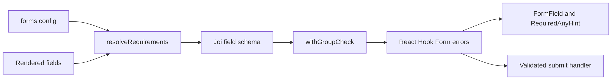

# Forms and Validation

Source review: `e30dd9b47`, 2026-11-02. Shared contact/scheduling forms use React
Hook Form, Joi and `components/shared/Forms`; auth and profile dialogs retain
their own schemas. A shared field appearance does not imply a shared submission
contract.

## Requirements resolution

`configs/defaults/forms.ts` declares `required`, `requiredAny` and optional
per-form blocks. `resolveRequirements(form, fields)` selects the per-form block
when present; otherwise it selects the global rules. It intersects rules with
the rendered field set. A group with one visible member becomes a required field;
a group with no visible members disappears.

For a synthetic rendered set `['name', 'email']` and a required-any group
`['email', 'phone']`, the resolved requirement is `email`: the invisible phone
cannot satisfy the form. Per-form rules replace global rules, and the default
`requestInfo` block does not require message. Preserve intended blocks when
overriding the forms map.

## Validation and rendering path

`useRequirementsForm` creates the schema for the values held by the form and wraps
the Joi resolver with `withGroupCheck`. The group check runs after field validation,
adds `requiredAny` errors to unfilled members and returns no values on failure.
This avoids Joi object-root errors that cannot be displayed at a field. A filled
but invalid email still fails the email schema; filling one group member only
satisfies presence, not format. Labels and validation messages use translations.

## Contact transaction

`ContactForm/useContactForm.ts` seeds identity from `UserProvider`, updates a
controlled message independently, normalizes missing optional strings to `''`
and sanitizes the phone. With `mlsNumber`, it calls
`APIContact.requestInfo` → POST `/contact/requestinfo`; otherwise it calls
`addComment` → POST `/contact/contactus` with `pageUrl` and optional tags.

On a resolved call it resets the form, runs `onSend`, and either opens the
configured redirect or shows success. Catch shows an error snackbar. **The two
API methods have different failure semantics:** `requestInfo` uses `fetchJSON`
and rejects non-OK HTTP responses; `addComment` uses `fetchRaw` and the hook does
not inspect `response.ok`. A displayed success for the latter is not evidence of
backend delivery. Newsletter and estimate-meeting methods also return raw
responses; inspect their consumers before promising delivery confirmation.

## Other contracts

| Form boundary | Owner | What to inspect when changing it |
| --- | --- | --- |
| Tour scheduling | `Forms/ScheduleForm`, `APIContact.homeTourRequest` | Method/date/time and listing identity; JSON error path |
| Estimate meeting | `APIContact.meetingRequest` | Estimate identity; raw response semantics |
| OTP / signup | `Dialogs/AuthDialog/schemas.ts`, `UserProvider` | Email/phone validation, signup and OTP transitions |
| Profile | `Dialogs/ProfileDialog/schema.ts`, `UserProvider.update` | Profile preferences and returned success boolean |
| Saved search | `Dialogs/SaveSearchDialog/SaveSearchForm.tsx`, `SaveSearchProvider` | Naming, notification options, geometry and server limits |
| Local API body/query | `app/api/_lib.ts` and each handler | Server validation is independent of client validation |

## Verification

Existing `requirements.test.ts`, `groupResolver.test.ts`, `fieldSchemas.test.ts`
and `ContactForm/schema.test.ts` exercise requirement resolution and validation.
They do not send mail, create a CRM lead or prove external delivery. See
[F09](/technical-guide/workflows/user-actions#f09--contact-submission) for a
synthetic transaction and [Testing](/operations/testing) for execution evidence.
