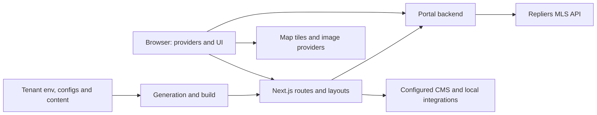
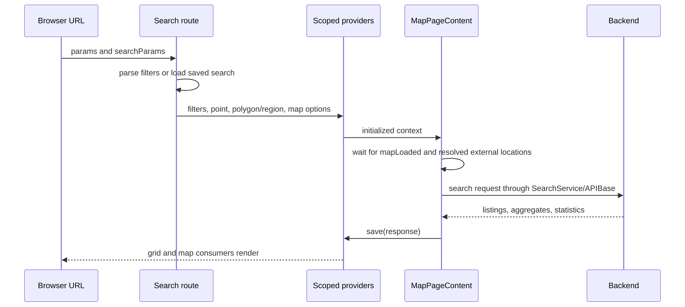

# Rendering and lifecycle

The portal runs in three contexts: build/static regeneration, a Next.js request and the browser. The same API service can run in more than one context; its token, forwarding headers and retry behavior depend on that context.

## System boundary

The browser does not send the Repliers API key. `src/configs/defaults/api.ts` builds the proxy base as `${NEXT_PUBLIC_API_URL}/api`. Same-origin `src/app/api/` handlers are a separate surface: CMS pagination, overlays and other integration adapters live there. A frontend API service is not automatically a Next.js API route.

## Execution contexts

| Context | Request cookies | Forwarding headers | Retry policy | Main entry |
| --- | --- | --- | --- | --- |
| Browser | `js-cookie` token read | `getForwardedFrom` returns null | No APIBase retry | Client components/providers |
| Request-scoped Next render | Cookie read through `next/headers` when available | With `x-forwarded-for`: `ssr`, original chain and SSR token | Configured server retry | Page, metadata or handler |
| Static build / ISR / cache scope | `requestScoped()` prevents cookie access | Without a forwarded chain: `ssg`, SSG token; no empty XFF header | Configured server retry | Prerender or regeneration |

Source: `src/utils/xff.ts` (`requestScoped`, `getRequestHeaders`, `getForwardedFrom`), `src/utils/tokens.ts` (`getToken`), `src/services/API/APIBase.ts` (`getHeaders`, `fetchJSON`). Forwarding selection is based on the presence of a real forwarded chain, not merely the fact that JavaScript is running on the server. An SSR request without that chain takes the SSG forwarding branch.

`requestScoped` reads Next's work-unit store. Calling `headers()` or `cookies()` speculatively during a static render can mark that render dynamic before an exception is caught. The helper avoids that call entirely outside a request. This is an implementation tied to the installed Next version; recheck it during upgrades.

## From URL to interactive page

1. `next.config.js` provides generated redirects/rewrites and `src/proxy.ts` applies request-time guards. See [Middleware](/technical-guide/middleware).
2. The route awaits `params` / `searchParams`, checks its feature gate and resolves server data. A redirect, `notFound()` and an upstream failure are distinct outcomes.
3. `src/app/layout.tsx` and `_providers.tsx` supply translation, theme and global client providers. Route/template providers add domain state.
4. Server output and serialized props initialize the browser. `UserProvider` starts with empty profile and `logged=false`, then reads cookie/profile after mount; it does not render a browser-only signed-in state into the initial server HTML.
5. Domain effects fetch or update data. Search waits for map readiness; a CMS page can already have its content in the server output. Do not infer the fetching strategy from a component's visual appearance.

## Search is a staged initialization

`src/app/search/[layout]/page.tsx` handles a `searchId` before the map mounts. One saved polygon ring becomes an editable polygon; several become a read-only region, with the camera fitted across all rings. A saved-search 404 calls `notFound`; other errors are rethrown. The normal path reads filters, point and polygon from the URL. The listing fetch itself belongs to `MapPageContent`, not to this server route.

## Build and generated artifacts

The monorepo `dev` command explicitly runs `prebuild`: aliases → feature synchronization → rewrites → deployment ID. `build-remote.js` chooses webpack when the override plugin is present, and Turbopack for a normalized tree or an export without that plugin. These are different resolution paths; describe the one actually being run.

Locations are a generated data input, not a location tree reconstructed on every page request. Documentation output is another generated artifact: the two docs sites are exported independently and then copied into the portal by `scripts/build-documentation.js`. See [Multi-tenant System](/technical-guide/multi-tenant) and [First Launch](/getting-started/first-launch#what-prebuild-does).

## Evidence and limits

Source-read against portal monorepo `e30dd9b47`, 2026-11-02: the files and symbols above, `src/app/_providers.tsx`, `src/providers/UserProvider.tsx`, `scripts/build-remote.js`, `package.json`. `APIBase.test.ts` and `utils/xff.test.ts` were executed as part of the Search verification group; they check forwarding behavior, not a deployed proxy/CDN chain. The subsequent defaults/sample-data browser trace verifies local search and direct listing rendering. [Coverage](/coverage) records the exact runtime boundary.
