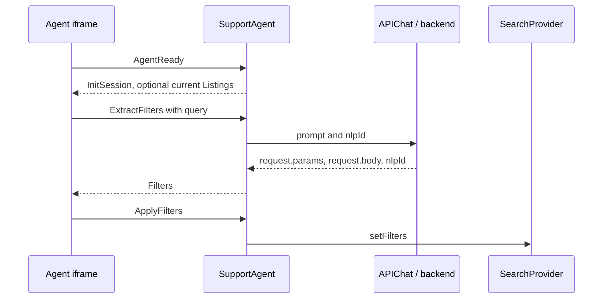
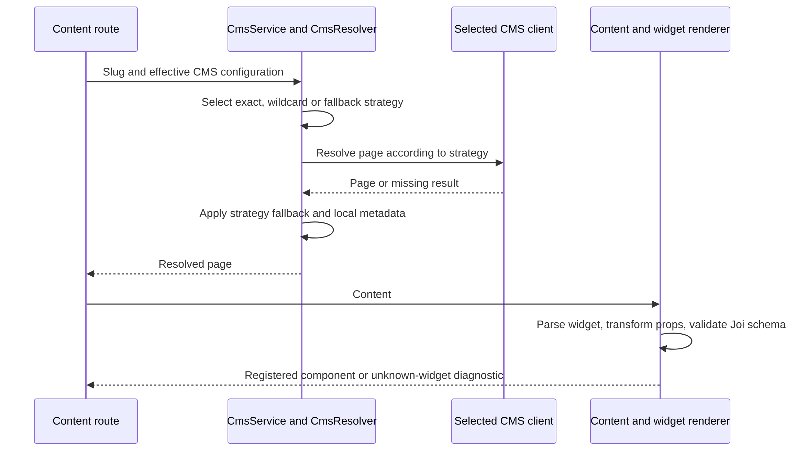
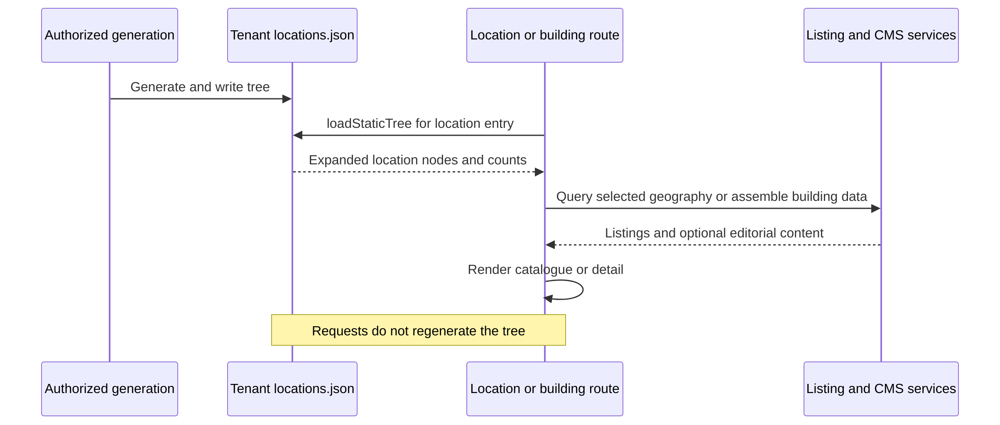
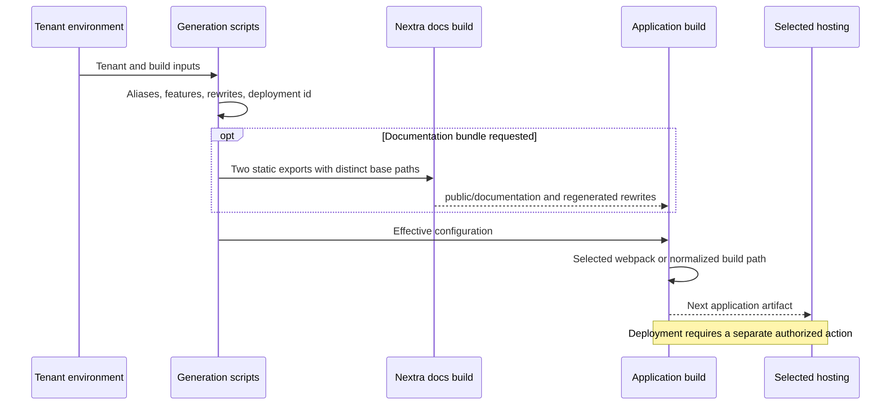

# Content and Build Workflows

Source review: `e30dd9b47`, 2026-11-02. Examples describe current code with
synthetic content. No remote CMS edit, data regeneration, export or deployment
was performed while writing these traces.

## F03 — Turn language into search

The built-in chat and the external iframe bridge share `APIChat.fetchReply`.
It posts `{ prompt, nlpId, aggregates: 'map' }` to `/listings/nlp`. Backend NLP
returns `request` and `nlpId`; the returned token threads follow-up queries.
This token is distinct from authentication and from the iframe session id.
Preconditions: the selected chat feature and configured backend; the external
branch also requires a mounted iframe and its readiness handshake.

| Path | State owner | Apply boundary |
| --- | --- | --- |
| Built-in chat | Chat history/token storage and search providers | `useApplyFilters` applies parsed filters, geometry and image-search context |
| External agent | `SupportAgent` local NLP token and iframe session | `ExtractFilters` returns `Filters`; a subsequent `ApplyFilters` changes search |

<div style={{ overflowX: 'auto' }} tabIndex={0} role="region" aria-label="Scrollable architecture diagram">



</div>

For a synthetic request body containing `minBedrooms: 2`, the bridge merges
`request.params` followed by `request.body` into the returned filters. Extraction
failure returns null filters and clears its loading state; it does not apply a
new search. The reference agent applies only a nonempty filter object.

Current protocol limitations were read at both ends: messages use target `'*'`,
the receivers do not validate origin/source or compare session-id equality, and
only some handlers require a session field. This is not an authenticated message
channel. The reference client sends `AgentReset`, whereas the portal registers
`ResetAgent`; that reset name does not match. The protocol table documents the
portal contract, not proof that all reference-client actions work end to end.

## F10 — Resolve a CMS page and render a widget

`CmsService` selects configured clients; `CmsResolver` then chooses per slug:
exact match, longest wildcard, `*`, finally `remoteFirst`. `localOnly` reads local
MDX; `remoteOnly` reads remote content; `remoteFirst` falls back to local when the
remote lookup returns no page. Exceptions are not the same as a missing page and
are not caught as a blanket fallback by this resolver. Client-level fallbacks
must also be considered when assessing effective behavior.

When remote content is found, defined local metadata is merged over the remote
page. Thus a remote body and a local title/meta can legitimately appear together.
Blog client selection is separate and requires the blog feature.

<div style={{ overflowX: 'auto' }} tabIndex={0} role="region" aria-label="Scrollable architecture diagram">



</div>

Preconditions: an enabled content route and configured local/remote source.
The sequence follows a successful resolution; exceptions are the separate failure
boundary described above, not an implicit fallback.

Synthetic widget content:

```text
[TestWidget title="Example widget" count=2 enabled=true]
```

`widgetParser` extracts the name/properties; `widgetTransform` converts values
against `CmsWidgets/registry.ts`; Joi validates the declared schema; the renderer
selects the registered component. `count` becomes numeric 2. A valid widget-only
paragraph is replaced as a whole to avoid invalid nested HTML. Unknown components
use `UnknownWidget`; parser/transform tests do not establish remote publishing or
all browser layouts. See [Adding a Widget](/tutorials/adding-widget).

## F11 — Publish geography and building content

Location pages read the pre-generated `public/<tenant>/locations.json` through
`loadStaticTree`. The loader expands compact nodes and count maps, sharing work
within a request. A disabled feature returns an empty tree; a missing file logs
and returns an empty tree. It does not rebuild geography in the request path.
Malformed JSON is a separate parse failure, not the missing-file branch.

The CLI generator is the normal maintenance path. The guarded
`/api/generateLocations` route also performs generation and writes the file,
including in `output=file` mode; downloading the result is **not** a read-only
operation. Generation and ISR invalidation are different actions. Process-cached
counts require their own lifecycle consideration after replacement.

Buildings combine CMS editorial data and listing/building data. WordPress naming
is inverted: its `buildings` CPT represents groups, while categories identify
individual buildings. Follow the [CMS anatomy](/product-guide/cms-content/technical)
and the assembly utility rather than equating a CMS id, category id and MLS
building identifier. Existing assembly/location tests exercise those transformations;
they do not certify a tenant's current external catalog.

<div style={{ overflowX: 'auto' }} tabIndex={0} role="region" aria-label="Scrollable architecture diagram">



</div>

Preconditions: the corresponding feature and configured data source; location
entries need the generated tree. A synthetic selected node contributes geography
to the listing query; a CMS building category contributes editorial identity.
These are distinct identifiers, not interchangeable lookup keys.

## F12 — Build and publish an artifact

<div style={{ overflowX: 'auto' }} tabIndex={0} role="region" aria-label="Scrollable architecture diagram">



</div>

Preconditions: the [deployment prerequisites](/operations/deployment), selected
tenant inputs and available build-time services. A failed generation/build does
not produce a verified artifact; deployment/runtime health is a separate check.

Monorepo development runs prebuild then webpack. Production build uses the wrapper
that selects the applicable normalized/Turbopack or webpack path. The export
scripts produce a different repository shape; their paths are not interchangeable
with monorepo commands. Documentation bundling builds both sites with distinct
base paths, copies them under the portal and regenerates rewrites.

Successful package-local docs builds do not establish that a portal deployment
contains those files or serves the rewrites. Verify the deployed hub, one article,
its assets and search index after an authorized deployment. This task does not
perform that deployment. See [Deployment](/operations/deployment).
