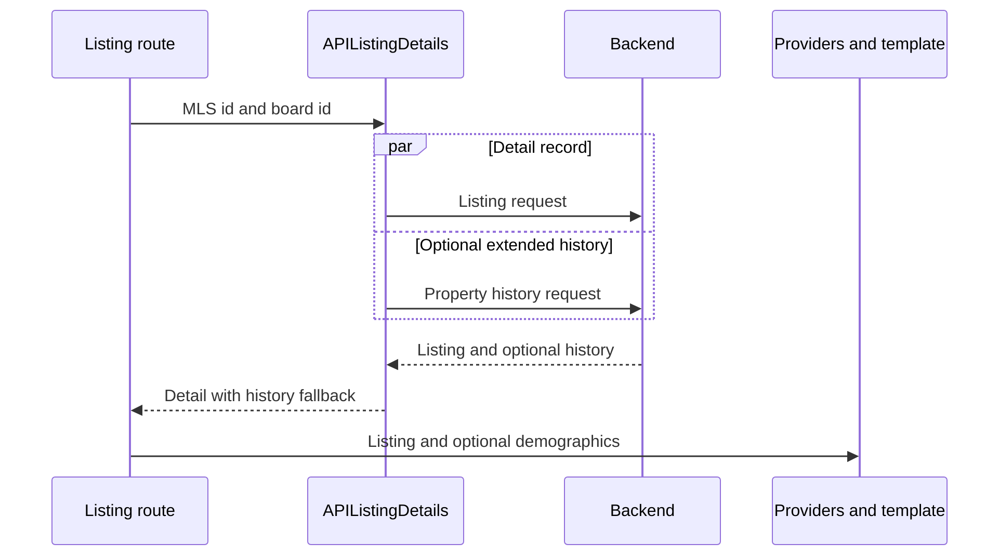
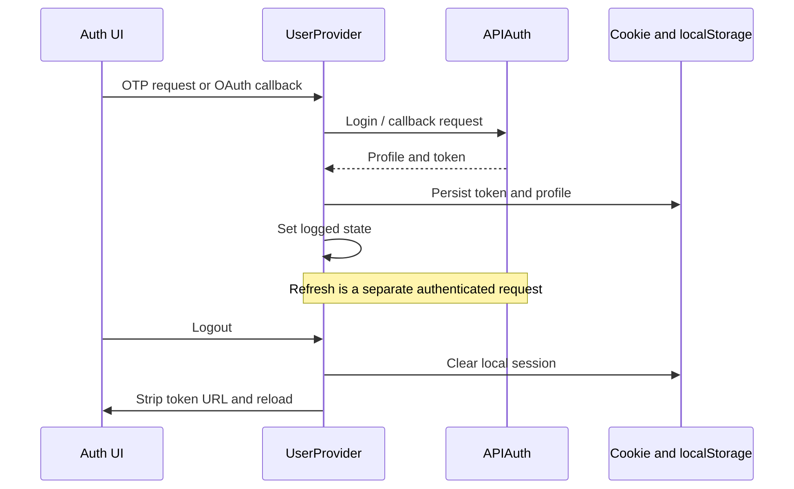

# Listing and Authentication Workflows

Source review: `e30dd9b47`, 2026-11-02. The parser example is synthetic; a separate
executed detail example follows it. No login or account mutation was performed.

## F04 — Open a listing

Entry can be a full listing URL or the search listing dialog. A full route uses
`app/listing/[[...listingName]]/utils.ts::parseParams`; the dialog's selected
record already carries MLS and board identity. These are different entry paths
into the shared detail services and templates.

| Stage | Input → output / owner |
| --- | --- |
| Parse route | A trailing 1–3 digit board suffix wins; otherwise an allowed `?boardId=` wins, then `searchConfig.defaultBoardId` |
| Resolve listing id | Last remaining slug segment; otherwise `listingId`, `propertyId`, `mlsNumber`, `id` query fallbacks |
| Fetch | `APIListingDetails.fetchListing(mlsNumber, boardId)` sends board id and configured detail parameters to `/listings/<mlsNumber>` |
| Optional history | With `listings.extendedHistory`, detail and property history run in parallel with the same signal; nonempty history replaces the embedded array |
| Prepare view | Listing providers/templates select detail sections, permissions and translated presentation; `dataMapper` resolves raw fields |
| Failure | Full page catches detail failure, attempts nearby listings and renders `Listing40XTemplate`; transient metadata failures add noindex |

For the synthetic slug `example-home-ABC123-91`, the parser yields MLS `ABC123`
and board `91`. This only illustrates the suffix rule; it does not claim that
the current tenant supports board 91. Query board ids are checked against the
tenant's configured distinct boards. Do not derive a board from a display address.

History failure returns an empty history array from the optional request, so the
detail record retains its embedded history. A detail failure still rejects.
Restricted/scrubbed values are not ordinary empty values; consult the permission
helpers and configured scrub placeholders before classifying a record or rendering
an address/price. A guest's inability to view details is not a missing MLS record.

Evidence: listing detail service, route helpers, listing templates and existing
API/SEO/sanitizer tests. A live search-to-card replay requires matching tenant
filters and dataset; it is not implied by a successful unit test.

### Executed detail example

After the [F02](/technical-guide/workflows/search#executed-defaults-trace) search,
the observed first card linked to
`/listing/17-3500-pecan-springs-rd-austin-78723-ACT3766104`.
Opening that URL directly on localhost:3000 rendered MLS `ACT3766104`, price
670000, 2 bedrooms, 4 bathrooms and 1590 sqft. The page title matched those values;
the description explicitly identified the record as sample data. The active
defaults config resolves unsuffixed links to board 110, matching the search record.

This verifies the direct page path. A separate search-dialog click attempt ended
with the browser automation session closing, so dialog continuity is not counted
as executed evidence. No save/contact action was used. Observed sample dates and
days-on-market labels are not certified as mutually consistent by this trace.

## F05 — Authenticate, refresh and leave

The following authentication trace is source-derived, not an executed login.

`UserProvider` owns reactive `logged` state and profile. The token is a cookie;
profile is localStorage. Both are initialized after mount, so initial browser
state is not proof of an authenticated user. Role UI gates are derived from the
decoded profile; the backend still decides resource access.

OTP request first calls `/auth/login`. A 404 enters signup and returns that
result; the provider does **not** issue another login request in this branch.
Confirmation uses `/auth/otp`. OAuth uses provider URL retrieval followed by
the processing route and callback exchange. Email-link tokens take their own
`TokenLoginHandler` path; a 412 opens the OTP dialog.

Expired tokens trigger local logout. Refresh is considered after half the token
lifespan and scheduled from the provider mount path; it is not a continuous
background refresh guarantee. Refresh failure logs out. APIBase also clears the
cookie on 401, but that low-level operation is not the same as clearing every
mounted provider or persisting an updated profile.

The current UI logout clears browser state and reloads; it does not call the
defined `APIAuth.logout` method. Do not describe it as confirmed server revocation.
See [Authentication](/technical-guide/authentication) for method names and
[Data Ownership](/technical-guide/data-ownership) for storage lifetimes.
