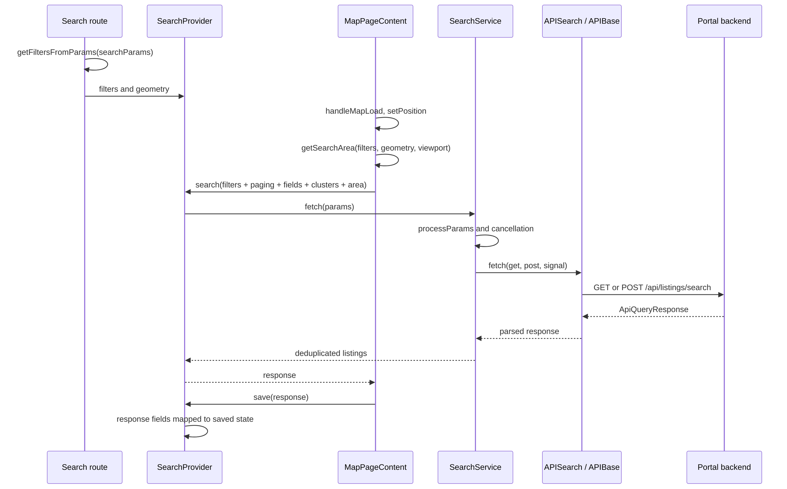
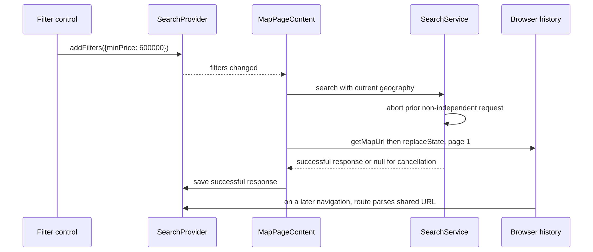

# Search and map workflows

Source review and runtime check: 2026-11-02, `e30dd9b47`. The introductory examples
remain synthetic; the final section records the executed defaults/sample-data trace.

The standard search entry is `src/app/search/[layout]/page.tsx`, followed by `MapOptionsProvider → SearchProvider → AiSearchProvider → MapPageContent`. Tenant component forks can change controls and behavior; this trace follows the shared implementation.

## F01 — Open a shared search

Preconditions: map feature enabled, a configured map view/token and a reachable portal backend. The following URL is **synthetic**; `Exampleville` is not an observed API location.

`/search/map?city=Exampleville&minPrice=500000&minBedrooms=2`

<div style={{ overflowX: 'auto' }} tabIndex={0} role="region" aria-label="Scrollable architecture diagram">



</div>

| Stage | Value or transformation | Owner |
| --- | --- | --- |
| Parse | Reads recognized keys from `defaultFilters` and `defaultAdvancedFilters`; advanced numeric values use `toSafeNumber` | Search route `_utils.ts`, `getFiltersFromParams` |
| Initialize | Unspecified keys keep configured defaults; provider holds filters independently of rendered controls | Search route and SearchProvider |
| Wait | Requires `mapLoaded`, center, zoom and no unresolved external IDs | `MapPageContent` fetch effect |
| Area | Drawn polygon or loaded region, point/radius, locations and bounds enter `getSearchArea` | `services/Search/params.ts` |
| Transform | Price/bed numeric transformations, configured type/status fragments, explicit fields and location expansion | `processParams` |
| Transport | Scalar filters in query; non-empty body means POST, otherwise GET | `APISearch.search` |
| Commit | `numPages` becomes `pages`; `aggregates.map.clusters` becomes `clusters`; listings/count/statistics retained | `SearchProvider.save` |
| Render | Provider consumers update grid and markers; saved-state effect clears loading | SearchProvider and MapRoot consumers |

The trace does not invent a complete backend request from the URL alone: final geography, fields and cluster precision depend on the actual map/configuration. Nor does it invent a result count. Capture those values from a running pair before labelling this trace executed.

### Outcomes and variations

- Missing map feature reaches `notFound()`.
- With `searchId`, the route loads the saved record and converts its filters/geometry first. A 404 stays a not-found outcome; other failures propagate.
- Unsupported external overlay IDs are removed during parsing. Supported IDs wait for their geometry; a request without the intended constraint is not sent while they are unresolved.
- Search errors caught by SearchProvider leave the previous saved result; there is no generic error toast in that catch. See [Failure and degradation](/technical-guide/failure-and-degradation).

## F02 — Change a filter and share the result

Synthetic action: change `minPrice` to `600000` through the existing search provider action. This is a new state value, not an assertion about available listings.

<div style={{ overflowX: 'auto' }} tabIndex={0} role="region" aria-label="Scrollable architecture diagram">



</div>

| Step | Important value / rule |
| --- | --- |
| State mutation | `addFilters` merges the supplied fields with existing state |
| Request | `minPrice` becomes a number in `processParams`; geography remains resolved by `getSearchArea` |
| Cancellation | Superseded request returns null; independent widget requests do not participate in this cancellation |
| URL | `getNonDefaultFilters` removes unset/default values; `getMapUrl` serializes full field names with repeated array values |
| Page | A changed camera/filter/point signature calls `pushUrl(1)`; page 1 is omitted from the URL |
| Presentation | Layout/layer/orientation/style changes use the other effect and keep the current page |
| Reopen | `getFiltersFromParams` reads the serialized filter fields; the camera codec reads the bare coordinate key and `z` |

The URL write uses `updateWindowHistory` / `history.replaceState`, not a Next router navigation. The listing request comes from the search effect. Do not document every history update as a new server render or backend search.

### Adapter branches to preserve

- Explicit `style` input wins over a style derived from `listingType`.
- A selected sold/active date range owns the status axis instead of unioning it with the default active status.
- Configured multi-type union produces POST `queries`; top-level `class` / `propertyType` / `style` are folded into the branches rather than conflicting with them.
- `soldPriceAndDate` swaps a sold range to sold-price limits and the sold-date sort after numeric transformations.
- A raw field must be offered by the configured raw-filter lists before the URL parser admits it.

Source: `services/Search/adapter.ts` (`processParams`, `applyListingTypeUnion`, `applySoldPriceAndDate`), search route `_utils.ts` (`pickRawFilters` use). These are configured variations, not a claim that every tenant exposes the same controls.

## Evidence

Source-read against portal monorepo `e30dd9b47`, 2026-11-02. The route,
`MapPageContent`, SearchProvider, SearchService, adapter, `APISearch` and URL
codecs were traced together. The Search verification group passed 10 suites /
99 tests. Unit URL tests cover omission/default serialization; the following
browser replay supplies separate runtime evidence.

## Executed defaults trace

On 2026-11-02, the user confirmed `defaults` on localhost:3000 and restarted the
localhost:8080 proxy with sample data. A real read confirmed board 110 and
`details.propertyType = 'Residential'` before the successful trace. An earlier
backend/dataset mismatch was excluded from the success evidence.

| Stage | Observed input / output |
| --- | --- |
| Initial browser URL | `/search/map?30.290000,-97.740000&z=11.5&layers=livebyNeighborhood&layers=livebySchool` |
| Initial main request | POST `/api/listings/search`; `class=condo&class=residential`, `status=A`, `type=sale`, configured property types, `resultsPerPage=96`, `pageNum=1`, fields and map aggregates |
| Request body | `map` with one viewport ring; no invented server-side city substitution |
| Initial response/UI | HTTP 200, `count=500`, `pageSize=96`; UI displayed 500 listings |
| User action | Advanced filters: Beds `2+`, minimum price `600000`, then Show listings |
| Written URL | Same camera/layers plus `minBedrooms=2&minPrice=600000`; no short filter aliases |
| Reopen | Navigated to the generated URL; main request retained both filters |
| Reopened response/UI | HTTP 200, `count=299`, `pageSize=96`; UI displayed 299 and two active advanced filters |
| First filtered record | MLS `ACT3766104`, board 110, price 670000, bedrooms 2; card matched these values |

The observed body was:

```json
{
  "map": [[
    [-97.66522811899253, 30.35035321990533],
    [-97.81477188100506, 30.35035321990533],
    [-97.81477188100506, 30.229609622579844],
    [-97.66522811899253, 30.229609622579844]
  ]]
}
```

The dialog also made a count-preview request with page size 100. It is not the
96-item main-grid request used for the final comparison. Counts, ordering and
viewport coordinates are observations from this run, not timeless assertions.
No account action or search alert was created. The direct detail page is recorded
in [F04](/technical-guide/workflows/listing-and-auth#f04--open-a-listing).
