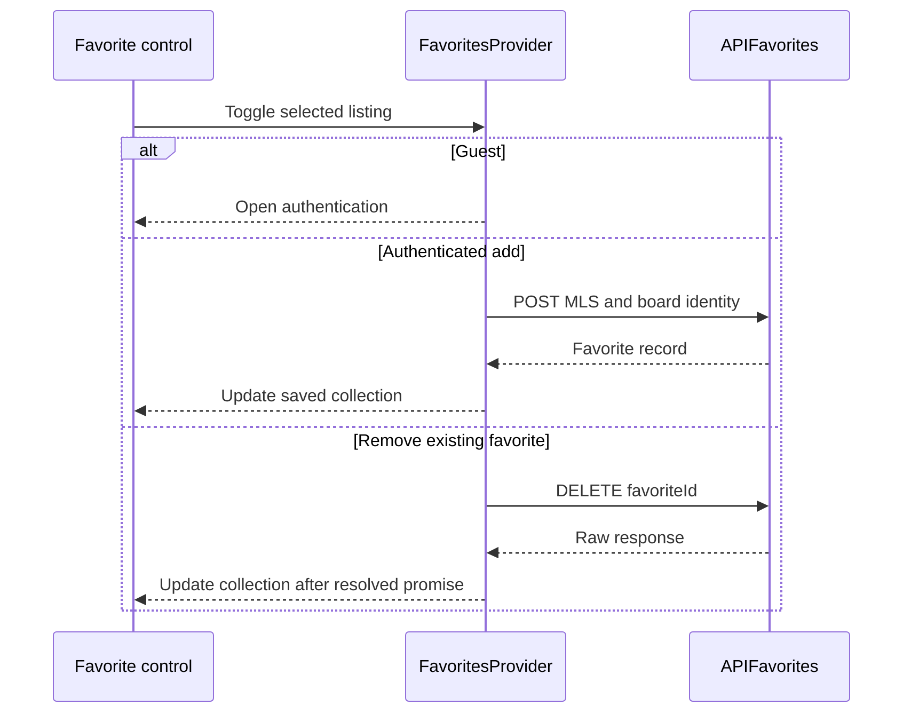
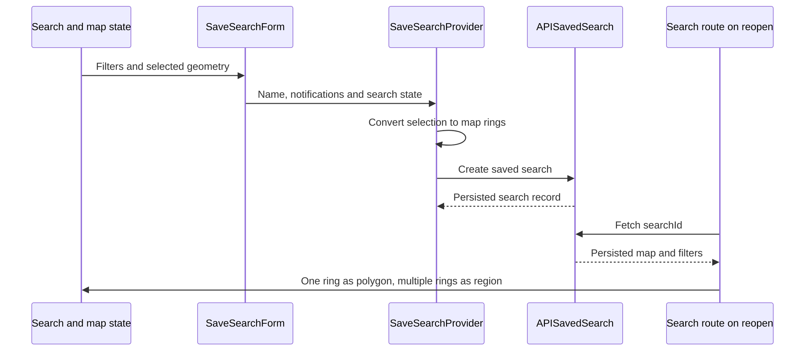
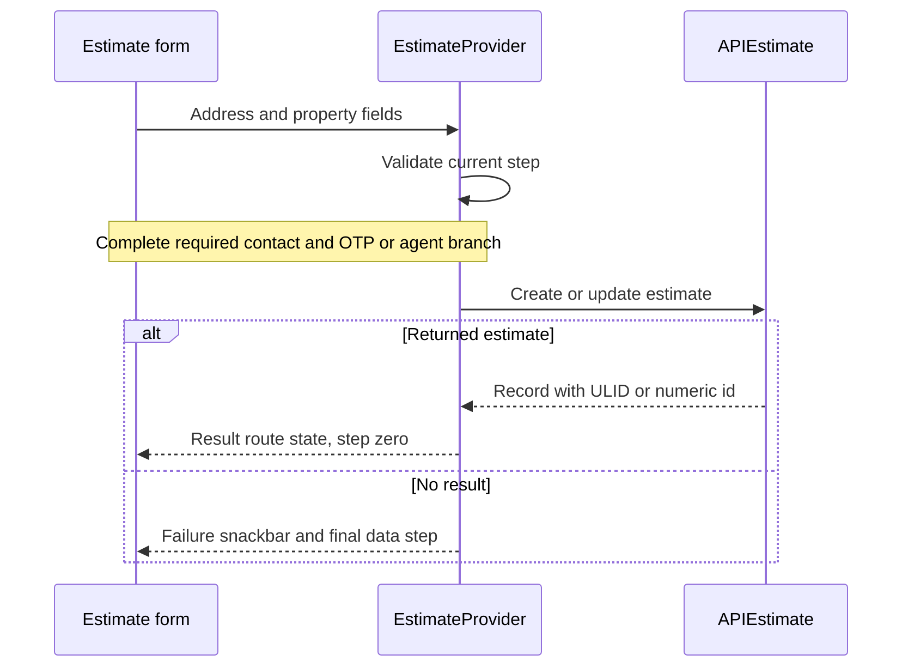
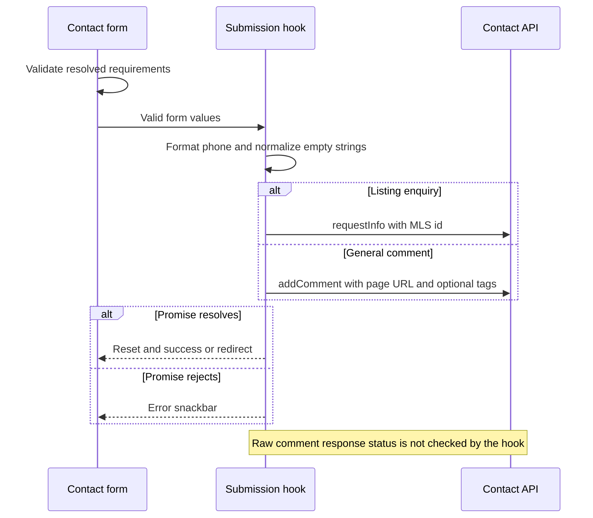

# User Action Workflows

Source review: `e30dd9b47`, 2026-11-02. These are synthetic source traces. No
favorite, saved-search alert, estimate, email or CRM record was created for this
documentation. Values and successful outcomes below are conditional examples.

## F06 — Save or remove a favorite

Preconditions: favorites feature/provider mounted and an authenticated user role.
A guest toggle opens authentication rather than completing the mutation.

| Stage | Transformation / observable state |
| --- | --- |
| Select | Listing's MLS id and board id identify the add request |
| Add | `APIFavorites.add` posts `{ mlsNumber, boardId }` to `/favorites/` |
| Persist result | Provider adds the returned favorite identity after the promise resolves; this is not an optimistic add before the response |
| Remove | The stored `favoriteId`, not MLS id, is sent to DELETE `/favorites/<favoriteId>` |
| Reopen | Provider fetches the saved collection for the authenticated user |

Provider lookup currently compares MLS number; do not promise board-aware lookup
merely because add transmits board id. Its catches do not provide a general
failure snackbar. Delete uses `fetchRaw`, so a resolved promise alone does not
prove server deletion. Photo favorites use their own provider/API and image
identity; they are not additional fields on a listing favorite.

## F07 — Save a search and reopen it

`SaveSearchForm` collects name/notification options; `SaveSearchProvider` and its
utilities convert live search state into the backend request. The API uses
`/searches/`, with GET list/detail, POST create, PATCH update and DELETE remove.
Returned names are HTML-decoded once in the service and rendered as text.
Preconditions: the saved-search capability/provider, authenticated user and a
resolved search selection. Reopening additionally requires a stored search id.

Synthetic example: two selected locations with boundaries become two persisted
map rings. On reopen they load as a read-only `region`; one ring loads as an
editable polygon. Locations with no geometry are skipped, so saved geometry can
match fewer listings than the original location-id query. The region is not
serialized as the editable URL polygon. Copying the ordinary map URL is therefore
not equivalent to reopening the saved record.

The save-count UI gate is heuristic; server geometry/count rules can reject the
request. Create failure extracts the backend info message when available and
shows a snackbar, then clears processing. A missing saved-search record becomes
404 at the route; other fetch errors are rethrown. Delete uses a raw response,
so distinguish UI removal from confirmed remote persistence.

## F08 — Complete an estimate

Entry is the estimate catch-all or embedded flow. `EstimateProvider` wraps RHF,
step selection, estimate data and OTP hooks. Form progress, fetched address history,
persisted estimate identity and displayed result are different states.
The selected route/configuration must enable the estimate flow and its backend.

1. Select an address; APIEstimate address suggestions use a session token distinct
   from auth. Property-detail lookup can return null on failure.
2. Fill/validate data steps. Forward navigation validates the current step; backward
   movement is permitted. History-prefilled steps can fast-forward only through
   validated data steps, stopping before untouched contact/confirmation fields.
3. If this flow needs OTP, request/confirm it before submission. Agent flow uses
   the agent/client branch and may register a client before posting.
4. `APIEstimate.postEstimate` sends POST for a new estimate or PATCH for an existing
   id. Agent estimates use `postAgentEstimate` and the agent endpoint instead.
5. A returned record sets its ULID or numeric id, switches route state to `result`
   and resets the step to zero. No returned result shows a failure snackbar and
   returns to the final data step.

Existing conversion tests support the payload transformations, not AVM accuracy,
OTP delivery or a customer's CRM workflow. See [Estimate anatomy](/product-guide/estimate/technical).

## F09 — Contact submission

Synthetic input: a name, email, optional phone and message. The resolved form
requirements determine which values are required; the displayed fields constrain
the requirement set. Joi validation runs before submission, then phone formatting
and empty-string normalization prepare the payload.
Preconditions: a configured contact form, satisfied field requirements and the
appropriate backend endpoint. This example does not submit those values.

With an MLS id the hook posts a listing enquiry using `requestInfo`; without one
it sends a general comment including the current page URL and optional tags.
Resolved calls reset the form and trigger success/redirect; rejected calls show
an error snackbar. General comments use `fetchRaw` and do not inspect HTTP status
in the hook, so **UI success does not establish delivery**. The same warning must
be considered when verifying newsletter and estimate-meeting raw-response flows.

See [Forms and Validation](/technical-guide/forms-and-validation) for the exact
ownership and requirement algorithm. Verify external delivery only with an
authorized test destination; this audit deliberately used no real submission.
